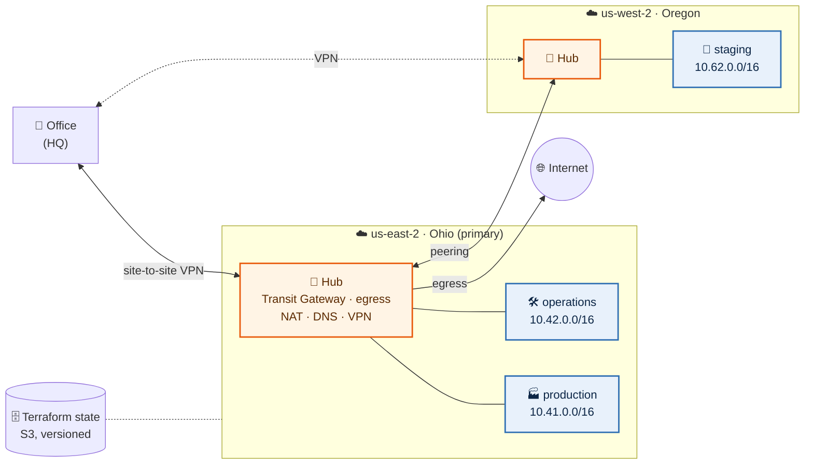
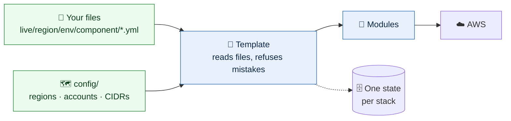
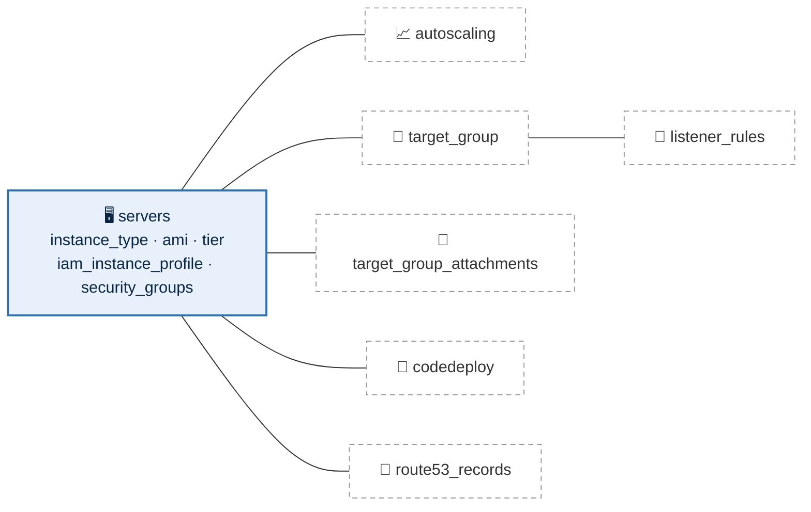
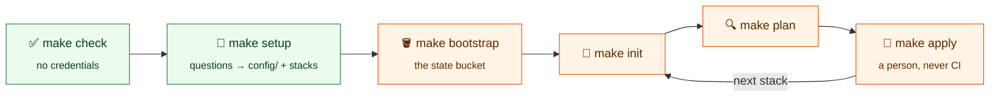

# terraform-aws-scaffold


[](LICENSE)

AWS on Terraform: a hub-and-spoke network across two regions, one VPC per
environment, and everything an environment runs, configured with YAML files
whose keys are the AWS provider's own argument names.

## The big picture



Hub route tables keep environments apart: production reaches only itself and
shared services. Every environment's VPC is carved the same way, so a file
means the same thing in every environment.

## How a stack works



Day to day you edit the green boxes. Each folder under `live/` is one stack with
its own state, so a change to DNS cannot touch a server.

## A compute file



Server keys sit at the top of the file; every optional feature is a block named
after its AWS resource. Leave a block out and the feature is off.

## Quick start



```sh
make hooks                                    # commit checks: format, lint, secrets, backends
make check                                    # every check CI would run: no credentials, no state
make setup                                    # guided: config/, accounts, stacks, profiles
make status                                   # where you are, and the next command
make bootstrap                                # the state bucket: create it, or use one that exists
make init  STACK=us-east-2/shared/hub
make plan  STACK=us-east-2/shared/hub         # read-only
make apply STACK=us-east-2/shared/hub         # shows the plan and asks first
```

The AWS accounts must exist first; everything else, setup and bootstrap walk
you through ([day one](docs/day-one.md)).

## Apply order

```mermaid
flowchart LR
  base["baseline"] --> hub["hub"] --> log["logging"] --> dns["dns"] --> iam["iam"]
  iam --> net["network"] --> sg["security-groups"] --> ep["endpoints"]
  ep --> keys["keys · backups"] --> cert["certificates"] --> lb["load-balancers · waf"]
  lb --> data["databases · storage · buckets"] --> comp["compute"] --> rec["records"]

  classDef g fill:#f3f0ff,stroke:#6741d9,color:#25125e
  classDef s fill:#fff4e5,stroke:#e8590c,color:#5c2a00
  classDef e fill:#e8f1fb,stroke:#2f6fb3,color:#0b2545
  class base,dns,iam g
  class hub,log s
  class net,sg,ep,keys,cert,lb,data,comp,rec e
```



Purple is account-wide, orange the region's shared stacks, blue each
environment's. Stacks find each other by tags and names, never another stack's
state; a plan names anything missing.

## Layout

```
config/            regions, accounts, CIDRs, the subnet layout, the state bucket
live/              one folder per stack: live/<region>/<environment>/<component>/
templates/         what each kind of stack builds from its .yml files
modules/           the building blocks templates use
examples/          a complete example file for every stack
bin/               tf (the wrapper), setup, stack, backends, check-files, diagram
tests/             the configs tests run against
```

## Documentation

| Read | For |
|---|---|
| [docs/day-one.md](docs/day-one.md) | start here: from a clone to running environments |
| [examples/](examples/README.md) | every stack's files, filled in |
| [docs/architecture.md](docs/architecture.md) | layout, stacks and how they depend on each other |
| [docs/configuration.md](docs/configuration.md) | `config/`, your profiles, running Terraform |
| [docs/network.md](docs/network.md) | hubs, VPCs, subnets, routing, DNS |
| [docs/security-groups.md](docs/security-groups.md) | groups, rules and sources |
| [docs/endpoints.md](docs/endpoints.md) | VPC endpoints |
| [docs/load-balancers.md](docs/load-balancers.md) | load balancers, listeners, rules |
| [docs/compute.md](docs/compute.md) | servers, Auto Scaling, target groups, CodeDeploy, DNS |
| [docs/data.md](docs/data.md) | keys, backups, databases, file systems, buckets |
| [docs/systems-manager.md](docs/systems-manager.md) | Session Manager, documents, tunnels, patching |
| [docs/global.md](docs/global.md) | account-wide and regional shared stacks |
| [docs/conventions.md](docs/conventions.md) | naming, tagging, versions |
| [docs/diagram.md](docs/diagram.md) | generated by `make diagram` |
| [CONTRIBUTING.md](CONTRIBUTING.md) · [SECURITY.md](SECURITY.md) · [SKILLS.md](SKILLS.md) | commits, secrets, rules for AI assistants |

## License

[MIT](LICENSE)
