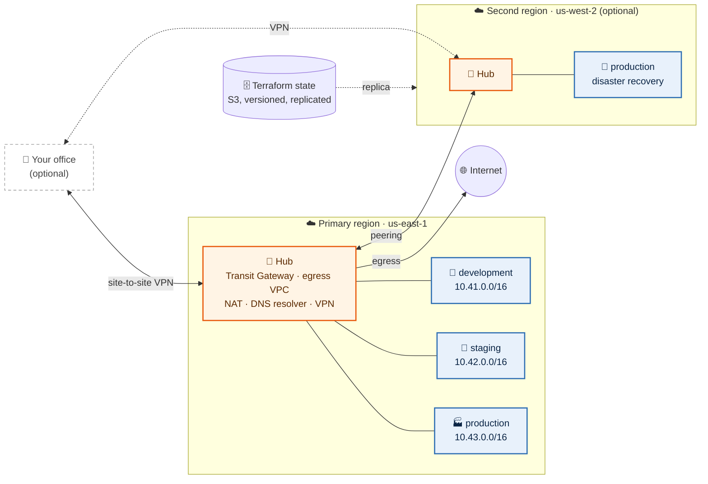
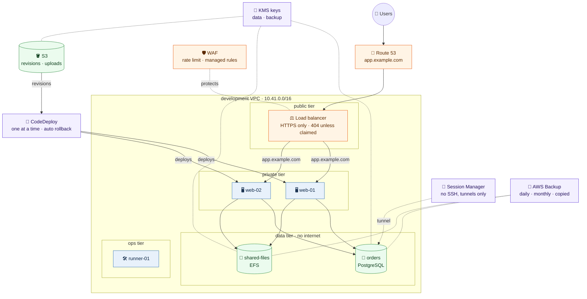
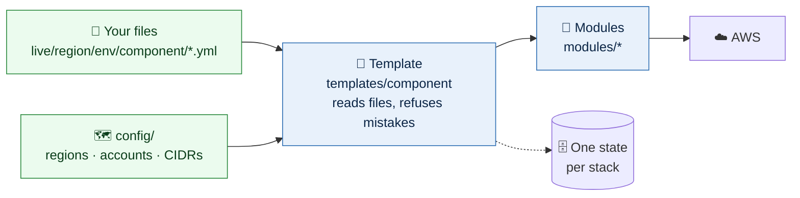
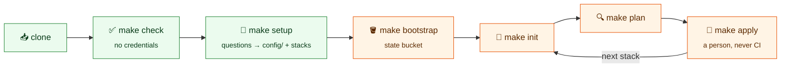

# terraform-aws-scaffold

[](LICENSE)


A starting point for running AWS on Terraform: a hub-and-spoke network, one VPC
per environment, and everything an environment runs (load balancers, servers,
applications, databases, storage, DNS, patching), built from modules in this
repository and configured with plain YAML files beside each stack.

It is a scaffold. Every stack validates and plans against a mocked AWS out of
the box; nothing is built until you add your accounts. Run `make setup`, answer
its questions, replace the example files, and make it yours.

## The big picture



The example in this repository is the left half with one environment,
`development`. `make setup` adds staging, production and a second region when
you ask it to. Route tables on the hub keep environments apart: production
reaches only itself and shared services, never staging or development.

## Inside the example environment



Every box is one `.yml` file in `live/us-east-1/development/`: `apps/web.yml`
holds the servers, their route on the load balancer, the CodeDeploy deployment
and the DNS name; the database, file system, buckets, security groups and the
rest each have their own.

## How a stack works



Day to day you edit the green boxes. A stack's identity (region, environment,
component) comes from its folder, so the same file means the same thing in
every environment.

## What you get

- **A network to build on**: a Transit Gateway hub per region, peered across
  regions, with central egress, a site-to-site VPN to your office, DNS
  forwarding both ways, and route tables that keep production isolated.
- **Small stacks, small blast radius**: one state per
  `live/<region>/<environment>/<component>`, so a change to DNS cannot touch a
  server.
- **YAML, not HCL, for the day-to-day**: a security group, a load balancer, a
  database or an application is one file. The templates turn files into
  resources and refuse mistakes at plan time.
- **Secure by default**: customer-managed KMS keys, AWS Backup with
  cross-region copies, IMDSv2, no SSH (Session Manager instead), TLS 1.2+,
  flow logs, and nothing public unless a file says so.
- **Guided setup**: `make setup` asks about regions, environments, accounts and
  your office, shows every change before writing it, and creates the stacks.
- **Checks without credentials**: `make check` runs every test and plans every
  stack's files against a mocked AWS that answers like the real one.
- **Guard rails**: a wrapper that refuses to run against the wrong account or
  without remote state, generated backends, `tflint` and `gitleaks` on every
  commit.
- **Only official providers** (`hashicorp/aws`, `hashicorp/archive`) and no
  third-party modules: everything that runs is in this repository.

## Requirements

- Terraform 1.12 or later, AWS CLI v2, `jq`, `yq` v4 (mikefarah), `gitleaks`;
  `tflint` is optional. `make setup` checks them.
- AWS accounts for your environments, made by whoever runs your AWS
  Organization. `make bootstrap` creates the state bucket
  ([day one](docs/day-one.md)).

## Quick start



Green steps never touch AWS (setup only makes read-only lookups); orange steps
need credentials.

```sh
git clone https://github.com/justin-samuel12/terraform-aws-scaffold.git
cd terraform-aws-scaffold
make hooks                                    # commit checks: format, lint, secrets, backends
make check                                    # tests, lint, and every stack's files against a mocked AWS
make setup                                    # guided: regions, environments, accounts, profiles, stacks
make bootstrap                                # creates the state bucket, writes every backend.tf
make init  STACK=us-east-1/shared/hub         # connects the stack to its state
make plan  STACK=us-east-1/shared/hub         # read-only
make apply STACK=us-east-1/shared/hub         # shows the plan and asks first
```

Stacks depend on each other only through tags and names, never another stack's
state, so they are applied in this order and each plan names anything missing:

```mermaid
flowchart LR
  base["baseline"] --> hub["hub"] --> log["logging"] --> dns["dns"] --> iam["iam"]
  iam --> net["network"] --> sg["security-groups"] --> ep["endpoints"]
  ep --> keys["keys · backups"] --> cert["certificates"] --> lb["load-balancers · waf"]
  lb --> data["databases · storage · buckets"] --> run["compute · apps"] --> rec["records"]

  classDef g fill:#f3f0ff,stroke:#6741d9,color:#25125e
  classDef s fill:#fff4e5,stroke:#e8590c,color:#5c2a00
  classDef e fill:#e8f1fb,stroke:#2f6fb3,color:#0b2545
  class base,dns,iam g
  class hub,log s
  class net,sg,ep,keys,cert,lb,data,run,rec e
```



Purple is account-wide (`live/global/shared`), orange the region's shared
stacks, blue each environment's. The full checklist is
[docs/day-one.md](docs/day-one.md).

## Layout

```
Makefile                         make help: setup, bootstrap, init, plan, apply, check
config/                          the network: global.yml (state bucket, subnet layout, HQ, DNS); one file per region (zones, hub, VPCs, accounts)
bootstrap/                       creates the state bucket (make bootstrap)
bin/                             tf (the wrapper), setup and configure (guided), bootstrap, stack, backends, check-files, diagram
modules/                         building blocks (vpc, transit-gateway, application, ...), sourced by local path
templates/                       what each kind of stack builds from its .yml files
tests/                           the configs tests run against, never your own
live/
  common/                        shared by every stack: identity from the path, settings from config/
  global/shared/                 account-wide, run in the primary region
    baseline/                    account settings: S3 public access block, EBS encryption, access analyzer
    iam/                         workload roles (web.yml, runner.yml) and shared policies
    dns/                         public zones (zones.yml); private zones come from config/
    cloudfront/                  distributions, their certificates and WAF (none in the example)
  us-east-1/                     the example's only region
    shared/                      used by every environment in the region
      hub/                       Transit Gateway, VPN to HQ, egress, DNS, prefix lists
      logging/                   load balancer and WAF log buckets
      ecr/                       image repositories
      session-manager/           Session Manager: encrypted, logged, time-limited
      documents/                 SSM documents (install-cloudwatch-agent.yml)
    development/                 the example environment, every stack with example files
      network/                   VPC and subnets, from config/us-east-1.yml
      security-groups/           web-lb, web, database, files, runner
      endpoints/                 Session Manager, Secrets Manager and S3 endpoints
      keys/                      KMS keys for data and backups
      backups/                   AWS Backup vault and plan
      certificates/              app.example.com
      load-balancers/            web: public, HTTPS, 404 unless claimed
      waf/                       web: rate limit and AWS managed rules
      databases/                 orders: PostgreSQL
      storage/                   shared-files: EFS
      buckets/                   revisions (CodeDeploy), uploads
      apps/                      web: two servers, its route, CodeDeploy, app.example.com
      compute/                   runner: a build runner
      records/                   runner.internal.example.com
      access/                    orders: a tunnel to the database
      patching/                  patch baselines and the maintenance window
      lambda/                    report: a daily function, code in src/report/
```

Add an environment by adding it to `config/<region>.yml` and creating its
stacks with `make stack`; add a region by adding its file
([day one](docs/day-one.md)).

## Documentation

| Read | For |
|---|---|
| [docs/day-one.md](docs/day-one.md) | **start here**: from a fresh clone to running environments, and what is not included |
| [SKILLS.md](SKILLS.md) | rules for AI assistants working here |
| [CONTRIBUTING.md](CONTRIBUTING.md) | commits, reviews, documentation |
| [SECURITY.md](SECURITY.md) | secrets and state |
| [docs/architecture.md](docs/architecture.md) | how it fits together |
| [docs/diagram.md](docs/diagram.md) | the live diagram, generated by `make diagram` |
| [docs/configuration.md](docs/configuration.md) | what must exist first, `config/`, your profiles, running Terraform with or without the wrapper |
| [docs/conventions.md](docs/conventions.md) | naming, tagging, versions |
| [docs/network.md](docs/network.md) | the network modules, IP plan, subnets, routing, DNS with HQ |
| [docs/security-groups.md](docs/security-groups.md) | one file per security group, sources, prefix lists |
| [docs/endpoints.md](docs/endpoints.md) | VPC endpoints for Session Manager, Secrets Manager and S3 |
| [docs/load-balancers.md](docs/load-balancers.md) | one file per load balancer, and what is built in |
| [docs/data.md](docs/data.md) | keys, backups, databases, file systems and buckets |
| [docs/systems-manager.md](docs/systems-manager.md) | Session Manager, SSM documents, tunnels and patching |
| [docs/compute.md](docs/compute.md) | servers, applications and CodeDeploy, chosen addresses, DNS records |
| [docs/global.md](docs/global.md) | shared and account-wide stacks: what each holds |

## License

[MIT](LICENSE)
