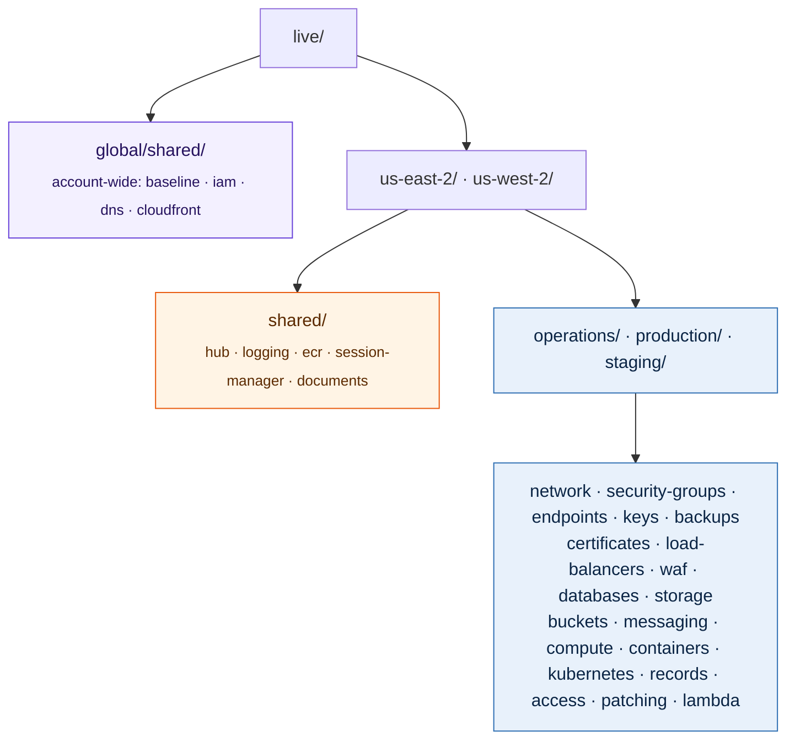
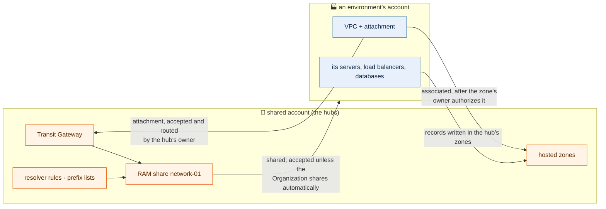

# Architecture



## Layout

Code is organised by region, then environment, then component:
`live/<region>/<environment>/<component>`. Each folder is one stack with its own
state.

- **Region first**: everything running in a region sits together, which is how
  a regional outage, a regional DR test or a region's cost is looked at.
- **Environment second**: production in Ohio and its DR copy in Oregon are the
  same stacks with the same settings, under each region's `production/`.
- **`shared`** is the environment every other one uses: each region's hub under
  `live/<region>/shared/`, and account-wide IAM and DNS under
  `live/global/shared/`. `global` takes a region's place for stacks that are not
  regional; they run in the primary region.

Every stack is three levels deep, so every stack's path names its region,
environment and component, and its state key is that path.

Who changes what follows the folders. `config/` (accounts, the state bucket, zones,
the subnet layout, hubs and VPCs) belongs to the network team or the AWS
administrators. Everything else, security groups, compute and databases, is
configured in `.yml` files beside the stack that builds it, and belongs to that
environment's owners. In a repository, CODEOWNERS enforces this: `/config/` for
the network team, and `/live/*/production/` for production's owners.

## Network

Hub and spoke, owned by us. One Transit Gateway hub per region, peered; each
environment is a spoke in its region. The hub is its own stack, separate from
operations: it rarely changes and every environment depends on it. A small or
ad hoc environment can instead stand off the hub, with its own NAT and VPC
peering to the few networks it needs ([network](network.md#off-the-hub-connectivity-peering)).

| Region | Hub | Spokes |
|---|---|---|
| us-east-2 (Ohio) | `live/us-east-2/shared/hub` | operations, production |
| us-west-2 (Oregon) | `live/us-west-2/shared/hub` | staging, production DR |

Ohio is the primary region: its hub in `config/us-east-2.yml` says `primary: true`, so it
requests the peering (the other hubs are applied first), is the sites' preferred VPN path,
and is where `global` stacks run. Oregon is the disaster-recovery region.

Each site's VPN terminates on both hubs. Spokes reach each other only
where hub route tables allow it. Modules, IP plan and routing: [network.md](network.md).

## One account, or one per environment

Both work, from the same code. With one account (`account_id` once in
`config/global.yml`), every environment, the hubs and the shared stacks live
together, and names carry the environment so nothing collides. With an account
per environment (`account_id` on its entry in `config/<region>.yml`), the hubs
stay in the shared account and share the network with the others:



What AWS lets only the hub's owner do, a stack does through its second
provider, `aws.hub`: the hub's account, with the `shared` environment's profile
(the same account in single-account mode, so nothing changes). That covers
accepting and routing the attachment, authorizing private zones, and writing
Route 53 records (records, certificate validation, compute's
`route53_records`). Whoever plans an environment's network, records,
certificates or compute in another account therefore needs profiles for both
accounts.

| | One account | An account per environment |
|---|---|---|
| Network | attachment routed directly | the hub shares the Transit Gateway, resolver rules and prefix lists through RAM (`network-01`); the hub's owner accepts and routes the attachment |
| Private zones | associated directly | authorized by the zone's owner, then associated |
| ECR | pulled directly | each repository lets the other accounts pull |
| Per-account settings | once: `global/shared/baseline`, `global/shared/iam`, each region's `shared/logging` and `shared/session-manager` | the same stacks again for each environment account: `global/<environment>/baseline`, `global/<environment>/iam`, `<region>/<environment>/logging`, `<region>/<environment>/session-manager` |

`organization_sharing: true` in `config/global.yml` says the accounts are in one
AWS Organization with RAM sharing turned on, so shares arrive without
invitations; leave it `false` and each environment account accepts the share
from its network stack.

Security group references across environments (`group:<environment>/<name>`)
work only between environments that share an account: a stack can only look
up groups its own account can see.

## Diagram

[diagram.md](diagram.md) is generated, never drawn: `make diagram` reads the VPCs
from `config/` through `modules/ip-plan`, and the stacks from `live/`. A stack
counts as built once it has `.tf` files of its own; everything else in the IP
plan shows as planned. Below the diagram, it lists every VPC's subnets with
their zone, CIDR and `Subnet` tag, in address order. The pre-commit hook refuses
a commit that leaves it stale.

## Dependencies

No stack reads another's state. A stack finds what it needs from other stacks
by name or tag when it plans, so it depends on another only when it looks
something up there. Applied too early, its plan fails naming what is missing,
and nothing changes. Every environment may read `shared`; `shared` reads no
environment.

## Apply order

`templates/needs.yml` says, for every template, which stacks it looks things
up in. It is one file, outside the templates' own folders, because templates
read the `.yml` files in their folder as their settings. Terraform never reads
it; `make order` and `make check` do.

```yaml
# templates/needs.yml
compute:
  needs:                     # applied first, always
    - "{region}/{environment}/network"
    - "{region}/{environment}/security-groups"
    - "{region}/{environment}/keys"
    - global/{environment}/iam
    - global/shared/dns
  when_present:              # applied first if the stack exists; never required
    - "{region}/{environment}/load-balancers"
```

`{region}` and `{environment}` are the stack's own (a global stack's region is
the primary). `{other_regions}` and `{each_region}` list the regions in
`config/`, and `when_primary` applies only to the primary region's stack: the
primary hub needs every other hub, because it requests the peering. An
environment's own stack that does not exist falls back to the shared one, so
`global/{environment}/iam` is `global/shared/iam` until the environment has an
account of its own. `named_in_files` lists stacks a template's files name
directly, such as CloudFront's origin bucket, which are checked but not
ordered.

```bash
make order                                     # every stack, in waves
make order STACK=us-east-2/production          # one environment, and everything it needs
make order STACK=us-east-2/production/compute  # what it needs first, and what to plan again after it
```

Stacks in one wave do not depend on each other: apply them in any order, or
side by side. Each line says whether the stack is applied (its state is in the
bucket, a read-only check; `--offline` skips it), and the end lists any stack
that is needed but does not exist yet. For one stack, `make order` also lists
the stacks that look it up, which are the ones to plan again after an apply.

`make check` keeps the file honest. It fails on:
- a template that looks something up (a key, a VPC, a load balancer) without
  listing the stack that builds it;
- a template with no entry at all;
- stacks that need each other in a loop, since none of them could be applied
  first.

`order_check: false` in `config/global.yml` turns the check off;
`make order` works either way.
