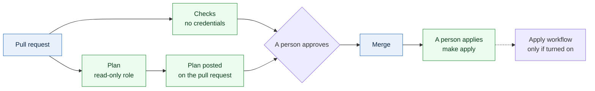

# CI/CD

The pipeline is written and off. Its files are in `.github/workflows-off/`, every
line commented, in a folder GitHub never reads, so nothing runs and nothing can
run by accident. `bin/workflows on` writes them into `.github/workflows/`,
uncommented; `bin/workflows off` removes them again. `bin/workflows check` proves
each file is still fully commented and still valid once uncommented.

The workflows hold almost no logic. They call `make` and `bin/ci`, the same
commands a person runs, so a pipeline failure can be reproduced on a laptop.

**Nothing deploys on merge.** There is no auto-apply. A merge changes the
repository, and a person then applies, stack by stack, in the order `make order`
gives.

## The workflows

| File | Runs on | Does | Needs |
|---|---|---|---|
| `checks.yml` | Pull requests, pushes to `master`, nightly | Format, lint, order, backends, the diagram, secrets, the CI tests, every unit against a mocked AWS | `CI_ENABLED`; no AWS |
| `plan.yml` | Pull requests that touch infrastructure | Plans each affected stack in apply order and posts the result on the pull request | `PLAN_ENABLED`, a read-only role |
| `drift.yml` | Nightly | Plans every built stack and keeps one `drift` issue open while anything differs | `PLAN_ENABLED`, a read-only role |
| `apply.yml` | A person starts it by hand | Applies one stack from `master`, only if the plan matches what that person expected | `APPLY_ENABLED`, `APPLY_ACTORS`, an apply role |
| `dependabot.yml` | Weekly | Proposes updates to the pinned actions | |
| `CODEOWNERS` | Every pull request | Names who must review | Branch protection |

`apply.yml` is there for later and is not part of the plan today. People apply
with `make apply`. Leave `APPLY_ENABLED` unset, and it does nothing even when the
workflows are on.

## Switches

Three repository variables, each off unless set to `true`, so the pipeline turns
on a step at a time:

| Variable | Turns on |
|---|---|
| `CI_ENABLED` | `checks.yml` |
| `PLAN_ENABLED` | `plan.yml` and `drift.yml` |
| `APPLY_ENABLED` | `apply.yml`, for the logins listed in `APPLY_ACTORS`, a JSON list |

`CI_JOBS` sets how many units run at a time, 2 by default, so a shared runner
stays responsive. A job aimed at a self-hosted runner that does not exist waits
in the queue forever; with its switch off it is skipped instead.

## Runners

Every job runs on self-hosted runners, in three pools, told apart by label:

| Label | AWS access | Used for |
|---|---|---|
| `terraform-check` | None | Checks, and posting results back to GitHub |
| `terraform-plan` | Read-only, and the state bucket | Plans and drift |
| `terraform-apply` | Write, in a runner group of its own | `apply.yml`, if it is ever turned on |

A pull request runs its own code on a runner before anyone has reviewed it: a
branch can change a workflow, a script or a Terraform provider setting. So:

- **The repository stays private,** and pull requests from forks never run. The
  jobs check for that, and GitHub's fork approval setting should agree.
- **Runners are ephemeral:** one job, then the machine is thrown away, so nothing
  carries from one pull request to the next.
- **The plan role cannot change anything,** and it is why applies stay manual: no
  pull request can reach a credential that writes. It does read state, which holds
  secrets, so keep it to the people who could read that state anyway.
- **Posting is a separate job.** The job that runs the branch's code has no write
  access to GitHub. A second job, which never checks the code out, posts the
  report.
- **Checks never skip work.** `CHANGED=1` trusts a record of what passed, and a
  branch could write that record, so the pipeline always runs everything.
- **Actions are pinned to commit SHAs,** and only GitHub's own are used. Nothing
  else from the marketplace runs next to these credentials.
- **Network:** outbound 443 only. GitHub never connects in.

`bin/ci doctor` fails a job early if a tool is missing from the image: Terraform,
`tflint`, `yq`, `jq`, the AWS CLI, `git`, `gh`, `gitleaks`, `shellcheck`,
`actionlint` and `make`. With an account per environment, the runner's AWS config
holds a profile per environment and `~/.config/infra/hashicorp-terraform.config`
maps them, exactly as on a laptop.

## Plans on a pull request

Plans run with `-lock=false`, so the role needs no write access at all and a plan
never blocks a person applying. A stack whose dependencies are not applied yet is
reported as `blocked`, not failed. The saved plan is deleted straight after, and
the report lasts one day as an artifact. A plan file can hold secrets; the text
Terraform shows does not print sensitive values.

`bin/ci changed` works out the stacks from everything each one reads: its folder,
its template, the modules below it, `config/` and blueprints. A change to
`config/` plans every stack. A deleted stack is not planned, because removing
infrastructure is a reviewed change made by a person.

## Applying from the pipeline

If `apply.yml` is ever turned on, its run takes the stack and the plan's summary
line, typed exactly: `Plan: 3 to add, 0 to change, 0 to destroy.` It plans again
from `master` and refuses unless the line matches, so what was reviewed is what
goes in, and a surprise destroy stops the run. Applies run one at a time, from
`master` only, for the logins in `APPLY_ACTORS`. A person's review is the gate:
GitHub's required reviewers on Environments are not relied on, since they depend
on the plan the organization is on.

## Turning it on

Needs no AWS account:

1. Build one `terraform-check` runner, and restrict its runner group to this
   repository.
2. `bin/workflows on`, review, and merge.
3. Set `CI_ENABLED` to `true`, and watch a pull request pass.
4. Name a second reviewer in `CODEOWNERS`. Nobody can approve their own pull
   request.
5. Protect `master`: require a pull request, one approval, code owner review,
   the `Static` and `Units` checks, and up-to-date branches; refuse force pushes.

Needs the accounts, and the first waves applied by hand:

6. Build the `terraform-plan` pool, with its read-only role.
7. Set `PLAN_ENABLED` to `true`.

Only if you decide to apply from the pipeline:

8. Build the `terraform-apply` pool, in its own runner group.
9. Set `APPLY_ACTORS`, then `APPLY_ENABLED`.

The tests for `bin/ci` are in `tests/ci/run.sh`; they need no AWS.
