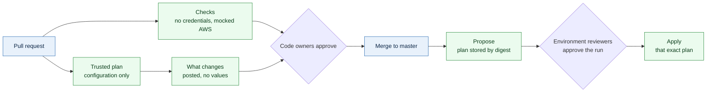

# CI/CD

The pipeline is written and off. Its files are in `.github/workflows-off/`, every
line commented, in a folder GitHub never reads, so nothing runs and nothing can
run by accident, including in a fresh clone. `bin/workflows on` writes them into
`.github/workflows/`, uncommented; `bin/workflows off` removes them again.
`bin/workflows check` proves each file is still fully commented, still valid YAML
once uncommented, and passes `actionlint` (its expressions, its permissions, and
`shellcheck` over every `run:`), from a pinned image when `actionlint` is not
installed.

The workflows hold almost no logic. They call `make` and `bin/ci`, the same
commands a person runs, so a pipeline failure can be reproduced on a laptop.

**Nothing deploys on merge.** There is no auto-apply. A merge changes the
repository; a person proposes a stack's plan, someone else approves that run, and
only then is that plan applied. Until the apply workflow is turned on, people
apply with `make apply`, stack by stack, in the order `make order` gives.

## The workflows

| File | Runs on | Does | Needs |
|---|---|---|---|
| `checks.yml` | Pull requests, pushes to `master`, nightly | Format, lint, order, `make security`, backends, the diagram, the workflows, secrets, the CI tests, every unit against a mocked AWS | `CI_ENABLED`; no AWS |
| `plan.yml` | Pull requests, from `master`'s copy of the workflow (`pull_request_target`) | If the pull request changes only configuration: plans each affected stack with `master`'s code and that configuration, and posts what changes. If it changes code: says so, and uses no AWS access | `PLAN_ENABLED`, the `plan` environment, the plan roles |
| `drift.yml` | Nightly | Plans every built stack, checks every hub attachment against `config/`, and keeps one `drift` issue open while anything differs | `PLAN_ENABLED`, the `plan` environment, the plan roles |
| `apply.yml` | A person starts it by hand, twice | First run: plans one stack from `master` and stores the plan. Second run, inside the stack's GitHub environment: applies exactly that stored plan, named by its digest | `APPLY_ENABLED`, `APPLY_ACTORS`, the propose and apply roles, the environments |
| `dependabot.yml` | Weekly | Proposes updates to the pinned actions | |
| `CODEOWNERS` | Every pull request | Names who must review each area: workload settings, and the foundation (pipeline, scripts, modules, templates, `config/`, shared and production stacks) | The ruleset |

## Switches

Three repository variables, each off unless set to `true`, so the pipeline turns
on a step at a time:

| Variable | Turns on |
|---|---|
| `CI_ENABLED` | `checks.yml` |
| `PLAN_ENABLED` | `plan.yml` and `drift.yml` |
| `APPLY_ENABLED` | `apply.yml`, for the logins listed in `APPLY_ACTORS`, a JSON list |

`CI_JOBS` sets how many units run at a time, 2 by default, so a shared runner
stays responsive. A job aimed at a self-hosted runner that does not exist waits
in the queue forever; with its switch off it is skipped instead.

## Runners

Every job runs on self-hosted runners, in three pools, told apart by label:

| Label | AWS access | Used for |
|---|---|---|
| `terraform-check` | None | Checks, which run a pull request's code |
| `terraform-trusted` | None | Only `master`'s code: classifying a pull request, routing an apply request, posting results back to GitHub with a write token |
| `terraform-plan` | `terraform-plan-<environment>`, through GitHub OIDC | Plans and drift |
| `terraform-apply` | `terraform-propose-<environment>` and `terraform-apply-<environment>-<duty>`, through GitHub OIDC, in a runner group of its own | `apply.yml` |

A pull request runs its own code on a runner before anyone has reviewed it: a
branch can change a workflow, a script or a Terraform provider setting. So:

- **The repository stays private,** and pull requests from forks never run. The
  jobs check for that; GitHub also never gives a fork's run an OIDC token unless
  someone turns that on, and `bin/github` keeps fork runs behind approval.
- **Runners are ephemeral:** one job, then the machine is thrown away, so nothing
  carries from one pull request to the next.
- **A pull request's own code never has AWS credentials.** Its workflow,
  `checks.yml`, runs with no token at all. AWS access comes only through
  `plan.yml`, which runs from `master`, and takes nothing from the pull request
  but `.yml` configuration ([below](#plans-on-a-pull-request)).
- **Posting is a separate job.** The job that runs the branch's code has no write
  access to GitHub. A second job, which never checks the code out, posts the
  report.
- **Checks never skip work.** `CHANGED=1` trusts a record of what passed, and a
  branch could write that record, so the pipeline always runs everything.
- **Actions are pinned to commit SHAs,** and only GitHub's own are used. The tools
  run in containers are pinned to image digests.
- **Network:** outbound 443 only. GitHub never connects in.

`bin/ci doctor` fails a job early if a tool is missing from the image: Terraform,
`tflint`, `yq`, `jq`, the AWS CLI, `git`, `gh`, `gitleaks`, `shellcheck`,
`actionlint`, `make` and `curl`.

## AWS credentials

No AWS key is ever stored in GitHub or on a runner. Each job that needs AWS asks
GitHub for a short-lived OIDC token, and `bin/ci credentials` turns it into AWS
profiles. The machine config maps them exactly as on a laptop, so `make plan` and
`make apply` run unchanged. The token is fetched again before each stack, so a
long drift run never outlives it.

The roles come from the `pipeline` stacks, one per environment
(`live/global/<environment>/pipeline`), built from `templates/pipeline` and
`modules/pipeline-roles`. Every stack belongs to one duty, named in
`templates/duties.yml`, and each duty has its own apply role, so a change to an
application never runs with the network's permissions, or the other way round.
The duties and their roles are in [accounts](accounts.md#duties).

| Role | Who can assume it | What it can do |
|---|---|---|
| `terraform-plan-<environment>` | Only `plan.yml` or `drift.yml`, from `master`, in the `plan` GitHub environment | Read configuration, its own environment's state and secrets. Never a stored plan, a parameter, a log, an object, or another environment's state or secrets; it takes no lock |
| `terraform-propose-<environment>` | Only `apply.yml`, from `master` | The same reads; take its environment's state lock; store a new plan for review, which can never overwrite one. It cannot change anything in AWS |
| `terraform-apply-<environment>-<duty>` | Only `apply.yml`, from `master`, in the `<environment>` GitHub environment, after that environment's reviewers approve the run | Change what its duty owns: its services, resources tagged with its environment and its components, roles under `/deployed/` that carry its boundary, its own state and the stored plans of its own stacks. [Its limits](accounts.md#what-every-apply-role-is-refused) |
| `terraform-network-<environment>` | Only `terraform-apply-<environment>-network`, in the hub's account | The hub's side of that environment's network, and nothing else: accept its attachment, join its own segment, announce to the segments it may, authorize its private zones |

Every role a stack creates is under the IAM path `/deployed/` and carries its
duty's permission boundary, `terraform-boundary-<environment>-<duty>`, so a role
made by the pipeline can never do more than the pipeline could. `make lint`
refuses a role that does not.

The account's GitHub OIDC provider is created once: by the shared stack in the
shared account, and otherwise by the first environment in an account,
alphabetically. The others look it up.

GitHub puts the workflow file in the token's subject once `bin/github apply` has
set the repository's OIDC subject to include `job_workflow_ref`, and AWS compares
the whole string, so a role trusts one workflow file on one branch. If that
setting is ever reset, tokens stop matching and every role refuses them.

**The pipeline stacks are applied by a person,** with `make apply`, like the state
bucket. No pipeline role may change a `terraform-*` role, policy or the OIDC
provider, and `bin/ci` refuses to apply a `pipeline` stack, so no workflow can
widen its own access.

## Plans on a pull request

A Terraform plan runs code: a provider, a `data "external"`, a `file()` of a
credential, or an `endpoints` block sending requests elsewhere. So code from a
pull request never runs next to AWS credentials, and a pull request is split by
what it changes:

| The pull request changes | What runs | With AWS access |
|---|---|---|
| Only `.yml` configuration: `config/`, a stack's `config/`, `blueprints/` | `checks.yml`, then `plan.yml` | Yes, with `master`'s code |
| Anything else: Terraform, templates, modules, scripts, lock files, workflows | `checks.yml`: format, lint, tests and every file planned against a mocked AWS | None until it is reviewed and merged; then Apply proposes the real plan |

`plan.yml` runs from `master`'s copy of the workflow and `master`'s code, so
nothing in the pull request can change its steps, providers, modules or scripts.
It asks GitHub which files changed, refuses anything that is not a regular `.yml`
file on an allowed path (no symlinks, no paths outside the checkout, none over
1 MiB, no key containing characters that could be read as an expression),
copies only those over `master`'s checkout, and deletes the pull request's
checkout. Credentials are made first, from `master`'s `config/`, so a pull request
cannot choose an account. YAML is data: Terraform decodes it, and every template
checks each field. Scripts never build an expression from a key in a file. Pull requests from forks never run.

Plans run with `-lock=false`. A stack whose dependencies are not applied yet is
reported as `blocked`, not failed. The saved plan is deleted straight after.

The report names what changes, and never a value: each resource's address, what
happens to it, and for an update the names of the arguments that change. Values
Terraform prints in an error are removed. The full text of a plan is never in a
log, a comment, a summary or an artifact. To read a whole stored plan, someone
with their own access runs `bin/ci show <stack> <digest>`.

The trade-off, on purpose: a change to platform code gets mocked checks, not a
plan against real AWS, until it is merged. Merging deploys nothing, and the real
plan is what Apply proposes and a reviewer approves. A platform engineer can
plan a branch from a laptop with their own credentials.

## Applying from the pipeline

An apply keeps three things apart, and checks each:

| | Means | Enforced by |
|---|---|---|
| **Integrity** | The plan applied is the plan reviewed, byte for byte | The digest, the SHA-256 of the plan file, checked before apply; Terraform itself, which refuses a plan whose state changed; only the propose role can write a stored plan or its record, and only as a new object |
| **Authorization** | The right people approved that plan, for that stack | GitHub: the run's name shows the stack and digest; before the run waits, a first job shows the reviewer the proposal's stack, account, region, environment, commit, digest, proposer and what changes; the run then waits in the stack's environment for a required reviewer, and with *prevent self-review* whoever started it cannot approve. After approval `bin/ci` reads, from GitHub's API, who approved this run in this environment, refuses if nobody did, and refuses a production or shared plan whose only approver proposed it |
| **Deployment identity** | Only that approved job can apply, and only there | AWS: the apply roles trust only that workflow file, on `master`, in that environment, so a token from a branch, a pull request, another workflow or another environment is refused; the role is the stack's environment's and duty's alone |

The two runs:

1. **Propose.** Start Apply with the stack and no digest. A first job, with no AWS
   access, checks the request and names the stack's environment. The propose job
   plans the stack from `master` with `terraform-propose-<environment>`, taking
   the state lock, and stores the plan file in the state bucket under
   `plans/<stack>/<digest>`, with a record of the stack, its duty, the commit,
   the run and who proposed it. The run's summary shows what changes and the
   digest.
2. **Review.** Someone reads what changes, and, to see values, the stored plan
   with `bin/ci show`.
3. **Apply.** Start Apply again with the stack and the digest. The apply job is in
   the stack's GitHub environment, so it waits for that environment's reviewers.
   Once approved it assumes `terraform-apply-<environment>-<duty>`, fetches the
   stored plan and refuses unless: its SHA-256 is the digest; its record names
   this digest, stack, environment, region, account and duty; the credentials are
   for that account; the record has not expired; its commit is on `master`; the
   run was approved for that environment; and someone other than the proposer
   approved where a second person is needed. It then claims the plan (below) and
   hands the file to `make apply`, which applies that exact file and nothing else.

What else holds:

- **A plan applies once, even if two runs try at the same moment.** Before
  applying, the run writes `applied/<stack>/<digest>.json` with S3's conditional
  write (`If-None-Match: *`): exactly one writer succeeds, and IAM refuses any
  write there that is not conditional. That record names the plan, who proposed,
  who approved, who applied and the run, and stays. A failed apply stays claimed:
  propose again. The stored plan is deleted after the apply, Terraform refuses a
  plan made before the state changed, and the bucket deletes anything left under
  `plans/` after a day. Expiry is `PLAN_MAX_AGE_MINUTES` (four hours), in the
  record and checked again by `make apply`.
- **Stored plans are protected.** They are encrypted in the bucket, which refuses
  anything not over TLS and keeps every version; only the propose role writes
  them, always as new objects, and only the stack's own apply role reads them; the
  plan role is refused outright. The plan is never uploaded as an artifact: only
  the record and the list of what changes, with no values, so the reviewer can see
  them.
- **A dispatch input cannot widen anything.** Anyone in `APPLY_ACTORS` can type any
  digest, but it must name a proposal made by this workflow on `master` for that
  stack, the reviewer sees it before approving, and approval covers that run only.
- **There is a record.** Who proposed, who approved and who applied are in the
  GitHub run and its environment's deployment history; every AWS call is in
  CloudTrail under the role and a session named after the run.

Applies run one at a time per stack, from `master` only, for the logins in
`APPLY_ACTORS`.

## Turning it on

`bin/github plan` prints every GitHub setting below as the API takes it, from
`config/global.yml`; `bin/github apply` writes them, after asking; `bin/github
verify` reads them back and names each one that differs. Files in this repository
cannot prove that a GitHub setting is on: run `bin/github verify` after each
change, and again whenever someone gains admin access.

Needs no AWS account:

1. Build one `terraform-check` runner, and restrict its runner group to this
   repository.
2. Replace the owners in `CODEOWNERS` with the people or teams who own each area,
   and name at least two reviewers for production and shared in
   `pipeline.reviewers`: nobody can approve their own work.
3. `bin/workflows on`, review, and merge.
4. `bin/github apply`. It sets a ruleset on `master`: a pull request, approvals
   (`pipeline.approvals`), code owners' review, approval again after any new
   commit (stale approvals dismissed, and the last push approved by someone
   else), resolved conversations, the `Static` and `Units` checks on an
   up-to-date branch, no force pushes, no deletion, and nobody who bypasses it;
   a read-only default token that cannot approve pull requests; the OIDC subject
   that names the workflow file; a `plan` environment and one environment per
   environment in `config/`, each deployable only from `master`, the latter with
   their reviewers and *prevent self-review*.
5. By hand, since no API call in `bin/github` sets them: require approval before
   workflows run for every outside contributor, and limit Actions to GitHub's own
   actions.
6. `bin/github verify`, then set `CI_ENABLED` to `true`, and watch a pull request
   pass.

Needs the accounts, and the first waves applied by hand:

7. Check `pipeline` in `config/global.yml`, then apply `global/shared/pipeline`
   and each environment's `global/<environment>/pipeline` with `make apply`.
   Run `bin/iam-check --aws` once with any credentials: AWS's own validator and
   policy simulator then check every policy and every request in
   `modules/deployment-policies/tests/requests.yml`.
8. Build the `terraform-plan` pool, and set `PLAN_ENABLED` to `true`.

Only when you decide to apply from the pipeline:

9. Build the `terraform-apply` pool, in its own runner group.
10. Set `APPLY_ACTORS`, then `APPLY_ENABLED`.
11. Propose and apply one small stack in a non-production environment, and check
    the run waited for approval and the plan was deleted after.

The tests for `bin/ci` and `bin/github` are in `tests/ci/run.sh`; they need no
AWS and no GitHub.
