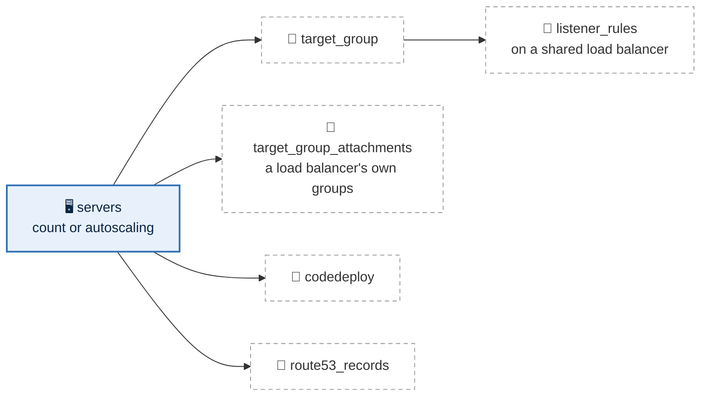

# Compute

Every server is in one stack per environment, `live/<region>/<environment>/compute/`,
one file per group of servers. A group is the same kind of file whatever it does:
a plain group of runners, a SQL Server cluster with chosen addresses, or an
application behind a load balancer that CodeDeploy deploys. What servers point at
stays in stacks of its own, so a change to a redirect cannot touch a server:

| What | Where |
|---|---|
| Servers, and for a group that has them: its target group, listener rules, CodeDeploy deployment and DNS records | `compute/`, one file per group |
| Load balancers, listeners, their own rules, network load balancer targets | the `load-balancers` stack ([load balancers](load-balancers.md)) |
| DNS names for anything else | `records/`, one file per name |
| Certificates | the `certificates` stack ([global](global.md#certificates)) |
| Images | pinned by ID in each file; building them is not included ([day one](day-one.md)) |

These stacks are scaffolding: they exist, validate, and build nothing until a
file is added. Complete example files for every stack are in
[`examples/`](../examples/README.md).



## One file per group

A group says what its servers share and how many there are. Its servers are
named `<group>-01`, `<group>-02` and so on, and any one of them can be pinned
or changed under `members`.

A plain group:

```yaml
# live/us-east-2/operations/compute/gitrunner.yml
count: 3
instance_type: c6i.large
ami: ami-0123456789abcdef0
tier: ops
iam_instance_profile: gitrunner
security_groups:
  - gitrunner
```

Servers that hold state, pinned to subnets with chosen addresses:

```yaml
# live/us-east-2/production/compute/sqlserver.yml
count: 2
instance_type: r6i.2xlarge
ami: ami-0123456789abcdef0
iam_instance_profile: sqlserver
security_groups:
  - sqlserver
ebs_block_device:
  data:
    device_name: /dev/sdf
    volume_size: 1000
    iops: 6000
    throughput: 500
members:
  sqlserver-01:
    subnet: data-az1
    ips:
      primary: 70
      cluster: 71
      listener: 72
  sqlserver-02:
    subnet: data-az2
    ips:
      primary: 70
      cluster: 71
      listener: 72
```

An application behind a load balancer, deployed by CodeDeploy, with its DNS
name:

```yaml
# live/us-east-2/operations/compute/grafana.yml
count: 2
instance_type: t3.medium
ami: ami-0123456789abcdef0
tier: ops
iam_instance_profile: grafana
security_groups:
  - grafana
target_group:
  port: 3000
  health_check:
    path: /api/health
listener_rules:
  - load_balancer: internal
    host_header:
      - grafana.example.com
    priority: 1010
codedeploy:
  deployment_config_name: CodeDeployDefault.OneAtATime
route53_records:
  - name: grafana
    zone: example.com
```

Behind a network load balancer, not deployed by CodeDeploy:

```yaml
# live/us-east-2/operations/compute/zabbix-proxy.yml
count: 1
instance_type: t3.small
ami: ami-0123456789abcdef0
tier: ops
iam_instance_profile: zabbix-proxy
target_group_attachments:
  internal-nlb/zabbix: 10051
```

| Key | Meaning |
|---|---|
| `count` | How many servers; adding one adds `<group>-NN` and touches nothing else, removing one removes only the last |
| `instance_type` | The instance type; a member can override it. Changed in place: AWS stops the server, changes it and starts it again |
| `ami` | An AMI id, pinned; the plan refuses a name or a search. A new image reaches new servers only; an existing server moves to it when rebuilt on purpose ([below](#rebuilding-a-server)) |
| `tier` | Where unpinned members go: spread across the region's zones in turn (`ops-az1`, `ops-az2`, …). Default `private` |
| `security_groups` | From the environment's security-groups stack, by name |
| `iam_instance_profile` | Required: a role from the `iam` stack, by name (its instance profile has the same name), so every server's permissions are chosen |
| `root_block_device` | `volume_size`: the root disk in GB (default 30) |
| `ebs_block_device` | Extra disks by name, each with `device_name`, `volume_size` (GB), `iops` and `throughput`. Never destroyed by a plan |
| `backup` | In the environment's AWS Backup plan (default `true`) |
| `user_data` | A boot script beside the file, run when a server is first built. Never secrets: user data is readable by anyone who can describe the instance |
| `members` | Per server: `subnet` (`data-az1`), `instance_type`, and `ip` or `ips` (host numbers in the subnet's reserved block) |
| `tags` | Extra tags |

Then one block per optional feature, each named after its AWS resource. Leave
a block out and the feature is off; any combination works:

| Block | Turns on | Keys |
|---|---|---|
| `autoscaling` | an Auto Scaling group instead of fixed servers ([below](#auto-scaling-groups)); replaces `count` and `members` | `min_size`, `max_size`, `desired_capacity`, `target_tracking_configuration` |
| `target_group` | the group's own target group | `port` (required), `protocol` (`HTTP`, or `HTTPS` to servers that terminate TLS), `slow_start` (30 to 900 seconds), `health_check` (`path`, default `/`; `matcher`, default `200-399`), `stickiness` (`cookie_duration` in seconds) |
| `listener_rules` | rules on a shared load balancer's listener, forwarding to the group's target group; needs `target_group` | each: `load_balancer` by name, `listener` port (default 443), `host_header` and/or `path_pattern`, `priority` from 1000 up (1 to 999 are the load balancer's own rules). `path_pattern: ["/*"]` at the highest priority number takes everything left over |
| `target_group_attachments` | registration in target groups from the load-balancers stack, such as a network load balancer's | `<load balancer>/<target>: <port>` |
| `codedeploy` | a CodeDeploy application and deployment group ([below](#deploying-with-codedeploy)) | `deployment_config_name`: `CodeDeployDefault.OneAtATime`, `CodeDeployDefault.HalfAtATime`, `CodeDeployDefault.AllAtOnce`, or a custom configuration |
| `route53_records` | DNS aliases to the group's load balancer | each: `name`, `zone`, `private_zone`, and `load_balancer` when it is not the first listener rule's |

A group's own target group is named `<environment>-<group>-<suffix>`, cut to
AWS's 32 characters; the suffix keeps it unique and changes with its port and
protocol, so a change AWS cannot make in place builds the new group first.

## Built in, for every server

- **Protected:** termination protection on every
  server, and a new image or boot script never rebuilds one. Stop protection is
  off, so a type change can be made in place.
- **IMDSv2 only**, with a hop limit of 2 (so containers on the server can reach
  the metadata service) and the server's tags readable from it.
- **No SSH key, no public address.** Access is Session Manager, which works on
  every server through Default Host Management
  ([systems manager](systems-manager.md#session-manager)), whatever its role
  holds.
- Root and data disks encrypted with the environment's data key, detailed
  monitoring, automatic recovery.
- The tags `Group = <group>`, `PatchGroup = <environment>` (patching) and
  `Backup = standard`.

## Auto Scaling groups

A group that should grow and shrink with load says `autoscaling` instead of
`count`:

```yaml
# live/us-east-2/production/compute/orders-api.yml
instance_type: m6i.large
ami: ami-0123456789abcdef0
tier: private
iam_instance_profile: orders-api
security_groups:
  - orders-api
autoscaling:
  min_size: 2
  max_size: 6
  desired_capacity: 2
  target_tracking_configuration:
    predefined_metric_type: ASGAverageCPUUtilization
    target_value: 50
target_group:
  port: 8080
  health_check:
    path: /health
listener_rules:
  - load_balancer: internal
    host_header:
      - orders.internal.example.com
    priority: 1100
codedeploy:
  deployment_config_name: CodeDeployDefault.OneAtATime
```

It becomes a launch template and an Auto Scaling group named
`<environment>-<group>`, launching into every zone of its tier, behind the same
target group, listener rules and DNS records a fixed group gets. The keys are the
provider's (`aws_autoscaling_group`, `aws_autoscaling_policy`):

| Key | Meaning |
|---|---|
| `min_size`, `max_size` | The fewest and most instances |
| `desired_capacity` | How many to start with. Scaling changes it from then on, and a plan never moves it back |
| `target_tracking_configuration` | Optional: `predefined_metric_type` (`ASGAverageCPUUtilization`, `ASGAverageNetworkIn`, `ASGAverageNetworkOut`, or `ALBRequestCountPerTarget` with a `resource_label`) and the `target_value` to hold it at. Without it the group stays at `desired_capacity` and replaces unhealthy instances |

How it differs from fixed servers:

- **Instances come and go**, so there is no `count`, no `members`, no chosen
  addresses and no per-server names; they are found by the `Group` tag. They
  carry the same tags as fixed servers (stamped on at launch, since provider
  default tags never reach them), except `Backup`: their state belongs in a
  database, a file system or a bucket.
- **A new image rolls out by itself.** Changing `ami` (or the instance type,
  the boot script, the disks) starts an instance refresh: a few instances at a
  time are replaced, keeping 90% in service. Fixed servers never change image
  without a deliberate `-replace`.
- **Health comes from the load balancer** when the group has a target group
  or target group attachments, so an instance that stops answering is replaced; otherwise from EC2.
- **CodeDeploy deploys to the Auto Scaling group by name**, and an instance it
  launches later gets the current release before it joins the load balancer.
- Disks belong to the instance and are deleted with it. The same metadata and
  encryption settings as fixed servers apply: IMDSv2 with a hop limit of 2,
  tags readable from metadata, disks encrypted with the data key.

The plan refuses `autoscaling` with `count` or `members`, an unknown key under
it, sizes out of order (`min_size <= desired_capacity <= max_size`), an image
search instead of an ID, and a tier the VPC does not have.

## Target groups and listener rules

With `target_group` and `listener_rules`, the group gets a target group of its
own, its servers are registered in it, and each listener rule forwards to it.
The plan refuses two listener rules,
in any group, with the same priority on one listener or claiming the same host
and path. With `target_group_attachments`, its servers also join target groups in the
load-balancers stack (a network load balancer's, which has no rules).

## Deploying with CodeDeploy

With a `codedeploy` block, the group gets a CodeDeploy application named
`<environment>-<group>` and a deployment group named after the environment,
which finds its servers by two tags that must both match, `Environment` and
`Group`, so a deployment cannot reach another environment's servers or another
group's. A group behind a load balancer deploys with traffic control: each
server leaves every target group it is in, its own and any network load
balancer's, while it is updated. Every deployment rolls back by itself on
failure. The environment's CodeDeploy service role, `codedeploy-<environment>`,
is created by this stack when the first group has a `codedeploy` block.

What a deployed group also needs, outside this stack:

- the **CodeDeploy agent in its image**;
- a **revisions bucket**: a file in the environment's `buckets` stack (for
  example `buckets/revisions.yml`), where the build uploads each release;
- **read access to it in the group's role**: a shared policy in the iam stack,
  `policies/read-revisions.yml`, allowing `s3:GetObject` on that bucket's
  objects, listed under each deployed group's role;
- a **role for the CI system** to upload and start deployments (not included:
  it depends on the CI system, see [day one](day-one.md)).

A deployment changes only the code on the servers; a new image is a rebuild.

## Rebuilding a server

A plan never rebuilds a server because its image or boot script changed: those
reach new servers only. A server is rebuilt only on purpose, or when a member
moves to another subnet:

```bash
make plan  STACK=us-east-2/operations/compute ARGS='-replace=module.server_group["grafana"].module.servers.aws_instance.servers["grafana-02"]'
```

(or `terraform plan -replace=…` in the stack). Removing a server from the file
(lowering `count`) destroys it the same way. Either way the steps run in this
order:

1. it leaves every target group, draining for 60 seconds;
2. its extra disks are detached from it, and kept: no plan destroys a disk;
3. termination protection is turned off and it is powered off at once, without
   an OS shutdown (`aws ec2 terminate-instances --skip-os-shutdown`);
4. the new server is built from the current image and boot script, its disks
   attached, and it joins its target groups.

Nothing is flushed and no service stops cleanly, so a disk that is reattached
comes back as after a power cut: stop the service first when it matters. A
server with extra disks cannot simply be removed, since its disks would be
destroyed with it; the plan refuses until the disk is dealt with on purpose.

The AWS provider has no setting for step 3's fast power-off. A destroy-time step
runs the AWS CLI with the stack's profile (`bin/tf` passes it on). If the CLI is
missing, too old (`make setup` warns), or refused, Terraform's own terminate
still runs, with the usual slower OS shutdown, so the destroy never fails
because of the shortcut.

Target groups rebuild the other way round: the new group is built first and
every listener and rule moves to it in place (see
[load balancers](load-balancers.md#built-in)). A group's own target group lives
in the same plan as its servers and listener rules. When a target group in the
load-balancers stack is rebuilt, the servers that join it with `target_group_attachments` move
to the new one only on compute's next apply, so apply compute straight after.

## Addresses: AWS-assigned, or chosen and identical everywhere

By default AWS assigns each server an address. Where something needs a stable
address (a SQL Server cluster and listener, a partner's allow list), a member
names a host number in its subnet: `ip: 70`, or `ips:` with `primary` and any
extra addresses. Because every environment's VPC is carved identically, the same
file gives the same address everywhere but the second octet:

| | `subnet: ops-az1`, `ip: 70` |
|---|---|
| production, Ohio | 10.41.228.70 |
| production DR, Oregon | 10.61.228.70 |
| staging, Oregon | 10.62.228.70 |
| operations, Ohio | 10.42.228.70 |

Chosen addresses come from a block every subnet reserves: `.64` to `.127` of
its first /24 (`reserved: 26` per tier in `config/global.yml`). The block is a
subnet CIDR reservation of type explicit, so AWS never hands one of its
addresses to anything on its own; load balancers, endpoints, databases and
servers without `ip` take addresses from the rest of the subnet, and a chosen
address can never be taken first. The plan refuses an address outside the block
and an address chosen twice.

## `records`: DNS names

One file per name, pointing at a load balancer, a server, or another name.

```yaml
# live/us-east-2/production/records/api.yml
zone: example.com
load_balancer: external
```

```yaml
# live/us-east-2/operations/records/grafana.yml
zone: internal.example.com
private_zone: true
server: grafana-01
```

| Key | Meaning |
|---|---|
| `zone` | The hosted zone; `private_zone: true` for a private zone |
| `name` | The record's name in the zone; default the file name |
| `load_balancer` | An alias to that load balancer, following its health |
| `server` | An A record to that server's private address |
| `cname` | A CNAME to another name |

Zones are the global `dns` stack's; records belong to the environment that owns
what they point at. A group's own names go in its compute file instead.
