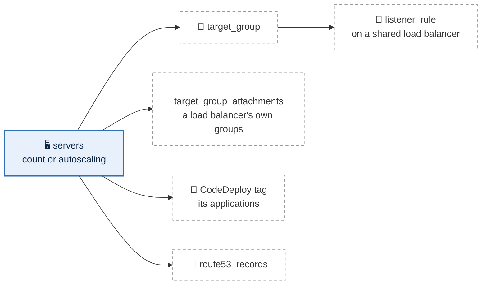

# Compute

Every server is in one stack per environment, `live/<region>/<environment>/compute/`,
one file per group of servers, in its `config/` folder. A file's
keys are `aws_instance`'s arguments (`instance_type`, `ami`,
`vpc_security_group_ids`, `root_block_device`, `ebs_block_device`,
`user_data`, `iam_instance_profile`, `tags`) and, for what it reaches, the
arguments of the resource each block is named after. Four keys are this repository's own, because one file builds several servers: `count`, `server_name`, `tier` and `members`. A group is the same kind of file whatever it does:
a plain group of runners, a SQL Server cluster with chosen addresses, or an
application behind a load balancer that CodeDeploy deploys. What servers point at
stays in stacks of its own, so a change to a redirect cannot touch a server:

| What | Where |
|---|---|
| Servers, and for a group that has them: its target group, listener rules, CodeDeploy deployment and DNS records | `compute/`, one file per group |
| Load balancers, listeners, their own rules, network load balancer targets | the `load-balancers` stack ([load balancers](load-balancers.md)) |
| DNS names for anything else | `records/`, one file per name |
| Certificates | the `certificates` stack ([global](global.md#certificates)) |
| Images | pinned by ID in each file; building them is not included ([day one](day-one.md)) |

These stacks are scaffolding: they exist, validate, and build nothing until a
file is added. Complete example files for every stack are in
[`examples/`](../examples/README.md).



## One file per group

A group says what its servers share and how many there are. Its servers are
named `<group>-01`, `<group>-02` and so on, or after its `server_name` with
their number added (`server_name: accounts` names them `accounts01`,
`accounts02`), and any one of them can be pinned or changed under `members`, by
that name. A server's name is its `Server` tag and its host name, and its
`Name` tag is the environment and that name (`Staging - accounts01`); it is part of
its identity, so changing `server_name` after servers exist replaces them.

Where each server goes is decided for you, evenly, and never changes once it
exists:

1. **A pin wins.** `members.<server>.subnet_id: private-az2` puts that server there.
   Pinning is the override, for the rare server that must be in one zone.
2. **A server that exists stays.** The plan reads the environment's servers (their
   `Server` and `Subnet` tags, through the tagging API; `Name` for a server built
   before it had a `Server` tag) and keeps each in its
   subnet: in AWS, moving a server means rebuilding it. A group moved to another
   tier is the exception, rebuilt in its new tier.
3. **A new server goes where it is needed most:** to a zone where its group has
   the fewest servers, and among those the emptiest zone in the tier, the
   groups (by name) taking the zones in turn. Four servers over three zones are
   never three in one, and single-server groups spread across the zones
   instead of stacking in the first.

Deleting servers never rebalances the rest, since that would rebuild them; the
next new servers fill the emptier zones.

Files sit in `config/`, below the stack's `.tf` files, and in folders of your
own inside it, as deep as you like, to keep a large stack readable:

```
live/us-west-2/staging/compute/
  config/
    apps/           accounts-service.yml, sso-portal.yml, …
    infra/          the servers that are not apps
    deployments/    how each CodeDeploy application rolls out (below)
```

The folders are only for people: a group's name is its file's name wherever it
sits, so a name is used once in a stack, and the plan refuses a second file of
the same name in another folder. `deployments/` is CodeDeploy's, and a
stack's own `tests/` holds test fixtures; neither holds groups.

A plain group:

```yaml
# live/us-east-2/operations/compute/config/gitrunner.yml
count: 3
instance_type: c6i.large
ami: ami-0123456789abcdef0
tier: ops
iam_instance_profile: gitrunner
vpc_security_group_ids:
  - gitrunner
tags:
  Backup: standard
```

Servers that hold state, pinned to subnets with chosen addresses:

```yaml
# live/us-east-2/production/compute/config/sqlserver.yml
count: 2
instance_type: r6i.2xlarge
ami: ami-0123456789abcdef0
iam_instance_profile: sqlserver
vpc_security_group_ids:
  - sqlserver
ebs_block_device:
  - device_name: /dev/sdf
    volume_size: 1000
    iops: 6000
    throughput: 500
    tags:
      Name: data
members:
  sqlserver-01:
    subnet_id: data-az1
    private_ip: "70"
    secondary_private_ips:
      - "71"
      - "72"
  sqlserver-02:
    subnet_id: data-az2
    private_ip: "70"
    secondary_private_ips:
      - "71"
      - "72"
tags:
  Backup: standard
```

Each node carries, beside its own address, the cluster's and the listener's
address in its subnet, so whichever node holds them is reached there. Two nodes
need a third vote: a file share witness on a small server pinned to the third
zone, in a group of its own (`live/us-west-2/staging/compute/config/infra/`
holds staging's nodes and witness). The nodes reach each other and the witness
through the `sqlserver-cluster` and `sqlserver-quorum` groups.

An application behind a load balancer, deployed by CodeDeploy, with its DNS
name:

```yaml
# live/us-east-2/operations/compute/config/grafana.yml
count: 2
instance_type: t3.medium
ami: ami-0123456789abcdef0
tier: ops
iam_instance_profile: grafana
vpc_security_group_ids:
  - grafana
target_group:
  port: 3000
  health_check:
    path: /api/health
listener_rule:
  listener_arn: internal/443
  priority: 1010
  condition:
    host_header:
      values:
        - grafana.example.com
route53_records:
  - name: grafana.example.com
    type: A
    zone_id: example.com
    alias:
      name: internal
      evaluate_target_health: true
tags:
  Backup: standard
  CodeDeploy: "['grafana']"
```

Behind a network load balancer, not deployed by CodeDeploy:

```yaml
# live/us-east-2/operations/compute/config/zabbix-proxy.yml
count: 1
instance_type: t3.small
ami: ami-0123456789abcdef0
tier: ops
iam_instance_profile: zabbix-proxy
target_group_attachments:
  - target_group_arn: internal-nlb-zabbix
    port: 10051
```

| Key | Meaning |
|---|---|
| `count` | How many servers; adding one adds `<group>-NN` and touches nothing else, removing one removes only the last |
| `instance_type` | The instance type; a member can override it. Changed in place: AWS stops the server, changes it and starts it again |
| `ami` | An image: its file's name in `config/amis/` ([below](#images)), or an `ami-` ID. A new image reaches new servers only; an existing server moves to it when rebuilt on purpose ([below](#rebuilding-a-server)) |
| `tier` | The subnets its servers go in, one zone each, spread as below. Default `private` |
| `vpc_security_group_ids` | Groups from the environment's security-groups stack, by name (an `sg-` ID passes through); at most 5 |
| `iam_instance_profile` | Required: a role from the `iam` stack, by name (its instance profile has the same name), so every server's permissions are chosen |
| `root_block_device` | `volume_size`: the root disk in GB (default 30) |
| `ebs_block_device` | Extra disks, a list as the provider has it: `device_name`, `volume_size` (GB), `iops`, `throughput` and `tags` (`Name` labels the disk). Each is built as its own `aws_ebs_volume` and `aws_volume_attachment`, so no plan can destroy it with its server |
| `user_data` | A boot script, run when a server is first built: `scripts/<name>`, a file in the repository's `scripts/` folder (`scripts/ubuntu.sh`). Never secrets: user data is readable by anyone who can describe the instance |
| `server_name` | What the servers are called, before their number: `accounts` gives `accounts01`, `accounts02`. Without it, `<group>-01`. Refused with `autoscaling_group`, and when two servers in the stack would share a name |
| `members` | Per server, in `aws_instance`'s arguments: `subnet_id` (a subnet's name, `data-az1`), `instance_type`, `private_ip` and `secondary_private_ips` (a host number in the subnet's reserved block, or a full address), and `tags` of its own, over the group's. Any other key is refused |
| `tags` | Extra tags on every server, over the provider's defaults. `CodeDeploy` lists the applications its servers run ([below](#deploying-with-codedeploy)); `isContainerized: true` marks them containerized. `members.<server>.tags` gives one server a tag of its own, such as its `DNS` name |

Then one block per optional feature, each named after its AWS resource. Leave
a block out and the feature is off; any combination works:

| Block | Turns on | Keys |
|---|---|---|
| `autoscaling_group` | an Auto Scaling group instead of fixed servers ([below](#auto-scaling-groups)); replaces `count` and `members` | `min_size`, `max_size`, `desired_capacity` |
| `autoscaling_policy` | how an Auto Scaling group scales | `target_tracking_configuration` |
| `target_group` | the group's own target group (`aws_lb_target_group`) | `port` (required), `protocol` (`HTTP`, or `HTTPS` to servers that terminate TLS), `slow_start` (30 to 900 seconds), `health_check` (`path`, default `/`; `matcher`, default `200-399`), `stickiness` as the provider writes it: `type` (`lb_cookie` or `app_cookie`), `enabled`, `cookie_duration` in seconds, `cookie_name`. Without `stickiness` there is no stickiness block |
| `listener_rule` | one rule on a shared load balancer's listener, forwarding to the group's target group (an `aws_lb_listener_rule`, with its keys); needs `target_group` | `listener_arn` as `<load balancer>/<port>` (`services/443`), `priority` from 1000 up (1 to 999 are the load balancer's own rules), and `condition`: `host_header.values` and/or `path_pattern.values`, at most five together. Every host in full, `customer-staging.example.com`; it gets no DNS record unless a records file names one. `path_pattern.values: ["/*"]` at the highest priority number takes everything left over |
| `target_group_attachments` | registration of its servers (`aws_lb_target_group_attachment`) in target groups from the load-balancers stack, such as a network load balancer's | a list, each with `target_group_arn` (the target group's name, `<load balancer>-<target>`, or its ARN) and `port` |
| `route53_records` | DNS aliases to a load balancer (`aws_route53_record`) | a list, each with `name` (in full: `grafana.example.com`), `type` (`A` or `AAAA`), `zone_id` (the zone's name, which must be a private zone or a `dns.public_domain` in config/global.yml, or a zone ID) and `alias`: `name` (a load balancer of this environment, by name) and `evaluate_target_health`. A record in the environment's own private zone is written with its account; any other, through the hub's |

A group's own target group is named `<environment>-<group>-<suffix>`, cut to
AWS's 32 characters; the suffix keeps it unique and changes with its port and
protocol, so a change AWS cannot make in place builds the new group first.

## Built in, for every server

- **Protected:** termination protection on every
  server, and a new image or boot script never rebuilds one. Stop protection is
  off, so a type change can be made in place.
- **IMDSv2 only**, with a hop limit of 2 (so containers on the server can reach
  the metadata service) and the server's tags readable from it.
- **No SSH key, no public address.** Access is Session Manager, which works on
  every server through Default Host Management
  ([systems manager](systems-manager.md#session-manager)), whatever its role
  holds.
- Root and data disks encrypted with the environment's data key, detailed
  monitoring, automatic recovery.
- The tags `Group = <group>` and `PatchGroup = <environment>` (patching).
  Backup is the file's choice, its `Backup: standard` tag; every compute
  blueprint sets it.

## Auto Scaling groups

A group that should grow and shrink with load has `autoscaling_group` instead
of `count`:

```yaml
# live/us-east-2/production/compute/config/accounts-service.yml
instance_type: m6i.large
ami: ami-0123456789abcdef0
tier: private
iam_instance_profile: accounts-service
vpc_security_group_ids:
  - accounts-service
autoscaling_group:
  min_size: 2
  max_size: 6
  desired_capacity: 2
autoscaling_policy:
  target_tracking_configuration:
    predefined_metric_specification:
      predefined_metric_type: ASGAverageCPUUtilization
    target_value: 50
target_group:
  port: 8080
  health_check:
    path: /health
listener_rule:
  listener_arn: internal/443
  priority: 1100
  condition:
    host_header:
      values:
        - accounts.internal.example.com
tags:
  CodeDeploy: "['accounts-service']"
```

It becomes a launch template and an Auto Scaling group named
`<environment>-<group>`, launching into every zone of its tier, behind the same
target group, listener rules and DNS records a fixed group gets. The keys are the
provider's (`aws_autoscaling_group`, `aws_autoscaling_policy`):

| Key | Meaning |
|---|---|
| `min_size`, `max_size` | The fewest and most instances |
| `desired_capacity` | How many to start with. Scaling changes it from then on, and a plan never moves it back |
| `target_tracking_configuration` | Optional, as `aws_autoscaling_policy` writes it: `predefined_metric_specification` with `predefined_metric_type` (`ASGAverageCPUUtilization`, `ASGAverageNetworkIn`, `ASGAverageNetworkOut`, or `ALBRequestCountPerTarget` with a `resource_label`), and the `target_value` to hold it at. Without it the group stays at `desired_capacity` and replaces unhealthy instances |

How it differs from fixed servers:

- **Instances come and go**, so there is no `count`, no `members`, no chosen
  addresses and no per-server names; they are found by the `Group` tag. They
  carry the same tags as fixed servers (stamped on at launch, since provider
  default tags never reach them). Give them no `Backup` tag: their state
  belongs in a database, a file system or a bucket.
- **A new image rolls out by itself.** Changing `ami` (or the instance type,
  the boot script, the disks) starts an instance refresh: a few instances at a
  time are replaced, keeping 90% in service. Fixed servers never change image
  without a deliberate `-replace`.
- **Health comes from the load balancer** when the group has a target group
  or target group attachments, so an instance that stops answering is replaced; otherwise from EC2.
- **CodeDeploy deploys to the Auto Scaling group by name**, and an instance it
  launches later gets the current release before it joins the load balancer.
- Disks belong to the instance and are deleted with it. The same metadata and
  encryption settings as fixed servers apply: IMDSv2 with a hop limit of 2,
  tags readable from metadata, disks encrypted with the data key.

The plan refuses `autoscaling_group` with `count` or `members`, an unknown key under
it, sizes out of order (`min_size <= desired_capacity <= max_size`), an image
search instead of an ID, and a tier the VPC does not have.

## Target groups and listener rules

With `target_group` and `listener_rule`, the group gets a target group of its
own, its servers are registered in it, and the listener rule forwards to it.
The plan refuses two listener rules,
in any group, with the same priority on one listener or claiming the same host
and path. With `target_group_attachments`, its servers also join target groups in the
load-balancers stack (a network load balancer's, which has no rules).

## Deploying with CodeDeploy

Servers say which applications they run, in their `CodeDeploy` tag, and the
compute stack builds every application they name. Nothing else lists them:
add the tag to a group and its application appears; remove it from the last
group and it goes.

```yaml
# live/us-east-2/production/compute/config/api.yml
tags:
  CodeDeploy: "['external-api-service', 'reports:Function=api']"
  Function: api
```

- **One group can run several applications, and one application can span
  several groups.** Each listed application becomes a tag
  `CodeDeploy:<application>` on the group's servers. A YAML list works as well
  as the quoted string.
- **An application has the same name in every environment** (`external-api-service`),
  so a pipeline deploys to one name. Its **deployment groups**, by default one
  per branch deployed from, are `master`, `development` and `adhoc`. Each finds
  its servers by their `CodeDeploy:<application>` tag and this environment's
  `Environment` tag, so a deployment never reaches another environment's
  servers.
- **A selector narrows it further:** `reports:Function=api` deploys `reports`
  only to servers also tagged `Function = api`. Every server running an
  application must give it the same selector, or none.
- **Auto Scaling groups** are deployed to by name, so instances launched later
  get the current release.
- **Behind a load balancer**, with more than one server, each server leaves
  every target group it is in while it is updated.
- **A shared, containerized application:** when every server running it is
  tagged `isContainerized: true`, the application is shared by the
  environments. The first to create it owns it (an `EnvironmentOwner` tag), and
  each environment adds one deployment group, `primary-<environment>`. Whether
  it already exists, and whose it is, is read from AWS during the plan with the
  AWS CLI (read-only). `bin/tf` gives the CLI the stack's profile; with plain
  `terraform`, export `AWS_PROFILE` first. The plan stops, saying why, if the
  CLI's credentials are another account's or any check fails, so a failed check
  is never mistaken for a missing application.

How an application deploys is configuration anyone can change, in review:

| Where | What |
|---|---|
| `config/global.yml`, `codedeploy:` | the defaults for every application: `deployment_group_names`, `deployment_config_name` (default `CodeDeployDefault.OneAtATime`), `auto_rollback_configuration.events` (default `DEPLOYMENT_FAILURE`) |
| `config/deployments/<application>.yml` | one application's own values for any of those keys |

```yaml
# live/us-east-2/production/compute/config/deployments/external-api-service.yml
deployment_config_name: CodeDeployDefault.HalfAtATime
```

The plan refuses a malformed `CodeDeploy` tag, servers that disagree on an
application's selector, a deployment file for an application no server runs,
and the old `codedeploy:` block, saying where its settings went. The
environment's CodeDeploy service role, `codedeploy-<environment>-<region>`, is created
here with the first application.

**The GitHub connection.** With `codedeploy.bootstrap` set in
`config/global.yml` (a repository and a commit), each new application also gets
a deployment group of its own, `connection-check`, which requires a tag no
server carries. A deployment of that commit is started there and stopped, so
CodeDeploy's connection to GitHub exists before the first real release, and no
server is ever touched by it. If CodeDeploy refuses, the apply says so, with
AWS's reason; it never reports a connection that was not made. Without
`bootstrap`, nothing is started.

What a deployed application also needs, outside this stack:

- the **CodeDeploy agent in its image**;
- a **revisions bucket**: a file in the environment's `buckets` stack (for
  example `buckets/config/revisions.yml`), where the build uploads each release;
- **read access to it in the group's role**: a shared policy in the iam stack,
  `config/policy/read-revisions.yml`, allowing `s3:GetObject` on that bucket's
  objects, listed under each deployed group's role;
- a **role for the CI system** to upload and start deployments (not included:
  it depends on the CI system, see [day one](day-one.md)).

A deployment changes only the code on the servers; a new image is a rebuild.

## Rebuilding a server

A plan never rebuilds a server because its image or boot script changed: those
reach new servers only. A server is rebuilt only on purpose, or when a member
moves to another subnet:

```bash
make plan  STACK=us-east-2/operations/compute ARGS='-replace=module.server_group["grafana"].module.servers.aws_instance.servers["grafana-02"]'
```

(or `terraform plan -replace=…` in the stack). Removing a server from the file
(lowering `count`) destroys it the same way. Either way the steps run in this
order:

1. it leaves every target group, draining for 60 seconds;
2. its extra disks are detached from it, and kept: no plan destroys a disk;
3. termination protection is turned off and it is powered off at once, without
   an OS shutdown (`aws ec2 terminate-instances --skip-os-shutdown`);
4. the new server is built from the current image and boot script, its disks
   attached, and it joins its target groups.

Nothing is flushed and no service stops cleanly, so a disk that is reattached
comes back as after a power cut: stop the service first when it matters. A
server with extra disks cannot simply be removed, since its disks would be
destroyed with it; the plan refuses until the disk is dealt with on purpose.

The AWS provider has no setting for step 3's fast power-off. A destroy-time step
runs the AWS CLI with the stack's profile (`bin/tf` passes it on). If the CLI is
missing, too old (`make setup` warns), or refused, Terraform's own terminate
still runs, with the usual slower OS shutdown, so the destroy never fails
because of the shortcut.

Target groups rebuild the other way round: the new group is built first and
every listener and rule moves to it in place (see
[load balancers](load-balancers.md#built-in)). A group's own target group lives
in the same plan as its servers and listener rules. When a target group in the
load-balancers stack is rebuilt, the servers that join it with `target_group_attachments` move
to the new one only on compute's next apply, so apply compute straight after.

## Images

AMI IDs differ per region, so a file that holds one cannot be copied to another
region. A file in `config/amis/` names an image once, with the arguments of
`data.aws_ami`, and a server or blueprint uses that name:

```yaml
# config/amis/ubuntu-2404.yml
owners:
  - amazon
filter:
  - name: name
    values:
      - ubuntu/images/hvm-ssd-gp3/ubuntu-noble-24.04-amd64-server-20261001
```

```yaml
ami: ubuntu-2404
```

The template finds the image's ID in the stack's own region and account. The name
is exact: `most_recent`, `name_regex` and wildcards are refused, because a search
could give a new server a different image with no change in Git. A new image is a
reviewed commit to this one file. An image you bake must carry the same name in
every region it is copied to, and be shared with every account that uses it.
`include_deprecated: true` keeps an older image usable after AWS deprecates it. An
`ami-` ID still passes through as it is.

## Addresses: AWS-assigned, or chosen

By default AWS assigns each server an address. Where something needs a stable
address (a SQL Server cluster and listener, a partner's allow list), a member
says so with `aws_instance`'s own arguments: `private_ip`, and
`secondary_private_ips` for any extra addresses. The value is a host number,
quoted, and the rest of the address comes from the server's subnet, so the same
file gives the same address everywhere but the network:

| `subnet_id: data-az2`, `private_ip: "70"` | |
|---|---|
| staging, Oregon | 10.62.196.70 |
| production, Ohio | 10.41.196.70 |
| production DR, Oregon | 10.61.196.70 |

The third octet follows the subnet too: `data-az1` is `.192`, `data-az2` is
`.196`. A full address also works, for the rare one that must not follow the
network.

Chosen addresses come from a block every subnet reserves: `.64` to `.127` of
its first /24 (`reserved: 26` per tier in `config/global.yml`). The block is a
subnet CIDR reservation of type explicit, so AWS never hands one of its
addresses to anything on its own; load balancers, endpoints, databases and
servers without `private_ip` take addresses from the rest of the subnet, and a chosen
address can never be taken first. The plan refuses an address outside the block
and an address chosen twice.

## `records`: DNS names

One file per `aws_route53_record` in the stack's `config/`, named after it.

```yaml
# live/us-east-2/production/records/config/api.yml
zone_id: example.com
name: api.example.com
type: A
alias:
  name: external
  zone_id: external
  evaluate_target_health: true
```

```yaml
# live/us-east-2/operations/records/config/grafana.yml
zone_id: operations.corp.internal
name: grafana.operations.corp.internal
type: A
ttl: 300
records:
  - grafana-01
```

| Key | Meaning |
|---|---|
| `zone_id` | The hosted zone, by name (`example.com`) or ID. A public zone must be one of `dns.public_domain` ([DNS](global.md#dns-public-domains-one-private-domain)); the environment's own private zone is written with its own account, any other through the hub's |
| `name` | The record's full name |
| `type` | `A`, `AAAA`, `CNAME` or `TXT` |
| `ttl`, `records` | For a record that is not an alias. In an `A` record, a value that is not an address names a server of the environment (its `Server` tag), and its private address is written |
| `alias` | `name` and `zone_id`: a load balancer of the environment by name for both, or a DNS name and hosted zone ID; and `evaluate_target_health` |

Zones are the global `dns` stack's; records belong to the environment that owns
what they point at. A group's own names go in its compute file instead.
