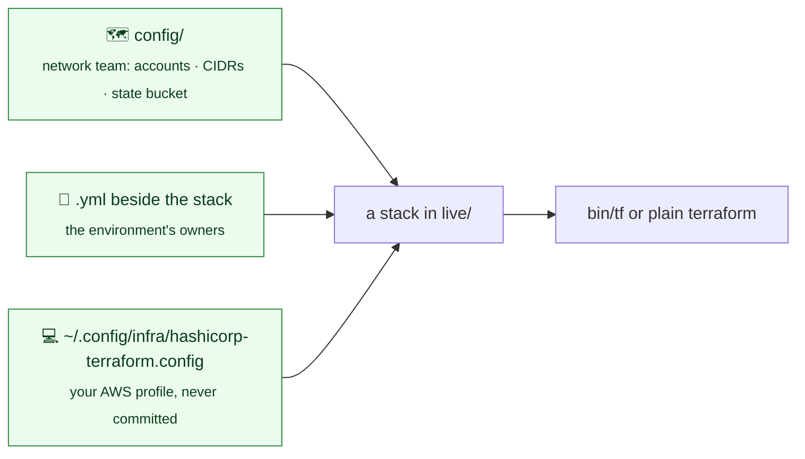
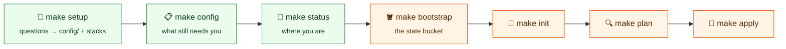

# Configuration



## Before anything runs

This repository builds inside AWS accounts it does not create. **Every AWS
account** the environments run in must exist first, made by whoever owns the AWS
Organization, with service control policies (SCPs) that allow what is built
here: the regions in `config/`, Transit Gateway, site-to-site VPN, internet and
NAT gateways, VPC flow logs, and RAM sharing when environments have accounts of
their own.

The state bucket comes next: `make bootstrap` creates it, or uses one that
already exists ([below](#the-state-bucket-make-bootstrap)). Until the accounts
and the bucket are in `config/`, nothing runs: `bin/tf` refuses every command
that needs state, and a plan refuses a stack whose environment has no account.
Apart from bootstrap's first minutes, there is no local state.



Green steps never change anything in AWS; their only AWS calls are read-only.

## config/

`config/global.yml` holds what every region shares: the state bucket and the
subnet layout every VPC uses ([network](network.md#ip-plan)):

```yaml
# config/global.yml, the state part
state:
  bucket: example-terraform-state
  region: us-east-2
  key: "{region}/{environment}/{component}"
```

`key` shapes every stack's state key, with `{region}` (or `global`),
`{environment}`, `{component}` and `{account_id}` (the environment's account)
filled in per stack, and `/terraform.tfstate` added. The default gives
`us-east-2/operations/network/terraform.tfstate`. To follow an organization's
standard instead, change this one line, for example
`aws/{account_id}/{environment}/{region}-{component}`, and run `make backends`.
`bin/backends` refuses a key without `{environment}` and `{component}`, and any
key that would give two stacks the same state. Decide it before the first
apply: changing a key afterwards means moving each stack's state.

Then one file per region, named after it, with everything about that region: its
zones, its hub, and every environment's VPC there.

```yaml
# config/us-east-2.yml
zones:
  - use2-az1
  - use2-az2
  - use2-az3
hub:
  account_id: "333333333333"
  team: network
  cidr: 10.40.0.0/20
  amazon_side_asn: 64512
  primary: true
vpcs:
  operations:
    account_id: "222222222222"
    team: platform
    cidr: 10.42.0.0/16
    segment: shared
    public: false
  production:
    account_id: "111111111111"
    team: platform
    cidr: 10.41.0.0/16
    segment: restricted
    public: true
```

| Key | Meaning |
|---|---|
| `sites`, `prefix_lists`, `dns` (in `global.yml`) | The networks reached over a VPN, each with its VPN address, BGP ASN, ranges and forwarded domains, and `enabled` ([network](network.md#sites)); named address groups for security group rules ([security groups](security-groups.md#prefix-lists)); DNS between AWS and the sites ([network](network.md#dns-with-the-sites)), and the private hosted zones every VPC attaches to ([global](global.md#dns)) |
| `state.bucket`, `state.region`, `state.key` (in `global.yml`) | The one S3 bucket holding every stack's state, the region it lives in, and the shape of each stack's key (default: the stack's name, such as `us-east-2/operations/network/terraform.tfstate`) |
| `pipeline.github_repository`, `pipeline.branch` (in `global.yml`) | The GitHub repository, `owner/name`, whose workflows may assume the pipeline's roles, and the protected branch plans are proposed from ([CI/CD](ci-cd.md#aws-credentials)) |
| `pipeline.dedicated_accounts` (in `global.yml`) | Environments that must have an account of their own: the pipeline builds no roles while one shares its account. `[production]` when left out; `[]` accepts every environment sharing ([accounts](accounts.md#sharing-an-account)). An environment's name may not start with another's and a hyphen, and the state bucket's may not start with any environment's |
| `pipeline.approvals`, `pipeline.reviewers` (in `global.yml`) | How many approvals a pull request needs, and, per environment, the GitHub logins or `org/team`s who approve its applies; `bin/github` writes them to GitHub ([CI/CD](ci-cd.md#turning-it-on)) |
| `zones` | The availability zones every VPC in the region spans, by zone ID: at least two, numbered `az1` to `az6`. A zone ID is the same physical zone in every account, unlike a name such as `us-east-2a`, which AWS shuffles per account. Each tier gets one subnet per zone, named with its zone ID (`vpc-01-private-use2-az1`). Adding a zone only adds subnets; removing one is refused until done on purpose ([network](network.md#adding-and-removing-zones)) |
| `hub` | The `shared` environment in this region: the Transit Gateway hub and its egress VPC, or with `transit_gateway.owner: parent` the gateway of another organization it attaches to ([network](network.md#ip-plan)) |
| `vpcs.<environment>` | That environment's VPC in this region ([network](network.md#ip-plan)) |
| `account_id` | The only account the environment's stacks may run in. Optional when `config/global.yml` has one (below); quoted: unquoted, YAML reads `012345678901` as a number and drops the leading zero |
| `team` | Becomes the `Team` tag on everything the environment builds. Optional; without it the plan warns |

### One account, or one per environment

`account_id` at the top of `config/global.yml` is the account every
environment and hub uses when its own entry leaves `account_id` empty. With a
single account for everything, set it there once:

```yaml
# config/global.yml
account_id: "444444444444"
```

When environments get accounts of their own, add `account_id` to each entry in
`config/<region>.yml`; an entry's own account always wins, and the rest keep
using the global one. So moving production into its own account later is one
line under `vpcs.production`. An environment with neither refuses to plan, and
`bin/tf` refuses to run it. `make setup` shows which account each environment
gets, and whether it comes from `global.yml`; `{account_id}` in `state.key`
follows the same rule.

Environments in accounts of their own also need a few stacks repeated in each
of those accounts, and the hub shares the network with them
([architecture](architecture.md#one-account-or-one-per-environment)).
`organization_sharing` in `config/global.yml` is `true` when the accounts are in
one AWS Organization with RAM sharing on, so they need not accept the share.

An environment with VPCs in two regions has the same `account_id` and
`team` in both files; the plan refuses them if they differ. Stacks under a
`global` folder run in the region whose hub says `primary: true`.

The files are committed and reviewed like code: an account, a range or an owner
changes in a pull request, never on one person's machine.

## Setting up: `make setup`

```bash
make setup
```

A guided setup that takes you as far as you can go without creating anything in
AWS, and stops there:

1. **Prerequisites** (below).
2. **The accounts on this machine:** every AWS profile, the account it
   reaches, and whether it is logged in (if not: `aws sso login --profile
   <name>`), plus the Organization's accounts by name when you may list them.
   Read-only.
3. **The accounts this repository uses:** pick one or several from that list
   (or type IDs; blank if they do not exist yet). One account: everything lives
   in it. Several: you choose the shared account for the hubs, and each
   environment's account at step 6.
4. **Regions:** every AWS region, numbered, with its name (and, when you are
   logged in, which are not enabled for the account). Pick any number; the
   first is the primary.
5. **Environments:** their names.
6. **Where each environment runs:** the regions it runs in, one or more (an
   environment in two regions is the same environment, with its
   disaster-recovery copy), and in multi-account mode its account. The result is
   shown as a pairing, region by region.
7. **The IP scope, last:** one range inside `10.0.0.0/8` that every network is
   planned in. Each region's hub gets a /20 from the first free /16, and each
   environment gets a /16 in every region it runs in, avoiding every range
   already in `config/` and in your accounts' VPCs. The default is sized to what
   is needed. A scope that does not start on its own boundary is refused, and
   the aligned one is suggested. The plan is shown; answer no to change any
   range.
8. **Everything else is defaulted:**
   - zones are looked up when logged in;
   - segment is `restricted` for an environment whose name starts with `prod`,
     and `standard` otherwise;
   - nothing is public;
   - the state bucket and office VPN keep what `config/` holds.

   What only a person can give (a team, an account that does not exist yet,
   zones that could not be looked up) is written with a `# TODO(you):` comment
   on its line.
9. **The IP plan checks the answers** before anything is written, using the
   same rules as a plan. If it refuses them, nothing is written.
10. **The change, shown in full:** a diff of `config/` and every stack it will
    create or delete. Created:
    - every region's shared stacks;
    - every environment's stacks in each of its regions, empty or copied from
      `examples/`;
    - the `logging`, `session-manager`, `baseline` and `iam` stacks for each
      environment account.

    Each deletion is asked separately: an environment that left a region, or a
    whole region that is no longer used. Nothing is written until you say yes.
    Then every `backend.tf` and the diagram are written, and you can check the
    new stacks' files.
11. **This machine's profiles** (below), and read-only checks of the state
    bucket if it exists.
12. **Your turn:** how many `TODO(you)` items remain, and the next command.

Every answer defaults to what is already there, so running it again changes only
what you change. A guess stays marked until someone confirms it. Without a
terminal (CI), it asks nothing and only checks.

## What is filled in: `make config`

```bash
make config
```

Shows the whole configuration as tables:
- `config/global.yml`;
- for each region: its zones, its hub, and a row per environment with account,
  team, range, segment and public;
- this machine's profiles.

Each value is marked filled in, missing or not set. The list ends with **To do**:
every `TODO(you)` line, by file and line number. Read-only.

## Where you are: `make status`

```bash
make status
```

Works out from what exists, never from anything remembered, how far along you
are: tools, `config/` (checked by the IP plan), accounts, the stacks an account
of its own needs, profiles that reach each account, the state bucket (versioned,
encrypted, replicated), backends, and the first stack. It ends with the one
command to run next. Read-only; `--offline` skips AWS.

## The state bucket: `make bootstrap`

```bash
make bootstrap           # does it
bin/bootstrap --check    # says which of the four it would do, and changes nothing
```

It works out which of four situations it is in:

| | It |
|---|---|
| No bucket yet | creates `state.bucket` (or `terraform-state-<account>-<region>`) in the shared account: versioned, encrypted, never public, TLS only, old versions kept a year, replicated to `state.replica_region` when set. It shows the plan and asks first, then moves its own state into the bucket and writes every `backend.tf` |
| A run that stopped part-way | finishes it from its own local state, rather than refusing a bucket that it created itself |
| A bucket that already exists, someone else's | checks it is versioned, encrypted and not public, and uses it: creates nothing, manages nothing. An unsafe bucket is refused, with the reason |
| Already done | plans any change to the bucket from its state in the bucket |

With environments in accounts of their own, the bucket's policy lets each of
those accounts read and write only its own environments' state keys
(`us-east-2/production/*`, `global/production/*`), and list only under them and
under `env:/`, where Terraform's S3 backend looks for workspaces when a stack
starts. A bucket someone else owns needs the same from its owner.

**Run `make bootstrap` again** whenever that list changes: after adding an
environment in an account of its own, or a region for one, and once after
updating this repository, so a bucket made before `env:/` was allowed gets it.
Until then, that account's `make init` is refused with a message saying it may
not read its state. The run plans only the policy change, and asks first.

## Prerequisites

`make setup` checks the prerequisites (Terraform 1.12 or later, AWS CLI v2, `jq`, `yq` v4
`gitleaks` and `tflint` required; `make check` lints) and stops if one is missing.
Homebrew does not carry `tflint`; install it from its GitHub release, checked
against the release's checksums:

```bash
d=$(mktemp -d) && cd "$d" \
  && gh release download v0.64.0 --repo terraform-linters/tflint --pattern tflint_darwin_arm64.zip --pattern checksums.txt \
  && grep ' tflint_darwin_arm64.zip$' checksums.txt | shasum -a 256 -c - \
  && unzip -q tflint_darwin_arm64.zip && install -m 755 tflint ~/.local/bin/tflint
```

On an Intel Mac use `tflint_darwin_amd64.zip`. `tflint --init` then downloads the
AWS ruleset pinned in `.tflint.hcl`. It
creates the shared provider cache and installs the git hooks once the folder is
a git repository.

It then reads `config/` and reports each environment's account and the state
bucket, flagging any not filled in yet. Finally it matches your
AWS profiles to the accounts: it asks each profile on the machine which account
it is (`sts get-caller-identity`, read-only; profiles you are not logged in to
are skipped) and offers the matching one for each environment. It warns if you
choose a profile for the wrong account. With the `shared` environment's profile
it then checks the state bucket, read-only: that it exists, that versioning is
on (so an overwritten or deleted state can be recovered), that default
encryption is on, and that it is replicated to another region. It warns rather
than fails, and says to run `make bootstrap` when there is no bucket yet. A rerun offers your current choices as defaults, shows the
result and asks before writing; the previous file is kept as a dated backup.

Without a terminal (CI) it runs the checks and asks nothing.

## This machine's profiles

The only thing that differs from one person to the next is which AWS profile
they log in with. `make setup` writes it to `$INFRA_CONFIG`, else
`~/.config/infra/hashicorp-terraform.config`, readable by its owner only and
never committed. Stacks read the same file themselves, so it applies with or
without `bin/tf`:

```yaml
profiles:
  operations: example-operations
  production: example-production
```

An environment without a profile uses whatever credentials are active
(`AWS_PROFILE`, an instance role, a CI role). Either way the stack is pinned to
the account in `config/`, so the wrong credentials fail the plan rather than
build in the wrong account.

## Checking without credentials

```bash
make check                                          # everything, as CI runs it on main
make check CHANGED=1                                # only what changed since it last passed
make check-files ONLY="us-east-2/operations/compute" # one or more stacks
make check JOBS=8                                   # more checks at a time (default 4)
```

`make check` runs formatting, lint, the [order check](architecture.md#apply-order)
and the backends first, in under a minute, so a simple mistake stops it early.
Then the slow part, side by side: every module's, template's and stack's tests,
and every stack's and example's files.

`check-files` validates each stack with no mocks, so a provider a stack does
not configure fails here, not in AWS. Then it plans the stack's `.yml` files
through its template against a mocked AWS that answers like the real one: no
credentials, no state, and no accounts needed yet (blank account IDs are filled
with placeholders for the check). It catches what a real plan would refuse in
your files (a misspelt key, a missing image, two listener rules on one host)
before anyone logs in. Examples are checked as `make stack` would create them,
so a fresh clone is what is tested. Everything runs in a scratch copy under
`.check-files/`, never in `live/`.

**Only what changed.** Each check is a unit: one folder's tests, or one stack's
or example's files. A unit's fingerprint is a hash of everything it reads: its
files, its template, every module those use, the configuration and fixtures it
reads, and the Terraform version. A unit that passes records its fingerprint in
`.terraform.d/checked/`. With `CHANGED=1`, a unit whose fingerprint is unchanged
is skipped, because it would pass again. A one-module change runs a handful of
units, not a hundred; a change to `live/common` or `modules/ip-plan` runs nearly
all of them, because nearly all of them read it. No git is needed. CI never uses
`CHANGED=1`, because a branch could write that record ([CI/CD](ci-cd.md#runners)).

**In CI**, the same commands, with no logic of their own, on self-hosted runners.
The workflows are written and switched off ([CI/CD](ci-cd.md)).

Providers are fetched once, by one `init`, before checks run side by side:
concurrent downloads into one cache corrupt it.

## Running Terraform

```bash
make init STACK=us-east-2/operations/network
make plan STACK=us-east-2/operations/network
make plan REGION=us-east-2 ENV=operations STACK=network   # the same stack
make order REGION=us-east-2 ENV=operations               # that environment's order
```

`make help` lists every target. The targets run `bin/tf`, which can also be
called directly: `bin/tf live/us-east-2/operations/network plan`.

**Apply runs exactly the plan you reviewed.** `make plan` saves the plan in the
stack's `.terraform/`, with the fingerprint of everything it read: the stack,
its template, its modules and `config/`. `make apply` applies that saved plan
and nothing else, after showing its summary and asking for `yes`. It refuses
when there is no plan, when anything the plan read has changed since, when the
plan is older than four hours (`PLAN_MAX_AGE_MINUTES`), and when the state has
moved since (Terraform's own check). A plan is used once. Options such as
`ARGS='-replace=<address>'` go to `make plan`; apply takes none. A pipeline,
which has no terminal to answer in, sets `APPLY_CONFIRMED=yes` once its own
approval step has passed.

**Every plan is checked first, once per change.** Before planning, `bin/tf`
checks the formatting of the stack, its template and its modules, validates the
stack, and lints the template and modules. That takes seconds, and is skipped
while none of them has changed since it last passed. It also warns about any
stack this one looks things up in that is not applied yet. Apply refuses in that
case, and afterwards lists the stacks that look this one up, to plan again
([apply order](architecture.md#apply-order)).

Before Terraform runs, `bin/tf` checks that the stack's region file has a quoted
12-digit account for the environment, that `global.yml` names the state bucket,
that the stack's `backend.tf` matches it, and on `init` that the bucket exists
(`s3api head-bucket`, read-only). It refuses `destroy`, `-destroy` on any command, `force-unlock` and the `state` commands that rewrite state;
those are run by hand, deliberately. `fmt`, `validate` and `init -backend=false`
need no account or bucket.

### Without the wrapper

Plain `terraform` in a stack folder behaves the same for everything that
matters:

- **State:** every stack has a committed `backend.tf` with the bucket, its
  region and the stack's key, generated by `make backends` from
  `config/global.yml`. `terraform init` uses it as written and never asks, so
  state cannot land anywhere else without a reviewed change. After changing the
  bucket in `global.yml`, run `make backends`; the pre-commit hook refuses a
  commit where any `backend.tf` disagrees.
- **Account:** the stack reads its account from `config/` and refuses to plan
  with credentials for any other.
- **Profile:** the stack reads `~/.config/infra/hashicorp-terraform.config` itself,
  so your chosen profile is used without `bin/tf`.

What the wrapper adds is checking before Terraform starts (an empty account, a
missing bucket, a stale `backend.tf`, the stack's formatting, validity and lint,
stacks not applied yet), applying only the saved, reviewed plan, and refusing
`destroy` and the state commands. Plain `terraform apply` plans afresh, so what
it applies can differ from what was reviewed. VPCs, subnets and Transit Gateways refuse replacement either way.

## Creating a stack

A stack is a folder under `live/` with a copy of each file in `live/common/`, a
`stack.tf` naming it, and its own `.tf` files:

```bash
make stack STACK=us-west-2/staging/network
```

That runs `bin/stack`, which creates the folder and writes its `stack.tf`, its
`backend.tf` and its copies of `live/common/` (every stack is three levels deep,
including `global/shared/<component>`). It accepts `<region>/<environment>/<component>` or
`global/<environment>/<component>`. When `templates/<component>/` exists, it also writes a
`main.tf` that calls the template with the stack's region, and its environment
when the template takes one (a hub does not: it belongs to its region), and an
`outputs.tf` that passes on everything the template outputs. Without a template
the stack starts empty, for its own resources. It refuses a folder that is
already a stack.
