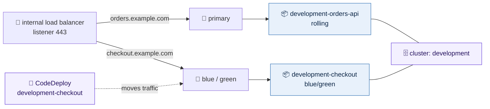

# Containers

`live/<region>/<environment>/containers` runs an environment's containerised
applications on ECS with Fargate, one `.yml` file per service. It comes after
`network`, `security-groups` and `keys`, and after `load-balancers` when a
service is routed through one. With no files it builds nothing, not even the
cluster.

ECS is AWS's container scheduler: you describe a task (one or more containers,
how much CPU and memory, which ports) and how many copies of it should run, and
ECS keeps that many running. Fargate is where they run: AWS supplies the
machine for each task, so there are no servers to patch, size or scale. Each
task gets its own network interface in a private subnet, with its own security
groups, exactly like a server would.



## What every environment gets

One cluster per environment and region, named after the environment
(`development`). It has Container Insights on, Fargate and Fargate Spot to run
on (Fargate unless a service says otherwise), and ECS Exec set up: sessions
into a container are encrypted with the environment's data key and every
command is logged to `/ecs/<environment>/exec` for a year.

## A file

A file is one service, named `<environment>-<file>`: `orders-api.yml` in
development is the service, task definition family and log group
`development-orders-api`.

```yaml
# live/us-east-1/development/containers/orders-api.yml
cpu: 512
memory: 1024
desired_count: 2
security_groups:
  - orders-api
image: 111111111111.dkr.ecr.us-east-1.amazonaws.com/orders-api:1.4.2
port: 8080
environment:
  LOG_LEVEL: info
secrets:
  DATABASE_URL: arn:aws:secretsmanager:us-east-1:111111111111:secret:development/orders-api/database-AbCdEf
health_check:
  path: /health
listener_rules:
  - load_balancer: internal
    host_header:
      - orders.example.com
    priority: 1300
```

| Key | Meaning |
|---|---|
| `cpu`, `memory` | The whole task's size: CPU units (1024 is one vCPU: 256, 512, 1024, 2048, 4096, 8192 or 16384) and MiB, in the range Fargate allows for that CPU. Default 256 and 512 |
| `desired_count` | How many tasks run (default 2); with `autoscaling`, how many it starts with |
| `tier` | The subnets the tasks run in, every zone of that tier (default `private`). Tasks never get a public address |
| `security_groups` | By name, from the security-groups stack. At least one |
| `image`, `port`, `command` | One container, named after the service: its image, the port it listens on, and its command if not the image's own |
| `environment` | Plain settings, `NAME: value`. Never secrets: a name that looks like one (`PASSWORD`, `TOKEN`, `API_KEY`…) is refused |
| `secrets` | `NAME: <ARN>` of a Secrets Manager secret (optionally `:<json-key>::`) or a Parameter Store parameter. ECS reads it when the task starts and hands the container the value; the value is never in Terraform, the plan or the task definition |
| `container_definitions` | Instead of `image` and the rest: several containers, each with `name`, `image`, `port`, `essential`, `command`, `environment`, `secrets` and a container `health_check` (`command`, `interval`, `timeout`, `retries`, `start_period`). The first with a port takes the load balancer's traffic |
| `runtime_platform.cpu_architecture` | `X86_64` (default) or `ARM64`, cheaper, if the image is built for it |
| `capacity_provider_strategy` | `FARGATE` and `FARGATE_SPOT`, each with `weight` and `base`. Spot is much cheaper and can be taken back with two minutes' notice, so it suits workers that can stop |
| `statement` | The application's own permissions: `actions` and `resources`, with `effect` if wanted. `{app}`, `{environment}` and `{region}` are filled in |
| `enable_execute_command` | ECS Exec into its containers (default true) |
| `health_check` | The load balancer's check: `path` (default `/`), `matcher` (default `200-399`), `interval`, `timeout`, `healthy_threshold`, `unhealthy_threshold` |
| `listener_rules` | As in compute: `load_balancer` (the load-balancers stack's file name), `listener` (default 443), `host_header` and/or `path_pattern`, and a `priority` of 1000 or more |
| `autoscaling` | `min_capacity`, `max_capacity`, and `target_tracking_configuration` with `predefined_metric_type` (`ECSServiceAverageCPUUtilization`, the default, `ECSServiceAverageMemoryUtilization` or `ALBRequestCountPerTarget`) and `target_value` |
| `deployment` | `strategy` (`rolling`, the default, or `blue_green`), `deployment_config_name` (blue/green only), `minimum_healthy_percent` and `maximum_percent` (rolling only, default 100 and 200), `termination_wait_time_in_minutes` (blue/green, default 5) |

A service without `listener_rules` is a worker: no target group, nothing
reaches it from a load balancer. Give it a name with the `records` stack when
it has one, pointing at the load balancer as any other name does.

Listener rule priorities share the listener with compute's groups, so pick
numbers no group uses (the plan checks this stack's own; AWS refuses a clash
between stacks when it is applied).

## Two roles per application

Every service has two roles, both assumable only by ECS tasks in this account.

| Role | Name | What it may do |
|---|---|---|
| Execution role | `<environment>-<app>-<region>-execution` | What ECS does before the app starts: pull the image from its own ECR repository, write the service's logs, read exactly the secrets listed in its file. Nothing else |
| Task role | `<environment>-<app>-<region>` | What the application's code does: the file's `statement`, plus ECS Exec's channel and log group when it is on |

The task role matters beyond its permissions. It is the application's
identity: when a container logs in to Vault with AWS auth, Vault sees this role
and so knows `orders-api` from `checkout`, the same way a server on a blueprint
is told apart by its own role ([blueprints](blueprints.md)). Roles are global,
so the name carries the region.

Logs go to `/ecs/<environment>-<app>`, kept 365 days.

## Deployments

A new version is a new task definition: a changed image tag, environment
variable or size. How it reaches the running service depends on `strategy`.

**Rolling** (the default) is ECS's own. ECS starts new tasks, waits for the
load balancer to call them healthy, then stops old ones, a few at a time,
never dropping below `minimum_healthy_percent`. Traffic shifts as tasks swap:
for a while both versions answer. If new tasks keep failing, the circuit
breaker stops the deployment and rolls back to the last version that worked.
Changing the file and applying is the deployment.

**Blue/green** hands deployments to CodeDeploy. The service has two target
groups, blue and green. CodeDeploy starts the new version in the idle one,
waits for it to be healthy, then moves the listener rule's traffic across, and
keeps the old tasks for `termination_wait_time_in_minutes` so a rollback is
instant. How the traffic moves is `deployment_config_name`:

| `deployment_config_name` | How traffic moves |
|---|---|
| `CodeDeployDefault.ECSAllAtOnce` (default) | All of it, as soon as the new tasks are healthy |
| `CodeDeployDefault.ECSCanary10Percent5Minutes`, `…Canary10Percent15Minutes` | 10% first, the rest after 5 (or 15) minutes if nothing failed |
| `CodeDeployDefault.ECSLinear10PercentEvery1Minutes`, `…Every3Minutes` | 10% more every 1 (or 3) minutes |
| a custom configuration's name | Whatever it says |

A failed deployment, or one stopped by hand, rolls back by itself.

With blue/green, Terraform registers each new task definition but does not put
it into service; that is a deployment's job. A pipeline runs
`aws deploy create-deployment` against application and deployment group
`<environment>-<app>` (the stack's `services` output lists them), with an
AppSpec naming the new task definition, the container and the port. CodeDeploy
also owns which target group is live, so Terraform leaves the service's load
balancer and the listener rule's target alone after creating them.

The plan refuses a `deployment_config_name` on a rolling service (canary and
linear exist only with CodeDeploy), a server configuration such as
`CodeDeployDefault.OneAtATime` on a service, blue/green without
`listener_rules`, and scaling on `ALBRequestCountPerTarget` with blue/green
(the target group it would count is swapped at every deployment).

## How it relates to compute

[Compute](compute.md) runs applications on EC2 servers you size and patch, and
CodeDeploy deploys onto those servers in place, by their `CodeDeploy` tag.
Containers run on Fargate: there are no servers, a deployment replaces whole
tasks, and nothing is installed onto anything.

|  | Compute (EC2) | Containers (Fargate) |
|---|---|---|
| Unit | A server, or an Auto Scaling group | A task: one or more containers |
| Identity | Instance profile; a role per app on a blueprint | Always a task role per app |
| Target group | Instances, `<env>-<group>-<hash>` | Task IPs, `<env>-<app>-<hash>` (two with blue/green) |
| Routing | `listener_rules`, priority 1000 and up | The same, on the same listeners |
| CodeDeploy | Compute platform Server, one application name in every environment, deployment groups per branch, in place | Compute platform ECS, application and group `<env>-<app>`, blue/green only |
| Rolling out | `deployment_config_name` such as `OneAtATime` | ECS rolling, or CodeDeploy all at once, canary or linear |
| CodeDeploy role | `codedeploy-<environment>-<region>` | `codedeploy-ecs-<environment>-<region>`, made when a service is blue/green |

Both can sit behind the same load balancer: a host can move from a server
group to a service by moving its listener rule from one file to the other.
