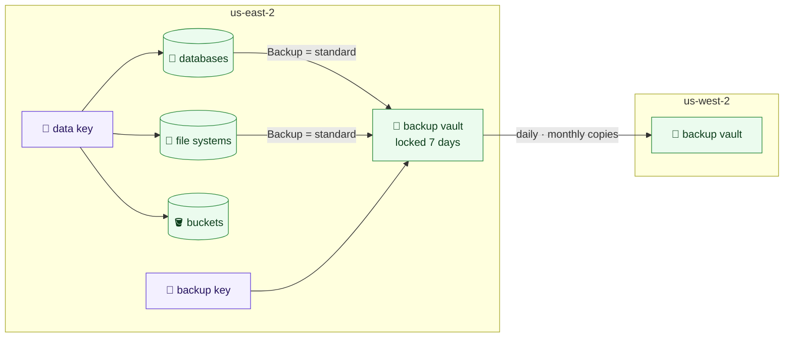

# Keys, backups, databases, file systems and buckets

Each environment's data has five stacks, applied in this order:
`live/<region>/<environment>/keys`, then `backups`, then `buckets`, `databases`
and `storage` (buckets first: SQL Server's native backups write to one). Each is our own module and a template reading the `.yml` files beside
it; with no files a stack builds nothing (except `keys` and `backups`, which
every environment has).

Every default below is fixed rather than optional: final snapshots, 35-day backups, AWS Backup with
copies to Oregon, customer-managed keys, managed passwords, TLS required, logs
exported, and file systems with a policy.



## `keys`

No settings. Three customer-managed KMS keys per environment, all multi-Region:
created in the stack's region and replicated to every other region in
`config/`, so a copy or restore there uses the same key.

| Alias | Used by |
|---|---|
| `alias/<environment>-data` | RDS, EFS, EBS, Secrets Manager, Kubernetes secrets (EKS), and AWS Backup reading them |
| `alias/<environment>-backup` | the backup vaults only |
| `alias/<environment>-messages` | SQS queues and SNS topics; SNS, EventBridge, alarms and S3 events use it as themselves, for this account ([messaging](messaging.md)) |

A backup cannot be read with the live key, nor live data with the backup key.
Each key's policy lets the account administer it through IAM, and lets only the
named services use it, in its regions, on this account's behalf. Keys rotate
yearly, have a 30-day deletion window, and are never destroyed by a plan:
destroying a key makes everything encrypted with it unreadable.

Keys are kept in Terraform rather than made in the console, because the key
policy is the access control on the data and must be reviewed like code.

## `backups`

```yaml
# live/us-east-2/operations/backups/backups.yml
daily_retention_days: 35
monthly_retention_days: 365
copy: true
```

An AWS Backup vault, encrypted with the backup key and locked so no backup is
deleted before it is 7 days old (`vault_lock: governance`, the default, lets a
principal allowed to bypass the lock remove it; `vault_lock: compliance` lets
nobody, and becomes permanent three days after the first apply); a daily backup kept 35 days and a monthly
one kept a year; each copied to a locked vault in the other region, encrypted
with the backup key's replica there. A resource joins the plan by tagging itself
`Backup = standard`, which every database and file system here does, and every
bucket with `backup: true` (the backup role has AWS's S3 backup and restore
policies).

## `databases`

One file per database. Its `engine` decides which of four kinds it is, and so
which keys it takes: a key that belongs to another kind, or to none, is refused
with a message saying where it belongs.

| Kind | Engines | Module |
|---|---|---|
| RDS | `mysql`, `postgres`, `mariadb` | `rds-instance` |
| RDS for SQL Server | `sqlserver-ex`, `sqlserver-web`, `sqlserver-se`, `sqlserver-ee` | `rds-instance` |
| RDS Custom for SQL Server | `custom-sqlserver-ee`, `custom-sqlserver-se`, `custom-sqlserver-web`, `custom-sqlserver-dev` | `rds-instance`, `rds-custom-engine-version` |
| Aurora | `aurora-postgresql`, `aurora-mysql` | `rds-cluster` |

```yaml
# live/us-east-2/production/databases/orders.yml
engine: mysql
engine_version: "8.0"
instance_class: db.t4g.medium
allocated_storage: 200
max_allocated_storage: 1000
multi_az: true
security_groups:
  - database-mysql
```

| Key | Kinds | Meaning |
|---|---|---|
| `engine` | all | One of the engines above |
| `engine_version` | all | RDS: the major version (`8.0`, `16`). SQL Server: `16.00`, or a full version such as `16.00.4185.3.v1`. RDS Custom: always a full version, AWS's or one of ours. Aurora: `16.6`, `8.0.mysql_aurora.3.08.0` |
| `instance_class` | all | The instance class; `db.serverless` for Aurora Serverless v2 |
| `allocated_storage` | RDS, SQL Server, RDS Custom | Starting GB (SQL Server at least 20) |
| `max_allocated_storage` | RDS, SQL Server | The most it grows to by itself (default five times the start). RDS Custom does not grow by itself |
| `multi_az` | RDS, SQL Server, RDS Custom | A standby in another zone. Default `true`, except SQL Server Express and Web, which default to `false` |
| `security_groups` | all | From the environment's security-groups stack, by name |
| `timezone`, `character_set_name` | SQL Server, RDS Custom | The Windows time zone (`Eastern Standard Time`; default UTC) and the server collation (default `SQL_Latin1_General_CP1_CI_AS`). Both are fixed once the database exists |
| `options` | SQL Server | Option name to its settings: see below |
| `domain` | SQL Server | An AWS Managed Microsoft AD directory (`d-...`) to join |
| `domain_fqdn`, `domain_ou`, `domain_auth_secret_arn`, `domain_dns_ips` | SQL Server, RDS Custom | A self-managed Active Directory to join, all four together. On RDS Custom, AWS documents domain joins but not this way of asking for one at creation: try it in a sandbox before relying on it |
| `license_model` | RDS Custom | `license-included` (default) or `bring-your-own-media` |
| `instances` | Aurora | How many instances: the writer, then readers (default 2) |
| `serverlessv2_scaling_configuration` | Aurora | `min_capacity` and `max_capacity` in ACUs, for `db.serverless` only |

Built in, for every database:

- in the `data` tier, never public;
- encrypted with the environment's data key;
- the admin password (`dbadmin`) kept and rotated by RDS in Secrets Manager
  (`manage_master_user_password`), never passing through Terraform; applications
  read it there, or use IAM authentication, which is on where the engine has it
  (not SQL Server). RDS Custom is the exception: see below;
- its own parameter group requiring TLS on every connection (`rds.force_ssl` on
  SQL Server and PostgreSQL, `require_secure_transport` on MySQL) and logging
  slow statements;
- logs exported to CloudWatch, in log groups created first so they are kept 365
  days: MySQL and MariaDB error and slow-query logs, PostgreSQL's log and upgrade
  log, SQL Server's agent and error logs;
- 35 days of automated backups, plus the AWS Backup plan; a final snapshot
  (`<name>-final`) whenever it is deleted; deletion protection, and never
  destroyed by a plan;
- Performance Insights and enhanced monitoring, through one monitoring role per
  environment.

The output gives each database's kind, endpoint (host and port), port, the
reader endpoint for Aurora, and the ARN of the secret holding its password.

### Three ways to run SQL Server

| | RDS for SQL Server | RDS Custom for SQL Server | SQL Server on EC2 |
|---|---|---|---|
| Who runs Windows and SQL Server | AWS | AWS, until you pause it | We do |
| Getting onto the server | No | Yes: Session Manager or RDP | Yes |
| Install software on the server (DBAmp, linked-server drivers, agents) | No | Yes | Yes |
| sysadmin | No | Yes | Yes |
| High availability | Multi-AZ, built in | Multi-AZ, built in | Our own cluster (today: two nodes and a quorum server) |
| Backups and patching | AWS | AWS (backups); patches as new versions we choose | We do |
| Editions | Express, Web, Standard, Enterprise | Web, Standard, Enterprise; Developer from our own media | Any |
| Here | `databases`, `sqlserver-*` | `databases`, `custom-sqlserver-*` | `compute` |

Choose RDS whenever the database is only a database: it is the least work and
the least to get wrong. Choose RDS Custom when something has to be installed on
the server itself: a linked server such as DBAmp (Salesforce), a third-party
driver, or an agent that needs sysadmin. Keep EC2 for what neither allows, such
as a failover cluster instance shared with other servers, or an edition or
version AWS does not offer.

### Editions

| Edition | Engine | Multi-AZ | Options | Notes |
|---|---|---|---|---|
| Express | `sqlserver-ex` | No | Native backup only | Free; `db.t3.micro` to `db.t3.xlarge`; Microsoft caps each database at 10 GB |
| Web | `sqlserver-web`, `custom-sqlserver-web` | From SQL Server 2022 (16.00.4215.2) | Native backup only | Only for public web workloads, under Microsoft's licence terms; RDS Custom up to 4xlarge |
| Standard | `sqlserver-se`, `custom-sqlserver-se` | Yes | All, TDE from SQL Server 2019 | The usual choice |
| Enterprise | `sqlserver-ee`, `custom-sqlserver-ee` | Yes | All | Larger instances, every feature |
| Developer | `custom-sqlserver-dev` | Yes | (RDS Custom) | Not for production; only from our own media |

### SQL Server options

```yaml
options:
  SQLSERVER_BACKUP_RESTORE:
    bucket: sqlserver-backups
  TDE: {}
  SSRS:
    MAX_MEMORY: 50
```

| Option | Editions | Versions | What it is |
|---|---|---|---|
| `SQLSERVER_BACKUP_RESTORE` | all | all | Native `.bak` backups to and restores from S3. `bucket` is a bucket from the buckets stack, by its file name; a role made here may read and write it and use the data key |
| `TDE` | Standard, Enterprise | Enterprise all; Standard 2019 on | Transparent data encryption. Once on, it stays |
| `SSIS` | Standard, Enterprise | 2016 to 2022 | Integration Services; turns on the CLR |
| `SSRS` | Standard, Enterprise | 2016 to 2022 | Reporting Services, on port 8443 (or `port`) |
| `PBIRS` | Standard, Enterprise | 2025 | Power BI Report Server, which replaces SSRS |
| `SSAS` | Standard, Enterprise | 2016 to 2019 | Analysis Services, on port 2383; not Multi-AZ |

Any other key under an option is an AWS option setting by its own name
(`MAX_MEMORY`, `MODE`). SSIS, SSRS, PBIRS and SSAS sign people in through
Windows, so they need the database joined to Active Directory. SSIS and SSAS
also move files through RDS's S3 integration, which is not built here yet.

### Active Directory

Today's servers use the company's own (self-managed) domain:

```yaml
domain_fqdn: corp.example.com
domain_ou: OU=RDS,OU=Servers,DC=corp,DC=example,DC=com
domain_auth_secret_arn: arn:aws:secretsmanager:us-east-2:111111111111:secret:production-rds-domain-join
domain_dns_ips:
  - 10.40.0.10
  - 10.40.0.11
```

The secret holds a service account allowed to join computers to that OU, as
`SELF_MANAGED_ACTIVE_DIRECTORY_USERNAME` (no domain prefix) and
`SELF_MANAGED_ACTIVE_DIRECTORY_PASSWORD`. It must be encrypted with a
customer-managed key that lets `rds.amazonaws.com` decrypt, and its resource
policy must let RDS read it. `domain_dns_ips` is two domain controllers (the
same one twice if there is only one), and the database's security groups must
let it reach them. For AWS Managed Microsoft AD, `domain: d-...` is enough:
the stack makes the role RDS joins it with.

### RDS Custom for SQL Server

```yaml
# live/us-east-2/production/databases/salesforce-sync.yml
# RDS Custom, not RDS: DBAmp is a Salesforce linked server installed on the server itself, which RDS does not allow.
engine: custom-sqlserver-se
engine_version: 16.00.4195.2.v1
instance_class: db.m6i.xlarge
allocated_storage: 200
multi_az: true
security_groups:
  - salesforce-sync-database
```

RDS still makes the server, takes the backups and fails over to the standby,
but we may sign in and change Windows and SQL Server. What it does not have:
parameter or option groups (settings are made on the server), Performance
Insights, enhanced monitoring, IAM authentication, log exports, read replicas,
automatic minor upgrades, or storage that grows by itself. The plan refuses
those keys.

- **Instance profile.** The servers run as `AWSRDSCustom-<environment>-<region>`,
  made here once per environment and region (AWS requires the `AWSRDSCustom`
  prefix), with AWS's `AmazonRDSCustomInstanceProfileRolePolicy` and use of the
  data key.
- **Password.** RDS Custom cannot keep its own password in Secrets Manager, so
  Terraform makes one at creation and passes it, write-only, both to RDS and to
  the secret `rds-custom/<name>/dbadmin` (encrypted with the data key). It is
  never in state or a plan. It is not rotated: change it on the server, then in
  the secret.
- **Deletion protection** is off, as RDS Custom does not support it; the plan
  still never destroys the database.

**Versions of our own.** A license-included database names one of AWS's
versions (`aws rds describe-db-engine-versions --engine custom-sqlserver-se`).
To use our own SQL Server licence and media, or a Developer edition, build a
Windows Server 2019 AMI with SQL Server installed as AWS's RDS Custom guide
describes, and describe it in `engine-versions/<name>.yml` beside the database
files:

```yaml
# live/us-east-2/production/databases/engine-versions/sqlserver-2022-se.yml
engine: custom-sqlserver-se
engine_version: 16.00.4185.3.byom-v1
source_image_id: ami-0123456789abcdef0
description: SQL Server 2022 Standard CU15 from our media
```

The `engine_version` is SQL Server's own build and a name of ours. A database
uses it by naming it as its `engine_version`, with
`license_model: bring-your-own-media`; the plan refuses a version no file
defines, or one defined for another engine. A version cannot be deleted while
a database runs it, so a new image is a new file with a new name.

**Getting onto the server.** Session Manager is the way in: it needs no open
port and is logged. Start a session from the console (Systems Manager, then
Session Manager) or with `aws ssm start-session --target <instance id>`; the
instance ID is on the database in the RDS console. For RDP, the database's
security group allows 3389 only from `hq`, and Session Manager can forward it
instead (`AWS-StartPortForwardingSession`). The Windows administrator password
is decrypted, as for any EC2 instance, with the key pair RDS made for the
server: its private key is in Secrets Manager under
`do-not-delete-rds-custom-<database>-...`.

**Pause automation before changing anything.** RDS Custom watches the server
and repairs what it does not expect. Before installing software or changing
settings, pause it for up to 24 hours:

```sh
aws rds modify-db-instance --db-instance-identifier production-salesforce-sync \
  --automation-mode all-paused --resume-full-automation-mode-minutes 120
```

Resume it with `--automation-mode full` when finished. Terraform has no
setting for this, so it is always done by hand. Leave RDS Custom's own agent
and services alone, or it marks the server as unsupported.

**Endpoints.** The data tier has no route to the internet, so RDS Custom reaches
AWS through VPC endpoints, which the endpoints stack must have, with 443 open
to them from the database:

| Endpoint | Type |
|---|---|
| `s3` | gateway |
| `ssm`, `ssmmessages`, `ec2messages` | interface |
| `ec2` | interface |
| `logs`, `monitoring`, `events` | interface |
| `secretsmanager` | interface |
| `sqs` | interface, for Multi-AZ |

Multi-AZ also needs its security group to allow TCP 1120 from itself, for
replication to the standby.

### Aurora

```yaml
# live/us-east-2/production/databases/reporting.yml
engine: aurora-postgresql
engine_version: "16.6"
instance_class: db.r6g.large
instances: 2
security_groups:
  - reporting-database
```

A cluster and its instances, `<name>-1` the writer and the rest readers in other
zones that take over by themselves. The endpoint always reaches the writer, and
the reader endpoint spreads reads across the readers. Storage grows by itself,
so there are no storage keys. Everything built in for RDS applies too: the data
key, the managed password, IAM authentication, TLS required (cluster parameter
group), logs exported (PostgreSQL's log; MySQL's error and slow-query logs) to
log groups kept 365 days, 35 days of backups, a final snapshot, deletion
protection, Performance Insights and enhanced monitoring on each instance.

For Serverless v2, each instance scales between two capacities, in Aurora
capacity units (ACUs, about 2 GB of memory each):

```yaml
engine: aurora-mysql
engine_version: 8.0.mysql_aurora.3.08.0
instance_class: db.serverless
instances: 2
serverlessv2_scaling_configuration:
  min_capacity: 0.5
  max_capacity: 16
```

`min_capacity: 0` lets it pause when idle, on versions that support it.

## `storage`

One file per EFS file system.

```yaml
# live/us-east-2/production/storage/sftp.yml
tier: data
security_groups:
  - accesscontrol-efs
access_points:
  uploads:
    posix_user:
      uid: 1001
      gid: 1001
    root_directory:
      path: /uploads
```

A mount target in every zone of the chosen tier (default `data`), encrypted
with the data key, elastic throughput, files unused for 30 days moved to cheaper
storage and brought back when read, and a file system policy that refuses
unencrypted connections and allows mounting only through its own mount targets.
Access points give clients a fixed directory and POSIX user (permissions
default `0750`). The policy grants the account, so a client also needs
`elasticfilesystem:ClientMount` and `ClientWrite` in its role (the `mount-files`
example policy) and mounts with TLS and IAM: `mount -t efs -o tls,iam`. Backed up by the environment's plan (EFS's own automatic
backups are off, so nothing is taken twice), and never destroyed by a plan.

## `buckets`

One file per S3 bucket, for the environment's own data (application files,
exports, uploads). Log buckets are the logging stack's, not these.

```yaml
# live/us-east-2/production/buckets/reports.yml
backup: true
expiration:
  days: 400
```

| Key | Meaning |
|---|---|
| `backup` | Back it up with the environment's AWS Backup plan (default `false`) |
| `expiration` | `days` before objects expire; leave out to keep them |
| `noncurrent_version_expiration` | `noncurrent_days` an overwritten or deleted object's old version is kept (default 90) |
| `object_lock_configuration` | `default_retention`, with `mode` (`GOVERNANCE`, or `COMPLIANCE`, which no one can override) and `days`: objects that must not change or be deleted. Only when the bucket is first created |
| `cors_rule` | Rules for browsers using the bucket directly (`allowed_methods`, `allowed_origins`, `allowed_headers`, `max_age_seconds`); origins are named, never `*` |

The bucket is named `<environment>-<file>-<account>-<region>` (the plan refuses
one longer than S3's 63 characters). Built in: never public, no ACLs, versioned,
every object encrypted with the environment's data key (with a bucket key, to
keep KMS cost down), anything not over TLS refused, incomplete uploads cleaned
up after 7 days, and never destroyed by a plan. No website hosting: public
content goes through CloudFront with a private bucket, and the `s3-bucket`
module takes the policy statement a distribution's output gives.
