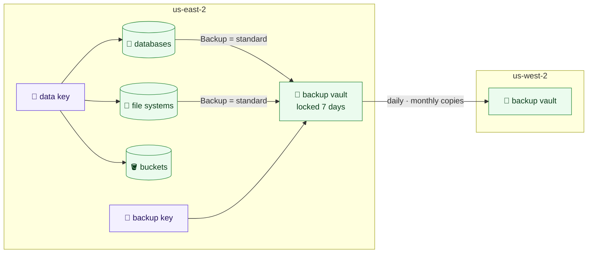

# Keys, backups, databases, file systems and buckets

Each environment's data has five stacks, applied in this order:
`live/<region>/<environment>/keys`, then `backups`, then `buckets`, `databases`
and `storage` (buckets first: SQL Server's native backups write to one). Each is our own module and a template reading the `.yml` files in
the stack's `config/` folder; with no files a stack builds nothing (except
`keys`, which every environment has).

The files are written in Terraform's own arguments. What is fixed is fixed in
the modules rather than offered: final snapshots, 35-day automated backups,
locked backup vaults, customer-managed keys, managed passwords, TLS required,
logs exported, and file systems with a policy.



## `keys`

No settings. Three customer-managed KMS keys per environment, all multi-Region:
created in the stack's region and replicated to every other region in
`config/`, so a copy or restore there uses the same key.

| Alias | Used by |
|---|---|
| `alias/<environment>-data` | RDS, EFS, EBS, Secrets Manager, Kubernetes secrets (EKS), and AWS Backup reading them |
| `alias/<environment>-backup` | the backup vaults only |
| `alias/<environment>-messages` | SQS queues and SNS topics; SNS, EventBridge, alarms and S3 events use it as themselves, for this account ([messaging](messaging.md)) |

A backup cannot be read with the live key, nor live data with the backup key.
Each key's policy lets the account administer it through IAM, and lets only the
named services use it, in its regions, on this account's behalf. Keys rotate
yearly, have a 30-day deletion window, and are never destroyed by a plan:
destroying a key makes everything encrypted with it unreadable.

Keys are kept in Terraform rather than made in the console, because the key
policy is the access control on the data and must be reviewed like code.

## `backups`

Two kinds of file: the vaults, and the plans that back up into them.

```text
live/us-east-2/operations/backups/
└── config/
    ├── backup-vault/
    │   ├── operations.yml
    │   └── operations-us-west-2.yml
    └── backup-plan/
        └── operations.yml
```

```yaml
# live/us-east-2/operations/backups/config/backup-vault/operations-us-west-2.yml
region: us-west-2
kms_key_arn: operations-backup
lock_configuration:
  min_retention_days: 7
  max_retention_days: 3650
```

A vault is an `aws_backup_vault`, named after its file, and its
`aws_backup_vault_lock_configuration`.

| Key | Terraform argument |
|---|---|
| `region` | `aws_backup_vault.region`: leave it out for the stack's own region; a copy vault names another region in `config/` |
| `kms_key_arn` | The backup key by its alias name (`operations-backup`, from the keys stack), found in the vault's region; or a key's ARN. Required |
| `lock_configuration` | `min_retention_days`, `max_retention_days`, `changeable_for_days`. Required: every vault is locked |
| `tags` | The vault's tags |

Without `changeable_for_days` the lock is in governance mode: no backup is
deleted before `min_retention_days` except by a principal allowed to bypass the
lock. With it, the lock is in compliance mode: nobody, ever, can, and it becomes
permanent once those days have passed. It cannot be undone.

```yaml
# live/us-east-2/operations/backups/config/backup-plan/operations.yml
rule:
  - rule_name: daily
    target_vault_name: operations
    schedule: cron(0 7 * * ? *)
    start_window: 60
    completion_window: 360
    lifecycle:
      delete_after: 35
    copy_action:
      - destination_vault_arn: operations-us-west-2
        lifecycle:
          delete_after: 35
  - rule_name: monthly
    target_vault_name: operations
    schedule: cron(0 8 1 * ? *)
    start_window: 60
    completion_window: 720
    lifecycle:
      delete_after: 365
    copy_action:
      - destination_vault_arn: operations-us-west-2
        lifecycle:
          delete_after: 365
```

A plan is an `aws_backup_plan`, named after its file, with its `rule` list as
the provider takes it: `rule_name`, `target_vault_name`, `schedule`,
`schedule_expression_timezone`, `start_window`, `completion_window`,
`enable_continuous_backup`, `recovery_point_tags`, `lifecycle`
(`delete_after`, `cold_storage_after`) and `copy_action` (`destination_vault_arn`
and its own `lifecycle`). `target_vault_name` is a vault in this stack, in the
stack's region. `destination_vault_arn` is a vault in this stack by name, or any
vault's ARN; a copy encrypted with the backup key's replica in that region can
be restored there.

The plan refuses a rule that keeps backups for less than its vault's
`min_retention_days`, or longer than its `max_retention_days` (forever counts as
longer): the vault lock would fail every backup. It also refuses a vault
without a lock, a key that is not an argument, and a vault, a region or a copy
destination that does not exist.

Fixed, for every plan: a resource joins it by tagging itself `Backup = standard`,
which every database and file system here does, and every bucket tagged
`Backup: standard`. Each plan has that one selection (`<plan>-tagged`), made with
the environment's backup role, `backup-<environment>`, which has AWS's backup
and restore policies, including S3's.

## `databases`

One file per database in `config/`, written in `aws_db_instance`'s arguments
(Aurora: `aws_rds_cluster`'s). Its `engine` decides which of four kinds it is,
and so which arguments it takes: one that belongs to another kind, or to none,
is refused with a message saying where it belongs. Nothing is defaulted for
it: leave out `multi_az` and there is no standby, as in AWS; leave out
`max_allocated_storage` and storage does not grow by itself.

```text
live/us-east-2/production/databases/
└── config/
    ├── orders.yml
    ├── billing.yml
    ├── salesforce-sync.yml
    └── engine-versions/
        └── sqlserver-2022-se.yml
```

A database can instead name a blueprint, `blueprint: sqlserver/v1` or
`aurora-postgres/v1`, and give only its security groups and, if it needs one, a
larger size. The approved engine, version, Multi-AZ and options are the
blueprint's, written in the same arguments ([blueprints](blueprints.md#databases)).

| Kind | Engines | Module |
|---|---|---|
| RDS | `mysql`, `postgres`, `mariadb` | `rds-instance` |
| RDS for SQL Server | `sqlserver-ex`, `sqlserver-web`, `sqlserver-se`, `sqlserver-ee` | `rds-instance` |
| RDS Custom for SQL Server | `custom-sqlserver-ee`, `custom-sqlserver-se`, `custom-sqlserver-web`, `custom-sqlserver-dev` | `rds-instance`, `rds-custom-engine-version` |
| Aurora | `aurora-postgresql`, `aurora-mysql` | `rds-cluster` |

```yaml
# live/us-east-2/production/databases/config/orders.yml
engine: mysql
engine_version: "8.0"
instance_class: db.t4g.medium
allocated_storage: 200
max_allocated_storage: 1000
multi_az: true
vpc_security_group_ids:
  - database-mysql
```

| Key | Kinds | Meaning |
|---|---|---|
| `engine` | all | One of the engines above |
| `engine_version` | all | RDS: the major version (`8.0`, `16`). SQL Server: `16.00`, or a full version such as `16.00.4185.3.v1`. RDS Custom: always a full version, AWS's or one of ours. Aurora: `16.6`, `8.0.mysql_aurora.3.08.0` |
| `instance_class` | all | The instance class; `db.serverless` for Aurora Serverless v2 |
| `allocated_storage` | RDS, SQL Server, RDS Custom | Starting GB |
| `max_allocated_storage` | RDS, SQL Server | The most it grows to by itself. RDS Custom does not grow by itself |
| `multi_az` | RDS, SQL Server, RDS Custom | A standby in another zone |
| `license_model` | SQL Server, RDS Custom | `license-included`, or `bring-your-own-media` for an RDS Custom version of our own |
| `vpc_security_group_ids` | all | Groups from the environment's security-groups stack, by name, or `sg-` IDs |
| `tags` | all | Extra tags on the database and what comes with it, over the provider's defaults. `Name` and `Backup` are the stack's own and refused |
| `timezone`, `character_set_name` | SQL Server, RDS Custom | The Windows time zone (`Eastern Standard Time`; AWS's default is UTC) and the server collation. Both are fixed once the database exists |
| `option` | SQL Server | The option group's options: see below |
| `domain`, `domain_iam_role_name` | SQL Server | An AWS Managed Microsoft AD directory (`d-...`) to join, and the role RDS joins it with, both together |
| `domain_fqdn`, `domain_ou`, `domain_auth_secret_arn`, `domain_dns_ips` | SQL Server, RDS Custom | A self-managed Active Directory to join. On RDS Custom, AWS documents domain joins but not this way of asking for one at creation: try it in a sandbox before relying on it |
| `password_wo_version` | RDS Custom | The version of the write-only admin password; required, start at 1 |
| `count` | Aurora | How many `aws_rds_cluster_instance`: the writer, then readers. Required |
| `serverlessv2_scaling_configuration` | Aurora | `min_capacity` and `max_capacity` in ACUs, for `db.serverless` only |

The plan checks what would otherwise fail late or confusingly: the engine,
the arguments each kind takes, the form of `engine_version` (the parameter
group's family is made from it), a version of our own that no file in
`engine-versions/` defines, `domain` without its role, and Serverless v2
without its capacities. Which editions and versions take which options, and
which can be Multi-AZ, is left to AWS, which refuses the request at once.

Built in, for every database:

- in the `data` tier, never public: the subnet group is the data subnets of
  the calculated layout, one per zone;
- encrypted with the environment's data key;
- the admin password (`dbadmin`) kept and rotated by RDS in Secrets Manager
  (`manage_master_user_password`), never passing through Terraform; applications
  read it there, or use IAM authentication, which is on where the engine has it
  (not SQL Server). RDS Custom is the exception: see below;
- its own parameter group requiring TLS on every connection (`rds.force_ssl` on
  SQL Server and PostgreSQL, `require_secure_transport` on MySQL) and logging
  slow statements; with the SSIS option, the CLR is turned on too;
- logs exported to CloudWatch, in log groups created first so they are kept 365
  days: MySQL and MariaDB error and slow-query logs, PostgreSQL's log and upgrade
  log, SQL Server's agent and error logs;
- 35 days of automated backups, plus the AWS Backup plan; a final snapshot
  (`<name>-final`) whenever it is deleted; deletion protection, and never
  destroyed by a plan;
- Performance Insights and enhanced monitoring, through one monitoring role per
  environment and region, `rds-monitoring-<environment>-<region>`.

The output gives each database's kind, endpoint (host and port), port, the
reader endpoint for Aurora, and the ARN of the secret holding its password.

### Three ways to run SQL Server

| | RDS for SQL Server | RDS Custom for SQL Server | SQL Server on EC2 |
|---|---|---|---|
| Who runs Windows and SQL Server | AWS | AWS, until you pause it | We do |
| Getting onto the server | No | Yes: Session Manager or RDP | Yes |
| Install software on the server (DBAmp, linked-server drivers, agents) | No | Yes | Yes |
| sysadmin | No | Yes | Yes |
| High availability | Multi-AZ, built in | Multi-AZ, built in | Our own cluster (today: two nodes and a quorum server) |
| Backups and patching | AWS | AWS (backups); patches as new versions we choose | We do |
| Editions | Express, Web, Standard, Enterprise | Web, Standard, Enterprise; Developer from our own media | Any |
| Here | `databases`, `sqlserver-*` | `databases`, `custom-sqlserver-*` | `compute` |

Choose RDS whenever the database is only a database: it is the least work and
the least to get wrong. Choose RDS Custom when something has to be installed on
the server itself: a linked server such as DBAmp (Salesforce), a third-party
driver, or an agent that needs sysadmin. Keep EC2 for what neither allows, such
as a failover cluster instance shared with other servers, or an edition or
version AWS does not offer.

### SQL Server on EC2: staging's cluster

Staging runs its own: two nodes and a quorum witness, in `compute`
(`config/infra/sqlserver.yml`, `config/infra/sqlserver-quorum.yml`). What it is
made of, and where each part is written:

| Part | Where |
|---|---|
| Two nodes, one per zone, each with its own address and the cluster's and listener's in its subnet | `compute`, pinned members with `private_ip` and `secondary_private_ips` ([compute](compute.md#addresses-aws-assigned-or-chosen)) |
| The quorum witness, a file share on a small server in the third zone | `compute`, pinned to `data-az3` |
| The nodes reaching each other (cluster, availability group replication, RPC, SMB) and the witness | `security-groups`: `sqlserver-cluster`, `sqlserver-quorum` |
| Apps reaching SQL Server on 1433 | `security-groups`: `sqlserver`, admitting `sqlserver-clients` |
| Windows Update, CData and DBAmp | a route out of the `data` tier through the hub's NAT ([network](network.md#a-route-for-one-tier)), and 443 and 80 out in the two groups |
| Joining the domain | `domain-join`, by the `Domain` tag ([systems manager](systems-manager.md#domain-join)) |
| Session Manager, the join secret | the `sqlserver` role and instance profile in `global/shared/iam` |

Done in the domain, not here: the cluster's and listener's computer objects,
created in the OU beforehand, with the cluster allowed to create the listener;
the service accounts (group managed service accounts) and the `MSSQLSvc` names
for Kerberos.

### Editions

| Edition | Engine | Multi-AZ | Options | Notes |
|---|---|---|---|---|
| Express | `sqlserver-ex` | No | Native backup only | Free; `db.t3.micro` to `db.t3.xlarge`; Microsoft caps each database at 10 GB |
| Web | `sqlserver-web`, `custom-sqlserver-web` | From SQL Server 2022 (16.00.4215.2) | Native backup only | Only for public web workloads, under Microsoft's licence terms; RDS Custom up to 4xlarge |
| Standard | `sqlserver-se`, `custom-sqlserver-se` | Yes | All, TDE from SQL Server 2019 | The usual choice |
| Enterprise | `sqlserver-ee`, `custom-sqlserver-ee` | Yes | All | Larger instances, every feature |
| Developer | `custom-sqlserver-dev` | Yes | (RDS Custom) | Not for production; only from our own media |

### SQL Server options

`option` is the `option` list of the database's `aws_db_option_group`, as the
provider takes it:

```yaml
option:
  - option_name: SQLSERVER_BACKUP_RESTORE
    option_settings:
      - name: IAM_ROLE_ARN
        value: production-sqlserver-backups
  - option_name: TDE
  - option_name: SSRS
    port: 8443
    vpc_security_group_memberships:
      - billing-database
    option_settings:
      - name: MAX_MEMORY
        value: "50"
```

Each option takes `option_name`, `port`, `version`,
`vpc_security_group_memberships` (groups by name or `sg-` ID) and
`option_settings` (`name` and `value`). `IAM_ROLE_ARN` names a role, which the
stack finds by name; an ARN passes through.

| Option | Editions | Versions | What it is |
|---|---|---|---|
| `SQLSERVER_BACKUP_RESTORE` | all | all | Native `.bak` backups to and restores from S3, through the role `IAM_ROLE_ARN` names |
| `TDE` | Standard, Enterprise | Enterprise all; Standard 2019 on | Transparent data encryption. Once on, it stays |
| `SSIS` | Standard, Enterprise | 2016 to 2022 | Integration Services; turns on the CLR |
| `SSRS` | Standard, Enterprise | 2016 to 2022 | Reporting Services, usually on port 8443 |
| `PBIRS` | Standard, Enterprise | 2025 | Power BI Report Server, which replaces SSRS |
| `SSAS` | Standard, Enterprise | 2016 to 2019 | Analysis Services, usually on port 2383; not Multi-AZ |

SSIS, SSRS, PBIRS and SSAS sign people in through Windows, so they need the
database joined to the domain ([below](#the-domain)). SSIS and SSAS also move files through
RDS's S3 integration, which is not built here yet.

**The native backup role** is a workload role in the iam stack
([global](global.md#iam)), one per environment, which RDS assumes:

```yaml
# live/global/shared/iam/config/role/production-sqlserver-backups.yml
description: Native SQL Server backups to production's sqlserver-backups bucket
assume_role_policy:
  statement:
    - effect: Allow
      actions:
        - sts:AssumeRole
      principals:
        - type: Service
          identifiers:
            - rds.amazonaws.com
statement:
  - effect: Allow
    actions:
      - s3:ListBucket
      - s3:GetBucketLocation
    resources:
      - arn:aws:s3:::production-sqlserver-backups-*
  - effect: Allow
    actions:
      - s3:GetObject
      - s3:PutObject
      - s3:ListMultipartUploadParts
      - s3:AbortMultipartUpload
    resources:
      - arn:aws:s3:::production-sqlserver-backups-*/*
  - effect: Allow
    actions:
      - kms:Encrypt
      - kms:Decrypt
      - kms:ReEncrypt*
      - kms:GenerateDataKey*
      - kms:DescribeKey
    resources:
      - "*"
    condition:
      - test: ForAnyValue:StringEquals
        variable: kms:ResourceAliases
        values:
          - alias/production-data
```

### The domain

There is no Active Directory of our own. The domain is Entra Domain Services,
a managed domain reached over the corporate site's VPN, and RDS joins it as a
self-managed domain:

```yaml
domain_fqdn: aadds.example.com
domain_ou: OU=RDS,DC=aadds,DC=example,DC=com
domain_auth_secret_arn: arn:aws:secretsmanager:us-east-2:111111111111:secret:production-rds-domain-join
domain_dns_ips:
  - 172.16.10.4
  - 172.16.10.5
```

The secret holds a service account allowed to join computers to that OU, as
`SELF_MANAGED_ACTIVE_DIRECTORY_USERNAME` (no domain prefix) and
`SELF_MANAGED_ACTIVE_DIRECTORY_PASSWORD`. It must be encrypted with a
customer-managed key that lets `rds.amazonaws.com` decrypt, and its resource
policy must let RDS read it. `domain_dns_ips` is the managed domain's two
domain controller addresses, the same ones its site forwards the domain to
([network](network.md#dns-with-the-sites)), and the database's security groups
must let it reach them. For AWS Managed Microsoft AD instead (the primary hub's
`directory` output, [network](network.md#directory-aws-managed-microsoft-ad)), give `domain: d-...` and
`domain_iam_role_name`, a role in the iam stack that `rds` assumes, with AWS's
`service-role/AmazonRDSDirectoryServiceAccess`.

### RDS Custom for SQL Server

```yaml
# live/us-east-2/production/databases/config/salesforce-sync.yml
engine: custom-sqlserver-se
engine_version: 16.00.4195.2.v1
license_model: license-included
instance_class: db.m6i.xlarge
allocated_storage: 200
multi_az: true
password_wo_version: 1
vpc_security_group_ids:
  - salesforce-sync-database
```

RDS Custom, not RDS, because DBAmp is a Salesforce linked server installed on
the server itself, which RDS does not allow. RDS still makes the server, takes the backups and fails over to the standby,
but we may sign in and change Windows and SQL Server. What it does not have:
parameter or option groups (settings are made on the server), Performance
Insights, enhanced monitoring, IAM authentication, log exports, read replicas,
automatic minor upgrades, or storage that grows by itself. The plan refuses
those arguments.

- **Instance profile.** The servers run as `AWSRDSCustom-<environment>-<region>`,
  made here once per environment and region (AWS requires the `AWSRDSCustom`
  prefix), with AWS's `AmazonRDSCustomInstanceProfileRolePolicy` and use of the
  data key.
- **Password.** RDS Custom cannot keep its own password in Secrets Manager, so
  Terraform makes one at creation and passes it, write-only, both to RDS and to
  the secret `rds-custom/<name>/dbadmin` (encrypted with the data key). It is
  never in state or a plan. Raise `password_wo_version` by one to set a new
  password on the database and in the secret together.
- **Deletion protection** is off, as RDS Custom does not support it; the plan
  still never destroys the database.

**Versions of our own.** A license-included database names one of AWS's
versions (`aws rds describe-db-engine-versions --engine custom-sqlserver-se`).
To use our own SQL Server licence and media, or a Developer edition, build a
Windows Server 2019 AMI with SQL Server installed as AWS's RDS Custom guide
describes, and describe it in `config/engine-versions/<name>.yml`, in
`aws_rds_custom_db_engine_version`'s arguments:

```yaml
# live/us-east-2/production/databases/config/engine-versions/sqlserver-2022-se.yml
engine: custom-sqlserver-se
engine_version: 16.00.4185.3.byom-v1
source_image_id: ami-0123456789abcdef0
description: SQL Server 2022 Standard CU15 from our media
```

The `engine_version` is SQL Server's own build and a name of ours. A database
uses it by naming it as its `engine_version`, with
`license_model: bring-your-own-media`; the plan refuses a version no file
defines, or one defined for another engine. A version cannot be deleted while
a database runs it, so a new image is a new file with a new name.

**Getting onto the server.** Session Manager is the way in: it needs no open
port and is logged. Start a session from the console (Systems Manager, then
Session Manager) or with `aws ssm start-session --target <instance id>`; the
instance ID is on the database in the RDS console. For RDP, the database's
security group allows 3389 only from the office's range (`cidr_ipv4`), and Session Manager can forward it
instead (`AWS-StartPortForwardingSession`). The Windows administrator password
is decrypted, as for any EC2 instance, with the key pair RDS made for the
server: its private key is in Secrets Manager under
`do-not-delete-rds-custom-<database>-...`.

**Pause automation before changing anything.** RDS Custom watches the server
and repairs what it does not expect. Before installing software or changing
settings, pause it for up to 24 hours:

```sh
aws rds modify-db-instance --db-instance-identifier production-salesforce-sync \
  --automation-mode all-paused --resume-full-automation-mode-minutes 120
```

Resume it with `--automation-mode full` when finished. Terraform has no
setting for this, so it is always done by hand. Leave RDS Custom's own agent
and services alone, or it marks the server as unsupported.

**Endpoints.** The data tier has no route to the internet by default, so RDS Custom reaches
AWS through VPC endpoints, which the endpoints stack must have, with 443 open
to them from the database:

| Endpoint | Type |
|---|---|
| `s3` | gateway |
| `ssm`, `ssmmessages`, `ec2messages` | interface |
| `ec2` | interface |
| `logs`, `monitoring`, `events` | interface |
| `secretsmanager` | interface |
| `sqs` | interface, for Multi-AZ |

Multi-AZ also needs its security group to allow TCP 1120 from itself, for
replication to the standby.

### Aurora

```yaml
# live/us-east-2/production/databases/config/reporting.yml
engine: aurora-postgresql
engine_version: "16.6"
instance_class: db.r6g.large
count: 2
vpc_security_group_ids:
  - reporting-database
```

A cluster and `count` instances, `<name>-1` the writer and the rest readers in other
zones that take over by themselves. The endpoint always reaches the writer, and
the reader endpoint spreads reads across the readers. Storage grows by itself,
so there are no storage arguments. `count` is Terraform's own, rather than a list of
instances, since every instance is the same but for its place in line. Everything built in for RDS applies too: the data
key, the managed password, IAM authentication, TLS required (cluster parameter
group), logs exported (PostgreSQL's log; MySQL's error and slow-query logs) to
log groups kept 365 days, 35 days of backups, a final snapshot, deletion
protection, Performance Insights and enhanced monitoring on each instance.

For Serverless v2, each instance scales between two capacities, in Aurora
capacity units (ACUs, about 2 GB of memory each):

```yaml
engine: aurora-mysql
engine_version: 8.0.mysql_aurora.3.08.0
instance_class: db.serverless
count: 2
serverlessv2_scaling_configuration:
  min_capacity: 0.5
  max_capacity: 16
```

`min_capacity: 0` lets it pause when idle, on versions that support it.

## `storage`

One file per EFS file system, in the stack's `config/`.

```yaml
# live/us-east-2/production/storage/config/sftp.yml
tags:
  Backup: standard
mount_targets:
  - subnet_id: data-az1
    security_groups:
      - accesscontrol-efs
  - subnet_id: data-az2
    security_groups:
      - accesscontrol-efs
  - subnet_id: data-az3
    security_groups:
      - accesscontrol-efs
access_points:
  uploads:
    posix_user:
      uid: 1001
      gid: 1001
    root_directory:
      path: /uploads
      creation_info:
        owner_uid: 1001
        owner_gid: 1001
        permissions: "0750"
```

| Key | Meaning |
|---|---|
| `tags` | The file system's tags; `Backup: standard` puts it in the environment's backup plan |
| `mount_targets` | One `aws_efs_mount_target` per zone, at least two: `subnet_id` by name (`data-az1`) and `security_groups` by name, as the security-groups stack names them |
| `access_points` | Name -> an `aws_efs_access_point`: `posix_user` (`uid`, `gid`, `secondary_gids`), `root_directory` (`path`, and `creation_info` with `owner_uid`, `owner_gid` and `permissions` when the directory should be created for it), `tags` |

An ID (`subnet-…`, `sg-…`) passes through unchanged. Built in: encrypted with
the data key, elastic throughput, files unused for 30 days moved to cheaper
storage and brought back when read, and a file system policy that refuses
unencrypted connections and allows mounting only through its own mount targets.
The policy grants the account, so a client also needs
`elasticfilesystem:ClientMount` and `ClientWrite` in its role (the `mount-files`
example policy) and mounts with TLS and IAM: `mount -t efs -o tls,iam`. EFS's
own automatic backups are off, so with the `Backup` tag nothing is taken twice;
never destroyed by a plan.

## `buckets`

One file per S3 bucket, for the environment's own data (application files,
exports, uploads), in the stack's `config/`. Log buckets are the logging stack's, not these.

```yaml
# live/us-east-2/production/buckets/config/reports.yml
tags:
  Backup: standard
lifecycle_configuration:
  rule:
    - id: reports
      status: Enabled
      expiration:
        days: 400
      noncurrent_version_expiration:
        noncurrent_days: 90
      abort_incomplete_multipart_upload:
        days_after_initiation: 7
```

| Key | Meaning |
|---|---|
| `tags` | The bucket's tags; `Backup: standard` puts it in the environment's backup plan |
| `lifecycle_configuration` | `rule`: the rules of `aws_s3_bucket_lifecycle_configuration`, each with `id`, `status`, and any of `filter` (`prefix`; left out, the whole bucket), `expiration` (`days`), `noncurrent_version_expiration` (`noncurrent_days`), `abort_incomplete_multipart_upload` (`days_after_initiation`). Without it, nothing expires and old versions are kept |
| `object_lock_enabled` | `true` for a bucket that can hold locked objects; only when the bucket is first created |
| `object_lock_configuration` | `rule.default_retention`: `mode` (`GOVERNANCE`, or `COMPLIANCE`, which no one can override) and `days` or `years`. Needs `object_lock_enabled: true` |
| `cors_rule` | The rules of `aws_s3_bucket_cors_configuration`, for browsers using the bucket directly: `allowed_methods`, `allowed_origins`, and any of `id`, `allowed_headers`, `expose_headers`, `max_age_seconds`; origins are named, never `*` |

The bucket is named `<environment>-<file>-<account>-<region>` (the plan refuses
one longer than S3's 63 characters). Built in: never public, no ACLs, versioned,
every object encrypted with the environment's data key (with a bucket key, to
keep KMS cost down), anything not over TLS refused, and never destroyed by a plan. No website hosting: public
content goes through CloudFront with a private bucket, and the `s3-bucket`
module takes the policy statement a distribution's output gives.
