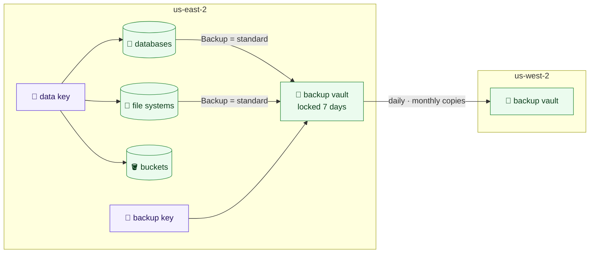

# Keys, backups, databases, file systems and buckets

Each environment's data has five stacks, applied in this order:
`live/<region>/<environment>/keys`, then `backups`, then `databases`, `storage`
and `buckets`. Each is our own module and a template reading the `.yml` files beside
it; with no files a stack builds nothing (except `keys` and `backups`, which
every environment has).

Every default below is fixed rather than optional: final snapshots, 35-day backups, AWS Backup with
copies to Oregon, customer-managed keys, managed passwords, TLS required, logs
exported, and file systems with a policy.



## `keys`

No settings. Three customer-managed KMS keys per environment, all multi-Region:
created in the stack's region and replicated to every other region in
`config/`, so a copy or restore there uses the same key.

| Alias | Used by |
|---|---|
| `alias/<environment>-data` | RDS, EFS, EBS, Secrets Manager, and AWS Backup reading them |
| `alias/<environment>-backup` | the backup vaults only |
| `alias/<environment>-messages` | SQS queues and SNS topics; SNS, EventBridge, alarms and S3 events use it as themselves, for this account ([messaging](messaging.md)) |

A backup cannot be read with the live key, nor live data with the backup key.
Each key's policy lets the account administer it through IAM, and lets only the
named services use it, in its regions, on this account's behalf. Keys rotate
yearly, have a 30-day deletion window, and are never destroyed by a plan:
destroying a key makes everything encrypted with it unreadable.

Keys are kept in Terraform rather than made in the console, because the key
policy is the access control on the data and must be reviewed like code.

## `backups`

```yaml
# live/us-east-2/operations/backups/backups.yml
daily_retention_days: 35
monthly_retention_days: 365
copy: true
```

An AWS Backup vault, encrypted with the backup key and locked so no backup is
deleted before it is 7 days old (`vault_lock: governance`, the default, lets a
principal allowed to bypass the lock remove it; `vault_lock: compliance` lets
nobody, and becomes permanent three days after the first apply); a daily backup kept 35 days and a monthly
one kept a year; each copied to a locked vault in the other region, encrypted
with the backup key's replica there. A resource joins the plan by tagging itself
`Backup = standard`, which every database and file system here does, and every
bucket with `backup: true` (the backup role has AWS's S3 backup and restore
policies).

## `databases`

One file per database.

```yaml
# live/us-east-2/production/databases/orders.yml
engine: mysql
engine_version: "8.0"
instance_class: db.t4g.medium
allocated_storage: 200
max_allocated_storage: 1000
multi_az: true
security_groups:
  - database-mysql
```

| Key | Meaning |
|---|---|
| `engine` | `mysql`, `postgres` or `mariadb` |
| `engine_version` | The major version; minor versions upgrade themselves in the maintenance window |
| `instance_class` | The instance class |
| `allocated_storage`, `max_allocated_storage` | Starting GB, and the most it grows to by itself (default five times the start) |
| `multi_az` | A standby in another zone (default `true`) |
| `security_groups` | From the environment's security-groups stack, by name |

Built in, for every database:

- in the `data` tier, never public;
- encrypted with the environment's data key;
- the admin password kept and rotated by RDS in Secrets Manager
  (`manage_master_user_password`), never passing through Terraform; applications
  read it there, or use IAM authentication, which is on;
- a parameter group of its own for its engine and version, requiring TLS on
  every connection and logging slow statements;
- error and slow-query logs (PostgreSQL: its log and upgrade log) exported to
  CloudWatch, in log groups created first so they are kept 365 days;
- 35 days of automated backups, plus the AWS Backup plan; a final snapshot
  (`<name>-final`) whenever it is deleted; deletion protection, and never
  destroyed by a plan;
- Performance Insights and enhanced monitoring, through one monitoring role per
  environment.

## `storage`

One file per EFS file system.

```yaml
# live/us-east-2/production/storage/sftp.yml
tier: data
security_groups:
  - accesscontrol-efs
access_points:
  uploads:
    posix_user:
      uid: 1001
      gid: 1001
    root_directory:
      path: /uploads
```

A mount target in every zone of the chosen tier (default `data`), encrypted
with the data key, elastic throughput, files unused for 30 days moved to cheaper
storage and brought back when read, and a file system policy that refuses
unencrypted connections and allows mounting only through its own mount targets.
Access points give clients a fixed directory and POSIX user (permissions
default `0750`). The policy grants the account, so a client also needs
`elasticfilesystem:ClientMount` and `ClientWrite` in its role (the `mount-files`
example policy) and mounts with TLS and IAM: `mount -t efs -o tls,iam`. Backed up by the environment's plan (EFS's own automatic
backups are off, so nothing is taken twice), and never destroyed by a plan.

## `buckets`

One file per S3 bucket, for the environment's own data (application files,
exports, uploads). Log buckets are the logging stack's, not these.

```yaml
# live/us-east-2/production/buckets/reports.yml
backup: true
expiration:
  days: 400
```

| Key | Meaning |
|---|---|
| `backup` | Back it up with the environment's AWS Backup plan (default `false`) |
| `expiration` | `days` before objects expire; leave out to keep them |
| `noncurrent_version_expiration` | `noncurrent_days` an overwritten or deleted object's old version is kept (default 90) |
| `object_lock_configuration` | `default_retention`, with `mode` (`GOVERNANCE`, or `COMPLIANCE`, which no one can override) and `days`: objects that must not change or be deleted. Only when the bucket is first created |
| `cors_rule` | Rules for browsers using the bucket directly (`allowed_methods`, `allowed_origins`, `allowed_headers`, `max_age_seconds`); origins are named, never `*` |

The bucket is named `<environment>-<file>-<account>-<region>` (the plan refuses
one longer than S3's 63 characters). Built in: never public, no ACLs, versioned,
every object encrypted with the environment's data key (with a bucket key, to
keep KMS cost down), anything not over TLS refused, incomplete uploads cleaned
up after 7 days, and never destroyed by a plan. No website hosting: public
content goes through CloudFront with a private bucket, and the `s3-bucket`
module takes the policy statement a distribution's output gives.
