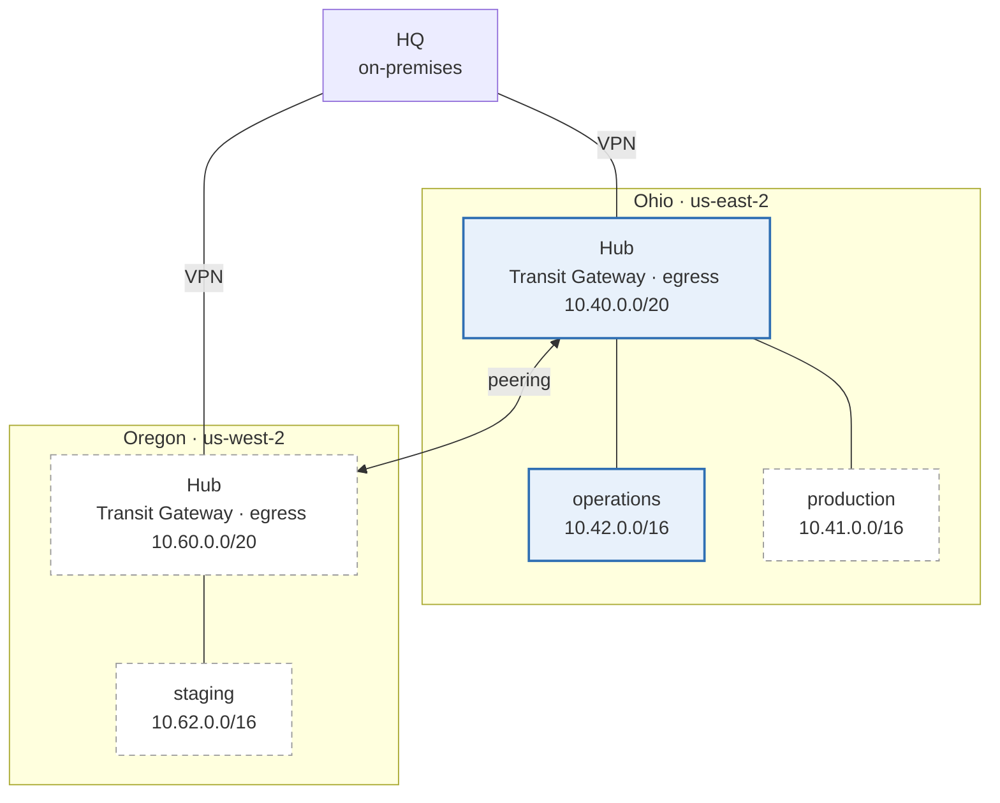

# Infrastructure diagram

Generated by `make diagram` from `modules/ip-plan` and the `live/` tree. Do not edit by hand.
Solid boxes have a stack in `live/`; dashed boxes are in the IP plan with no stack yet.

## Stacks

| Stack | Template | Modules |
|---|---|---|
| `global/shared/baseline` | `templates/baseline` | account-baseline, ip-plan |
| `global/shared/cloudfront` | `templates/cloudfront` | cloudfront-distribution, waf-web-acl |
| `global/shared/dns` | `templates/dns` | ip-plan, route |
| `global/shared/iam` | `templates/iam` | iam-role |
| `us-east-2/operations/access` | `templates/access` | ssm-document |
| `us-east-2/operations/backups` | `templates/backups` | backup-plan, ip-plan |
| `us-east-2/operations/buckets` | `templates/buckets` | s |
| `us-east-2/operations/certificates` | `templates/certificates` | acm-certificate |
| `us-east-2/operations/compute` | `templates/compute` | iam-role, ip-plan, placement, server-group |
| `us-east-2/operations/databases` | `templates/databases` | iam-role, rds-instance |
| `us-east-2/operations/endpoints` | `templates/endpoints` | ip-plan, vpc-endpoint |
| `us-east-2/operations/keys` | `templates/keys` | ip-plan, kms-key |
| `us-east-2/operations/lambda` | `templates/lambda` | lambda-function |
| `us-east-2/operations/load-balancers` | `templates/load-balancers` | ip-plan, load-balancer |
| `us-east-2/operations/network` | `templates/network` | ip-plan, vpc |
| `us-east-2/operations/patching` | `templates/patching` | patch-management |
| `us-east-2/operations/records` | `templates/records` | route |
| `us-east-2/operations/security-groups` | `templates/security-groups` | ip-plan, security-group |
| `us-east-2/operations/storage` | `templates/storage` | efs-file-system |
| `us-east-2/operations/waf` | `templates/waf` | waf-web-acl |
| `us-east-2/shared/documents` | `templates/documents` | ssm-document |
| `us-east-2/shared/ecr` | `templates/ecr` | ecr-repository, ip-plan |
| `us-east-2/shared/hub` | `templates/hub` | ip-plan, prefix-list, route, transit-gateway, vpc, vpn |
| `us-east-2/shared/logging` | `templates/logging` | log-bucket |
| `us-east-2/shared/session-manager` | `templates/session-manager` | ip-plan, kms-key, session-manager-preferences |

## Subnets

Every VPC's subnets, from `config/`, in address order. A stack refers to a subnet by its `Subnet` tag.

### us-east-2 / shared (`10.40.0.0/20`)

| Subnet tag | Zone | CIDR |
|---|---|---|
| `public-az1` | use2-az1 | 10.40.0.0/24 |
| `public-az2` | use2-az2 | 10.40.1.0/24 |
| `public-az3` | use2-az3 | 10.40.2.0/24 |
| `dns-az1` | use2-az1 | 10.40.14.0/28 |
| `dns-az2` | use2-az2 | 10.40.14.16/28 |
| `dns-az3` | use2-az3 | 10.40.14.32/28 |
| `transit-az1` | use2-az1 | 10.40.15.0/28 |
| `transit-az2` | use2-az2 | 10.40.15.16/28 |
| `transit-az3` | use2-az3 | 10.40.15.32/28 |

### us-east-2 / operations (`10.42.0.0/16`)

| Subnet tag | Zone | CIDR |
|---|---|---|
| `private-az1` | use2-az1 | 10.42.0.0/19 |
| `private-az2` | use2-az2 | 10.42.32.0/19 |
| `private-az3` | use2-az3 | 10.42.64.0/19 |
| `data-az1` | use2-az1 | 10.42.192.0/22 |
| `data-az2` | use2-az2 | 10.42.196.0/22 |
| `data-az3` | use2-az3 | 10.42.200.0/22 |
| `ops-az1` | use2-az1 | 10.42.228.0/23 |
| `ops-az2` | use2-az2 | 10.42.230.0/23 |
| `ops-az3` | use2-az3 | 10.42.232.0/23 |
| `transit-az1` | use2-az1 | 10.42.252.0/28 |
| `transit-az2` | use2-az2 | 10.42.252.16/28 |
| `transit-az3` | use2-az3 | 10.42.252.32/28 |

### us-east-2 / production (`10.41.0.0/16`)

| Subnet tag | Zone | CIDR |
|---|---|---|
| `private-az1` | use2-az1 | 10.41.0.0/19 |
| `private-az2` | use2-az2 | 10.41.32.0/19 |
| `private-az3` | use2-az3 | 10.41.64.0/19 |
| `data-az1` | use2-az1 | 10.41.192.0/22 |
| `data-az2` | use2-az2 | 10.41.196.0/22 |
| `data-az3` | use2-az3 | 10.41.200.0/22 |
| `public-az1` | use2-az1 | 10.41.216.0/23 |
| `public-az2` | use2-az2 | 10.41.218.0/23 |
| `public-az3` | use2-az3 | 10.41.220.0/23 |
| `ops-az1` | use2-az1 | 10.41.228.0/23 |
| `ops-az2` | use2-az2 | 10.41.230.0/23 |
| `ops-az3` | use2-az3 | 10.41.232.0/23 |
| `transit-az1` | use2-az1 | 10.41.252.0/28 |
| `transit-az2` | use2-az2 | 10.41.252.16/28 |
| `transit-az3` | use2-az3 | 10.41.252.32/28 |

### us-west-2 / shared (`10.60.0.0/20`)

| Subnet tag | Zone | CIDR |
|---|---|---|
| `public-az1` | usw2-az1 | 10.60.0.0/24 |
| `public-az2` | usw2-az2 | 10.60.1.0/24 |
| `public-az3` | usw2-az3 | 10.60.2.0/24 |
| `dns-az1` | usw2-az1 | 10.60.14.0/28 |
| `dns-az2` | usw2-az2 | 10.60.14.16/28 |
| `dns-az3` | usw2-az3 | 10.60.14.32/28 |
| `transit-az1` | usw2-az1 | 10.60.15.0/28 |
| `transit-az2` | usw2-az2 | 10.60.15.16/28 |
| `transit-az3` | usw2-az3 | 10.60.15.32/28 |

### us-west-2 / staging (`10.62.0.0/16`)

| Subnet tag | Zone | CIDR |
|---|---|---|
| `private-az1` | usw2-az1 | 10.62.0.0/19 |
| `private-az2` | usw2-az2 | 10.62.32.0/19 |
| `private-az3` | usw2-az3 | 10.62.64.0/19 |
| `data-az1` | usw2-az1 | 10.62.192.0/22 |
| `data-az2` | usw2-az2 | 10.62.196.0/22 |
| `data-az3` | usw2-az3 | 10.62.200.0/22 |
| `public-az1` | usw2-az1 | 10.62.216.0/23 |
| `public-az2` | usw2-az2 | 10.62.218.0/23 |
| `public-az3` | usw2-az3 | 10.62.220.0/23 |
| `ops-az1` | usw2-az1 | 10.62.228.0/23 |
| `ops-az2` | usw2-az2 | 10.62.230.0/23 |
| `ops-az3` | usw2-az3 | 10.62.232.0/23 |
| `transit-az1` | usw2-az1 | 10.62.252.0/28 |
| `transit-az2` | usw2-az2 | 10.62.252.16/28 |
| `transit-az3` | usw2-az3 | 10.62.252.32/28 |
