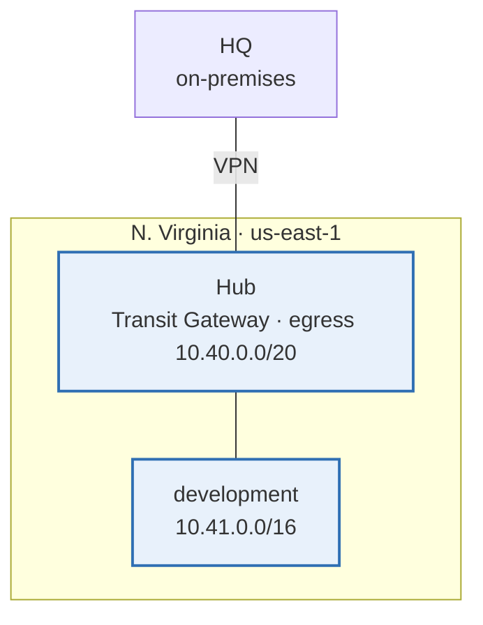

# Infrastructure diagram

Generated by `make diagram` from `modules/ip-plan` and the `live/` tree. Do not edit by hand.
Solid boxes have a stack in `live/`; dashed boxes are in the IP plan with no stack yet.

## Stacks

| Stack | Template | Modules |
|---|---|---|
| `global/shared/baseline` | `templates/baseline` | account-baseline, ip-plan |
| `global/shared/cloudfront` | `templates/cloudfront` | cloudfront-distribution, waf-web-acl |
| `global/shared/dns` | `templates/dns` | ip-plan, route53-zone |
| `global/shared/iam` | `templates/iam` | iam-role |
| `us-east-1/development/access` | `templates/access` | ssm-document |
| `us-east-1/development/apps` | `templates/apps` | application, iam-role, ip-plan, placement |
| `us-east-1/development/backups` | `templates/backups` | backup-plan, ip-plan |
| `us-east-1/development/buckets` | `templates/buckets` | s3-bucket |
| `us-east-1/development/certificates` | `templates/certificates` | acm-certificate |
| `us-east-1/development/compute` | `templates/compute` | ec2-instance, ip-plan, placement |
| `us-east-1/development/databases` | `templates/databases` | iam-role, rds-instance |
| `us-east-1/development/endpoints` | `templates/endpoints` | ip-plan, vpc-endpoint |
| `us-east-1/development/keys` | `templates/keys` | ip-plan, kms-key |
| `us-east-1/development/lambda` | `templates/lambda` | lambda-function |
| `us-east-1/development/load-balancers` | `templates/load-balancers` | ip-plan, load-balancer |
| `us-east-1/development/network` | `templates/network` | ip-plan, vpc |
| `us-east-1/development/patching` | `templates/patching` | patch-management |
| `us-east-1/development/records` | `templates/records` | route53-record |
| `us-east-1/development/security-groups` | `templates/security-groups` | ip-plan, security-group |
| `us-east-1/development/storage` | `templates/storage` | efs-file-system |
| `us-east-1/development/waf` | `templates/waf` | waf-web-acl |
| `us-east-1/shared/documents` | `templates/documents` | ssm-document |
| `us-east-1/shared/ecr` | `templates/ecr` | ecr-repository, ip-plan |
| `us-east-1/shared/hub` | `templates/hub` | ip-plan, prefix-list, route53-resolver, transit-gateway, vpc, vpn |
| `us-east-1/shared/logging` | `templates/logging` | log-bucket |
| `us-east-1/shared/session-manager` | `templates/session-manager` | ip-plan, kms-key, session-manager-preferences |

## Subnets

Every VPC's subnets, from `config/`, in address order. A stack refers to a subnet by its `Subnet` tag.

### us-east-1 / shared (`10.40.0.0/20`)

| Subnet tag | Zone | CIDR |
|---|---|---|
| `public-az1` | use1-az1 | 10.40.0.0/24 |
| `public-az2` | use1-az2 | 10.40.1.0/24 |
| `public-az4` | use1-az4 | 10.40.3.0/24 |
| `dns-az1` | use1-az1 | 10.40.14.0/28 |
| `dns-az2` | use1-az2 | 10.40.14.16/28 |
| `dns-az4` | use1-az4 | 10.40.14.48/28 |
| `transit-az1` | use1-az1 | 10.40.15.0/28 |
| `transit-az2` | use1-az2 | 10.40.15.16/28 |
| `transit-az4` | use1-az4 | 10.40.15.48/28 |

### us-east-1 / development (`10.41.0.0/16`)

| Subnet tag | Zone | CIDR |
|---|---|---|
| `private-az1` | use1-az1 | 10.41.0.0/19 |
| `private-az2` | use1-az2 | 10.41.32.0/19 |
| `private-az4` | use1-az4 | 10.41.96.0/19 |
| `data-az1` | use1-az1 | 10.41.192.0/22 |
| `data-az2` | use1-az2 | 10.41.196.0/22 |
| `data-az4` | use1-az4 | 10.41.204.0/22 |
| `public-az1` | use1-az1 | 10.41.216.0/23 |
| `public-az2` | use1-az2 | 10.41.218.0/23 |
| `public-az4` | use1-az4 | 10.41.222.0/23 |
| `ops-az1` | use1-az1 | 10.41.228.0/23 |
| `ops-az2` | use1-az2 | 10.41.230.0/23 |
| `ops-az4` | use1-az4 | 10.41.234.0/23 |
| `transit-az1` | use1-az1 | 10.41.252.0/28 |
| `transit-az2` | use1-az2 | 10.41.252.16/28 |
| `transit-az4` | use1-az4 | 10.41.252.48/28 |
