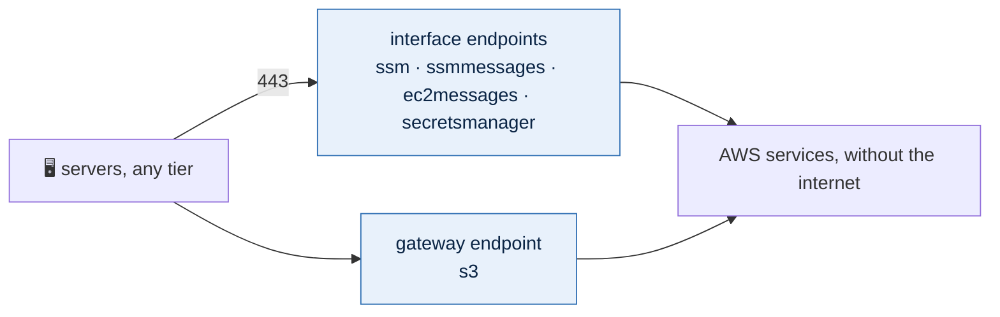

# VPC endpoints

Each environment's VPC endpoints are a stack of their own:
`live/<region>/<environment>/endpoints/`. Every file in its `config/` folder is
one `aws_vpc_endpoint`, named after the file, written in the provider's own
arguments.

```yaml
# live/us-east-2/operations/endpoints/config/ssm.yml
service_name: com.amazonaws.us-east-2.ssm
vpc_endpoint_type: Interface
subnet_ids:
  - private-az1
  - private-az2
  - private-az3
security_group_ids:
  - endpoints
private_dns_enabled: true
```

```yaml
# live/us-east-2/operations/endpoints/config/s3.yml
service_name: com.amazonaws.us-east-2.s3
vpc_endpoint_type: Gateway
route_table_ids:
  - private-az1
  - private-az2
  - private-az3
  - data-az1
  - data-az2
  - data-az3
  - ops-az1
  - ops-az2
  - ops-az3
```

| Key | Meaning |
|---|---|
| `service_name` | The service's full name in this region, `com.amazonaws.<region>.<service>` |
| `vpc_endpoint_type` | `Interface` or `Gateway` (only `s3` and `dynamodb` have gateways) |
| `subnet_ids` | Interface only: the subnets that hold its network interfaces, by name (`private-az1`), one per zone and at least two |
| `security_group_ids` | Interface only: its security groups, by name, from the environment's security-groups stack |
| `private_dns_enabled` | Interface only: `true` answers at the service's usual name inside the VPC, so agents need no settings |
| `route_table_ids` | Gateway only: the route tables that get the route. Each subnet has its own route table, named like the subnet (`data-az1`) |
| `tags` | The endpoint's tags; `Name` is the environment and the file's name (`Staging - s3`) |

Where an argument takes an ID, the file gives a name and the stack finds the ID
in the environment's VPC: subnets by their `Subnet` tag, route tables by the
subnet they belong to, security groups by their `Key` tag (the group's file name). An actual ID
(`subnet-…`, `rtb-…`, `sg-…`) passes through unchanged.



## Why these

- **`ssm`, `ssmmessages`, `ec2messages`** are what the Systems Manager agent
  needs for Session Manager (access without SSH or RDP open) and Patch Manager.
  Through these endpoints, servers in the `data` tier, which by default has no
  route to the internet, can still be managed.
- **`s3`** keeps S3 traffic off the NAT gateways, which is cheaper and private,
  and lets the `data` tier reach S3 (backups, patch baselines) without the
  internet; where an environment gives the tier a route out, S3 still goes
  through the endpoint, whose route is more specific. List every tier's route tables that should reach it.
- **`secretsmanager`** lets applications fetch their secrets without the
  internet.

Others a Windows or Linux fleet commonly needs, each a file of its own: `logs`
(CloudWatch agent), `kms`, `monitoring`, and `ecr.api` with `ecr.dkr` for
pulling container images.

## The endpoints' security group

Interface endpoints need a group that lets the VPC reach them on HTTPS. It is
an ordinary file in the environment's security-groups stack, so it is read and
changed like any other group:

```yaml
# live/us-east-2/operations/security-groups/config/endpoints.yml
description: Interface endpoints, reached over HTTPS from inside the VPC only
tags:
  Kind: endpoint
ingress:
  - description: HTTPS from inside the VPC
    ip_protocol: tcp
    from_port: 443
    to_port: 443
    cidr_ipv4: 10.42.0.0/16
```

No egress is written, so it has none; replies to the connections it accepts
still flow. Gateway endpoints are routes and have no security group. Apply the
security-groups stack before the endpoints stack.

## Cost

Interface endpoints cost about $0.01 an hour per zone each, plus data: Session
Manager's three in three zones are about $66 a month per VPC. Gateway endpoints
are free.

## What the plan refuses

The `vpc-endpoint` module builds the endpoints; the `endpoints` template reads
the files and refuses a key `aws_vpc_endpoint` does not take, a `service_name`
outside the stack's region, a type other than `Interface` or `Gateway`, a
subnet the VPC does not have, an interface endpoint in fewer than two zones or
without a security group or `private_dns_enabled`, a gateway without route
tables, and arguments that belong to the other type.
