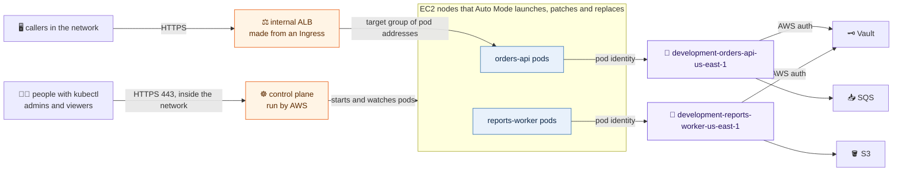

# Kubernetes

`live/<region>/<environment>/kubernetes` builds one Kubernetes cluster for an
environment in a region, using Amazon EKS in Auto Mode, and one AWS identity
per application that runs in it. It comes after `network`, `security-groups`
and `keys`. With no files, it builds nothing.

This page is written for someone who knows EC2, security groups and load
balancers, and has not used Kubernetes. Each Kubernetes word is explained the
first time it appears, in EC2 terms where there is one.



## Kubernetes in EC2 terms

**The cluster** is one environment's place to run containers. It has two
halves.

- **The control plane** is the part that decides what runs where: the
  Kubernetes API you talk to with `kubectl`, and the database behind it. AWS
  runs it, across three availability zones, and you never see its servers. It
  reaches into the VPC through network interfaces in the private subnets.
- **Nodes** are ordinary EC2 instances in the private subnets that actually run
  the containers. In Auto Mode, EKS chooses their instance types, launches
  them when there is work, removes them when there is not, keeps their
  operating system (Bottlerocket) patched, and replaces each one at least
  every 21 days. Nobody logs in to a node, and there is no AMI to pick.

**A pod** is one running copy of an application: one container, sometimes with
a small helper beside it, with its own private IP address from the VPC. Pods
are disposable, like instances in an Auto Scaling group; when one dies,
another starts somewhere else.

**A namespace** is a folder inside the cluster. Each application gets its own,
and permissions, quotas and network rules can be set per namespace.

Applications are described to the cluster in YAML files called **manifests**.
Three kinds matter most:

| Manifest | What it is, in EC2 terms |
|---|---|
| **Deployment** | The launch template plus Auto Scaling group: which container image, how much CPU and memory, how many copies, and how to replace them when the image changes |
| **Service** | A stable private name and address in front of a Deployment's pods, so other pods can call it without knowing which pods exist right now |
| **Ingress** | A listener rule on a load balancer: this host or path goes to that Service. In Auto Mode, it also creates the load balancer |

A **ServiceAccount** is the identity a pod runs as inside Kubernetes. It is what
an application's AWS role is attached to (below).

## How an Ingress becomes a load balancer

Auto Mode includes AWS's load balancer controller. When someone applies an
Ingress, it:

1. creates an Application Load Balancer, or adds to an existing one when the
   Ingress names the same **group** (so many apps share one ALB, as they share
   one in the `load-balancers` stack today);
2. creates a target group whose targets are the pods' own IP addresses, with
   the health check the Ingress asks for;
3. adds a listener rule for the Ingress's host and path;
4. keeps the targets current as pods come and go, and removes it all when the
   Ingress is deleted.

What kind of load balancer it makes (internal, which subnets, which
certificate) is set once per cluster in an **IngressClass**, which every
Ingress names. The example's `manifests/ingress-class.yaml` makes one called
`internal`: an internal ALB in the private tier, HTTPS on the environment's
certificate. The subnets are chosen by their `Tier` tag, so the network stack
does not need Kubernetes' own subnet tags.

These load balancers are made by the cluster, not by Terraform, so they are
not in any state file and not in the `load-balancers` stack. A DNS name for
one goes in the `records` stack, pointing at the ALB's name.

## Security groups

| Security group | Where it is | What it does |
|---|---|---|
| **Cluster security group** | Made by EKS. On the control plane's network interfaces and on every Auto Mode node | Lets the control plane and nodes talk to each other. Its ID is the stack's `cluster_security_group_id` output. Anything pods call, such as Vault or a database, must allow traffic from it |
| **API access groups** | `security_groups` in `cluster.yml`, made in the `security-groups` stack | Extra groups on the control plane's network interfaces: who may reach the private API on 443 to use `kubectl` |
| **Load balancer groups** | Made by Auto Mode for each ALB | Let callers reach the ALB, and the ALB reach the pods. Auto Mode adds the rules for you |

Pods on a node share that node's security groups. Auto Mode does not offer a
security group per pod. To keep applications apart inside the cluster, use
Kubernetes **network policies**, which Auto Mode supports once turned on; or,
for an application that must have its own security groups, a separate node
pool whose nodes carry them. Neither is set up yet.

## How a pod gets AWS permissions

Every application has its own IAM role, as every application on a blueprint
has its own role in `compute` ([compute](compute.md)). This matters for
Vault: Vault's AWS auth knows who is logging in by the role, so two
applications sharing a role would get each other's secrets.

1. The app's file in this stack, `<app>.yml`, makes the role
   `<environment>-<app>-<region>`, with the permissions the file lists.
2. The same file names the namespace and ServiceAccount its pods run as (by
   default, both are the app's name). Terraform links the two with an **EKS Pod
   Identity association**.
3. A pod running as that ServiceAccount, in that namespace, gets the role's
   short-lived credentials automatically. The AWS SDKs pick them up with no
   code change. No other pod can get them, and the role trusts only EKS Pod
   Identity acting for this cluster.
4. To read secrets, the app (or a Vault Agent beside it) logs in to Vault with
   the `aws` auth method, type `iam`, using those credentials. In Vault, a role
   bound to the app's IAM role ARN (`bound_iam_principal_arn`) decides which
   secrets it may read. The `ec2` type does not work for pods: it identifies
   the node, not the app.

The nodes have a role too, with only what a node needs to join the cluster and
pull images. Pods never use it.

## The files

```text
live/us-east-1/development/kubernetes/
├── cluster.yml          the cluster
├── orders-api.yml       one file per app: its AWS identity
└── reports-worker.yml
```

Each app file sits beside `cluster.yml`, one per app, the way every other stack
has one file per thing it builds; `cluster.yml` is the one reserved name.
Complete examples, with the manifests that go with them, are in
`examples/us-east-1/development/kubernetes/`.

```yaml
# live/us-east-1/development/kubernetes/cluster.yml
version: "1.35"
admins:
  - platform-admin
viewers:
  - developer
security_groups:
  - kubernetes-api
```

| `cluster.yml` key | Meaning |
|---|---|
| `version` | The Kubernetes version, in quotes. Required, with no default, so an upgrade is always a deliberate change. `aws eks describe-cluster-versions` lists the ones EKS offers |
| `admins` | IAM roles given full control of the cluster. A name is a role in this account; an ARN is used as written |
| `viewers` | IAM roles that may look at everything but secrets, and change nothing |
| `security_groups` | Groups from the `security-groups` stack added to the control plane, for who may reach the API |
| `public_access_cidrs` | Addresses that may reach the API from the internet. Leave it out: the API is then reachable only from inside the network. Never `0.0.0.0/0` |
| `deletion_protection` | `false` only to take the environment down (default `true`) |

```yaml
# live/us-east-1/development/kubernetes/reports-worker.yml
namespace: reports
service_account: reports-worker
statement:
  - actions:
      - s3:GetObject
    resources:
      - arn:aws:s3:::development-exports-*/*
```

| `<app>.yml` key | Meaning |
|---|---|
| `namespace`, `service_account` | Where its pods run and as whom (default: the file's name for both). Must match its manifests |
| `statement` | Permissions, as in IAM: `actions`, `resources`, optional `effect` and `condition` (`test`, `variable`, `values`) |
| `managed_policies` | AWS managed policies by name, such as `AmazonS3ReadOnlyAccess` |

The plan refuses a misspelt key, a missing or malformed `version`, a role in
both `admins` and `viewers`, an open API, app files without a `cluster.yml`,
two apps running as the same namespace and service account, a statement
allowing everything on everything, and `AdministratorAccess`,
`PowerUserAccess` or `IAMFullAccess` for an app.

## What every cluster gets

- **Auto Mode** for compute, load balancing and block storage, with its two
  built-in node pools: `general-purpose` for applications and `system` for
  cluster add-ons.
- **The private subnets** of the environment's VPC, in every zone, for the
  control plane's interfaces, the nodes and the pods. Each pod takes an address
  from them.
- **A private API.** People reach it over the VPN or from inside the network,
  through a group in `security_groups`.
- **Access by IAM role only.** Nobody has access until listed, not even
  whoever ran Terraform.
- **Kubernetes secrets encrypted** with the environment's data key
  (`alias/<environment>-data`).
- **Control plane logs** (API calls, audit, sign-ins) in CloudWatch,
  `/aws/eks/<environment>/cluster`, kept 365 days.
- **Deletion protection**, and **standard support**: when a version reaches
  the end of standard support, EKS upgrades the control plane itself rather
  than charging for extended support.

## Who owns what

| Terraform (this stack) | Application teams, through manifests |
|---|---|
| The cluster, its version, logging and encryption | Namespaces, Deployments, Services, Ingresses |
| Node settings (Auto Mode and its node pools) | How many copies, how much CPU and memory |
| Who may use `kubectl`, and how much | Health checks, rollout strategy |
| Each app's IAM role and its link to a ServiceAccount | The ServiceAccount itself, matching the app's file |
| | The IngressClass, once per cluster (the platform team) |

Manifests are not applied by Terraform. They live with the application and
are applied with `kubectl apply`, Helm (manifests as a template with values),
or Argo CD, which watches a Git repository and applies what changes there.
Argo CD is the usual choice once there is more than one app: Git becomes the
record of what runs, as `live/` is for infrastructure.

## Using kubectl

```sh
aws eks update-kubeconfig --region us-east-1 --name development   # the stack's output prints this
kubectl get pods -n orders-api                                     # what is running
kubectl logs -n orders-api deploy/orders-api                       # its output
kubectl describe ingress -n orders-api orders-api                  # the ALB it made
```

This works with your credentials for a role in `admins` or `viewers`, from
somewhere a group in `security_groups` lets in.

## Deploying a new version

**Rolling** is what a Deployment does by default, much like CodeDeploy's
one-at-a-time: change the image tag, apply, and Kubernetes starts a new pod,
waits for its readiness check, sends it traffic, stops an old one, and
repeats. With `maxUnavailable: 0` capacity never drops. `kubectl rollout undo`
goes back.

**Canary or blue/green** needs one of:

- **Argo Rollouts**, a controller installed in the cluster. A Rollout replaces
  the Deployment and moves traffic in steps (10%, then 50%, then all), shifting
  the ALB's weights between the old and new versions and rolling back on its
  own if error rates rise. It also does blue/green with a preview address.
- **Weighted routing by hand**: two Deployments and Services (blue and green),
  and an Ingress whose rule forwards to both with weights you change.

The example's `manifests/orders-api.yaml` ends with both as comments.

## Upgrades and patching

- **Nodes** patch themselves: Auto Mode replaces them with current images, one
  at a time, respecting each app's PodDisruptionBudget (how many copies must
  stay up). Give every app that serves traffic one, as the example does.
- **The control plane** is upgraded by changing `version` to the next minor
  version (1.35 to 1.36; never skip one) and applying. Auto Mode then moves the
  nodes over. Check the Kubernetes release notes for removed APIs first.
- **Applications** are rebuilt as new images; nothing is patched in place.

## From EC2 to Kubernetes

| On EC2 (`compute`) | In Kubernetes |
|---|---|
| A group file in `compute` | A Deployment manifest |
| AMI and `user_data` boot script | Container image and its start command |
| `instance_type`, `count`, Auto Scaling group | CPU and memory requests, `replicas`, and a HorizontalPodAutoscaler to scale on load |
| Servers in an Auto Scaling group | Pods on nodes Auto Mode runs |
| The app's own instance role (blueprint `role`) | The app's own role, through pod identity (`<app>.yml`) |
| Vault AWS auth by instance role | Vault AWS auth (`iam` type) by the pod's role |
| `target_group` and `listener_rules` on a shared ALB | An Ingress in the shared `internal` group; the target group is made for you |
| Target group health check | Readiness probe, and the Ingress's health check annotations |
| Security groups on the servers | The cluster security group on the nodes, network policies between pods |
| CodeDeploy rolling deployment | A Deployment's rolling update |
| CodeDeploy blue/green | Argo Rollouts, or weighted Ingress routing |
| Patch Manager and rebuilding servers | Auto Mode replacing nodes; rebuilding images |
| Session Manager into a server | `kubectl logs`, `kubectl exec` |
| CloudWatch agent on the server | Containers write to standard output; a log shipper (the CloudWatch Observability add-on or Fluent Bit) sends it on |
| `route53_records` on a group | A `records` file pointing at the ALB the Ingress made |

## Things to know

- **Pods use VPC addresses.** Every pod takes an address from the private
  tier, so a busy cluster uses many more addresses than the same apps on EC2.
  The private tier's /19 per zone has room for thousands.
- **Images** come from ECR. The nodes' role may pull; a repository in the
  shared account must allow this environment's account, as for servers.
- **Nothing in the cluster is in Terraform state** except the cluster, its
  access and the app identities. Deleting the stack does not delete load
  balancers Ingresses made; delete the Ingresses first.
- **The control plane costs about the same as a small server**, all day, per
  cluster, plus an Auto Mode fee on each node on top of its EC2 price.
