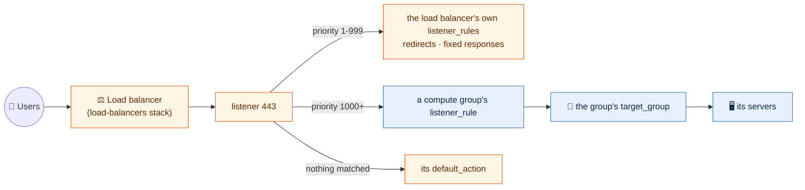

# Load balancers

Each environment's load balancers are a stack of their own:
`live/<region>/<environment>/load-balancers/`, one file per load balancer, named
after it, in the stack's `config/` folder, never beside its `.tf` files.

A file is the load balancer's `aws_lb` arguments, followed by the resources
that hang off it: its listeners, target groups, listener rules and extra
listener certificates. Every key is the provider's own name, in the provider's
own shape, so the Terraform documentation for `aws_lb`, `aws_lb_listener`,
`aws_lb_target_group`, `aws_lb_listener_rule` and
`aws_lb_listener_certificate` describes it. Nothing is filled in: what the file
says is what is built.

```yaml
# live/us-east-2/operations/load-balancers/config/grafana.yml
load_balancer_type: application
internal: true
subnets:
  - private-az1
  - private-az2
  - private-az3
security_groups:
  - grafana-lb
listeners:
  - port: 443
    protocol: HTTPS
    certificate_arn: grafana.example.com
    default_action:
      type: fixed-response
      fixed_response:
        content_type: text/plain
        message_body: Not found
        status_code: "404"
  - port: 80
    protocol: HTTP
    default_action:
      type: redirect
      redirect:
        port: "443"
        protocol: HTTPS
        status_code: HTTP_301
```

The 443 listener above answers 404 to anything nobody claims, because its
`default_action` says so. The groups of servers behind it each claim their
hosts and paths from their own file in the `compute` stack
([compute](compute.md#target-groups-and-listener-rules)). That is the usual
shape of an application load balancer here.



## Names for IDs

Where an argument takes the ID or ARN of something this repository builds, the
file gives its name and the stack finds it. An actual ID or ARN passes through
unchanged.

| Argument | A name means |
|---|---|
| `subnets` | A subnet of the environment's VPC by its `Subnet` tag, `<tier>-az<n>` (`private-az1`, `public-az2`), from the layout in `config/global.yml`. `subnet-…` passes through |
| `security_groups` | A group from the environment's security-groups stack, by its name (its `Key` tag). `sg-…` passes through |
| `certificate_arn` (listener and listener certificate) | The domain of an issued ACM certificate in the region (`grafana.example.com`, `"*.example.com"`). `arn:…` passes through |
| `target_group_arn` (in an action) | A target group in the same file. `arn:…` passes through |
| `listener_arn` (in a listener rule or listener certificate) | The port of a listener in the same file (`443`) |

## Keys

| Key | Meaning |
|---|---|
| `load_balancer_type` | Required. `application` (HTTP, HTTPS) or `network` (TCP, UDP, TLS) |
| `internal` | Required. `true` for a load balancer reached only from inside our networks, `false` for internet-facing |
| `subnets` | Required, at least two, by name (see above). Internet-facing ones sit in `public-az<n>`, which a VPC has only with `public: true` in `config/` |
| `security_groups` | The groups on the load balancer, by name |
| `listeners` | A list of `aws_lb_listener`: `port`, `protocol`, `certificate_arn` (HTTPS and TLS only, by domain) and `default_action` |
| `target_groups` | Name -> `aws_lb_target_group`: `port`, `protocol`, `target_type` (`instance` or `ip`), `deregistration_delay` (seconds) and optionally `health_check` (`enabled`, `path`, `port`, `protocol`, `matcher`, `interval`, `timeout`, `healthy_threshold`, `unhealthy_threshold`). All but `health_check` are required; a health check leaves out what AWS should default |
| `listener_rules` | Name -> `aws_lb_listener_rule`: `listener_arn` (the listener's port), `priority` (1 to 999), `action` and `condition` (`host_header.values` and/or `path_pattern.values`) |
| `listener_certificates` | A list of `aws_lb_listener_certificate`: `listener_arn` (an HTTPS or TLS listener's port) and `certificate_arn` (by domain). Each is served beside the listener's own certificate to the names it covers, so one listener answers for several domains |

An action, whether a listener's `default_action` or a rule's `action`, is
`aws_lb_listener`'s action block with one of three types:

| `type` | With |
|---|---|
| `forward` | `target_group_arn`: a target group in the file, by name |
| `redirect` | `redirect`: `status_code` (`HTTP_301` or `HTTP_302`), and any of `host`, `path`, `port`, `protocol`, `query`; what is left out keeps the request's own (`#{host}` and so on) |
| `fixed-response` | `fixed_response`: `content_type`, and optionally `message_body` and `status_code` |

A load balancer with several domains names one on the listener and the rest
as listener certificates:

```yaml
listener_certificates:
  - listener_arn: 443
    certificate_arn: "*.example.org"
  - listener_arn: 443
    certificate_arn: "*.example.net"
```

Listener rules handle the load balancer's own redirects and fixed responses:

```yaml
listener_rules:
  portal:
    listener_arn: 443
    priority: 10
    action:
      type: redirect
      redirect:
        host: www.example.com
        path: /p/login
        status_code: HTTP_301
    condition:
      host_header:
        values:
          - portal.example.com
```

## Who owns a target group

Whoever owns the servers owns the target group, so a server, its group and the
rule sending it traffic change together, in one plan:

| Traffic | Target group in |
|---|---|
| An application load balancer to a group of servers | the group's compute file (`target_group` and `listener_rule`) |
| A network load balancer | this stack's `target_groups`. Network load balancers have no rules, so the listener forwards to the target group, and compute groups join it with `target_group_attachments`, a list of `target_group_arn` (`<load balancer>-<target group>`) and `port` |

```yaml
# live/us-east-2/operations/load-balancers/config/internal-nlb.yml
load_balancer_type: network
internal: true
subnets:
  - private-az1
  - private-az2
  - private-az3
listeners:
  - port: 10051
    protocol: TCP
    default_action:
      type: forward
      target_group_arn: zabbix
target_groups:
  zabbix:
    port: 10051
    protocol: TCP
    target_type: instance
    deregistration_delay: 60
```

Priorities are split so the two stacks can never collide on one listener: this
stack's `listener_rules` take 1 to 999 and come first, and compute groups'
listener rules take 1000 and up. A group that takes everything left over uses
`condition.path_pattern.values: ["/*"]` in its `listener_rule`, at a priority
higher than every other rule.

## Built in

These are set by the module and are not keys, so no file can turn them off.

- **Deletion protection** on every load balancer: removing one is a reviewed
  change that turns it off first.
- **TLS 1.2 and 1.3 only** on HTTPS and TLS listeners
  (`ssl_policy` is `ELBSecurityPolicy-TLS13-1-2-2021-06`).
- **No plain HTTP on the internet**: on an internet-facing load balancer, an
  HTTP listener's `default_action` must redirect to protocol `HTTPS`.
- **Malformed headers dropped** on application load balancers, against request
  smuggling.
- **Every request logged** to the region's load balancer log bucket
  (`lb-logs-<account>-<region>`, from the logging stack), under a prefix named
  after the load balancer. The logging stack comes first.
- **Target groups are rebuilt without an outage.** A change AWS cannot make in
  place (a new port or protocol) builds the new group first, moves every
  listener and rule to it in place, and removes the old one last. So a group's
  name is `<environment>-<load balancer>-<target group>-<suffix>`, cut to AWS's
  32 characters; the suffix keeps it unique and comes from its port and
  protocol. Its `Key` tag is `<environment>-<load balancer>-<target group>`,
  which is how compute finds it; its `Name` tag is the environment, then
  `<load balancer>-<target group>` (`Staging - services-api`).
- **Names carry the environment:** a load balancer is `<environment>-<name>`, so
  two environments in one account never collide. Compute, containers, records
  and WAF find a load balancer by that name and a listener by its port.

The plan refuses a key the resource does not have (naming the arguments it
does take), a missing `load_balancer_type` or `internal`, fewer than two
subnets or one the VPC does not have (so nothing internet-facing in operations,
which has no public subnets), two listeners on one port, HTTPS or TLS without
a certificate, an action whose type does not match what it carries or that
names a target group the file does not have, a network listener that does not
forward, a rule priority of 1000 or more, a rule with no host or path, two
rules sharing a priority on one listener, a rule or listener certificate on a
port the file has no listener for, and plain HTTP on the internet.

## How it is built

The `load-balancer` module builds one load balancer, its target groups,
listeners, listener rules and listener certificates, taking the provider's
argument names. The `load-balancers` template reads the files and finds the
VPC, the subnets (by their `Subnet` tag), the security groups (by their `Key`
tag) and the certificates (by domain) without reading any other stack's state.
