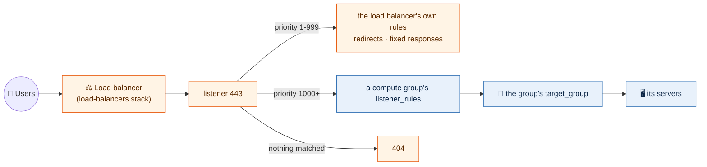

# Load balancers

Each environment's load balancers are a stack of their own:
`live/<region>/<environment>/load-balancers/`, one file per load balancer, named
after it.

```yaml
# live/us-east-2/operations/load-balancers/grafana.yml
load_balancer_type: application
internal: true
security_groups:
  - grafana-lb
certificate: grafana.example.com
listeners:
  "443":
    protocol: HTTPS
  "80":
    protocol: HTTP
    redirect: true
```

The 443 listener above has no target, so it answers 404 to anything nobody
claims. The groups of servers behind it each claim their hosts and paths from
their own file in the `compute` stack ([compute](compute.md#target-groups-and-listener-rules)).
That is the usual shape of an application load balancer here.



## Who owns a target group

Whoever owns the servers owns the target group, so a server, its group and the
rule sending it traffic change together, in one plan:

| Traffic | Target group in |
|---|---|
| An application load balancer to a group of servers | the group's compute file (`target_group` and `listener_rules`) |
| A network load balancer | this stack's `targets`. Network load balancers have no rules, so the listener forwards to the target group, and compute groups join it with `target_group_attachments: { <load balancer>/<target>: <port> }` |

```yaml
# live/us-east-2/operations/load-balancers/internal-nlb.yml
load_balancer_type: network
listeners:
  "10051":
    protocol: TCP
    target: zabbix
targets:
  zabbix:
    port: 10051
    protocol: TCP
```

Priorities are split so the two stacks can never collide on one listener: this
stack's `rules` take 1 to 999 and come first (redirects, fixed responses),
and compute groups' listener rules take 1000 and up. A group that takes everything
left over uses `path_pattern: ["/*"]` in its `listener_rules`, at a priority higher than every other rule.

| Key | Meaning |
|---|---|
| `load_balancer_type` | `application` (HTTP, HTTPS; the default) or `network` (TCP, UDP, TLS) |
| `internal` | `true` (the default) or `false` for internet-facing |
| `tier` | The tier whose subnets it sits in. Default `private` for internal, `public` for internet-facing, which needs a public tier (`public: true` for the VPC in `config/`) |
| `security_groups` | Groups from the environment's security-groups stack, by name |
| `certificate` | The domain of an issued ACM certificate, for HTTPS and TLS listeners |
| `listeners` | Port -> `protocol` and the `target` it forwards to. On an application load balancer, `redirect: true` sends a port to HTTPS instead, and a listener with no target answers 404 |
| `rules` | Rule name -> `listener` (port), `priority` (1 to 999), `host_header` and/or `path_pattern` it matches, and one action: `target`, `redirect` (`host`, `path`, `query`, `status_code`) or `fixed_response` (`status_code`, `content_type`, `message_body`) |
| `targets` | Target group name -> `port`, `protocol` and an optional `health_check` with its `path`. Compute groups join these with `target_group_attachments` (see above) |

## Built in

- **Deletion protection** on every load balancer: removing one is a reviewed
  change that turns it off first.
- **TLS 1.2 and 1.3 only** on HTTPS and TLS listeners
  (`ELBSecurityPolicy-TLS13-1-2-2021-06`).
- **No plain HTTP on the internet**: on an internet-facing load balancer, port
  80 can only redirect to HTTPS.
- **Malformed headers dropped** on application load balancers, against request
  smuggling.
- **Every request logged** to the region's load balancer log bucket
  (`lb-logs-<account>-<region>`, from the logging stack), under a prefix named
  after the load balancer. The logging stack comes first.
- **Target groups are rebuilt without an outage.** A change AWS cannot make in
  place (a new port or protocol) builds the new group first, moves every
  listener and rule to it in place, and removes the old one last. So a group's
  name is `<environment>-<load balancer>-<target>-<suffix>`, cut to AWS's 32
  characters; the suffix keeps it unique and comes from its port and protocol.
  Its `Name` tag is `<environment>-<load balancer>-<target>`, which is how
  compute finds it.
- **Names carry the environment:** a load balancer is `<environment>-<name>`, so
  two environments in one account never collide.
- **Targets drain for 60 seconds** when a server leaves, not AWS's 300.

Rules handle redirects and fixed responses:

```yaml
rules:
  portal:
    listener: 443
    priority: 10
    host_header:
      - portal.example.com
    redirect:
      host: www.example.com
      path: /p/login
```

The plan refuses an unknown key, a scheme other
than the two, a tier the VPC does not have (so nothing internet-facing in
operations, which has no public tier), HTTPS or TLS without a certificate, a
listener or rule whose target does not exist, a network listener without a
target, a rule priority of 1000 or more, a rule with no host or path, a rule
with more than one action, two rules sharing a priority on one listener, and
plain HTTP on the internet.

## How it is built

The `load-balancer` module builds one load balancer, its target groups and its
listeners. The `load-balancers` template reads the files and finds the VPC, the
tier's subnets, the security groups (by their `Name` tag) and the certificates
(by domain) without reading any other stack's state.
