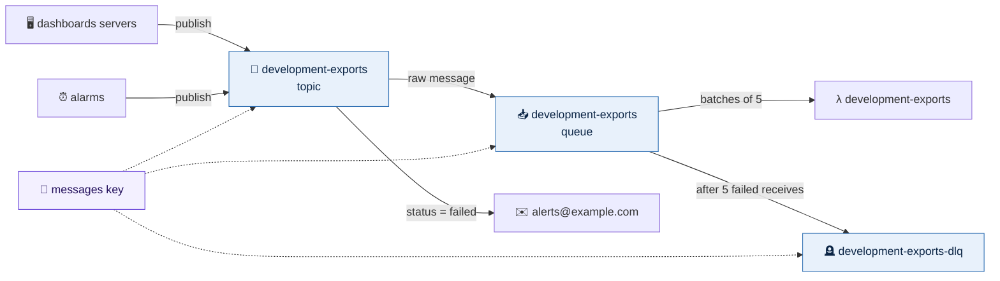

# Queues and topics

`live/<region>/<environment>/messaging` builds an environment's SQS queues and
SNS topics, after `keys` and before anything that sends or reads messages
(`lambda`, `compute`). Every queue is a file in `config/queue/`, every topic a
file in `config/topic/`. With no files, it builds nothing.



## The files

The keys are the arguments of `aws_sqs_queue` and `aws_sns_topic`, under the
provider's names. A queue or topic is named `<environment>-<file>`, with
`.fifo` added when `fifo_queue` or `fifo_topic` is true, so
`config/queue/exports.yml` in development is the queue `development-exports`.
A queue and a topic may share a name; two queues, or two topics, may not.

A queue, its dead-letter queue, and the topic that delivers into it:

```yaml
# live/us-east-2/development/messaging/config/queue/exports.yml
visibility_timeout_seconds: 360
receive_wait_time_seconds: 20
redrive_policy:
  dead_letter_target_arn: exports-dlq
  max_receive_count: 5
policy:
  statement:
    - effect: Allow
      actions:
        - sqs:SendMessage
      principals:
        - type: Service
          identifiers:
            - sns.amazonaws.com
      resources:
        - exports
      condition:
        - test: ArnEquals
          variable: aws:SourceArn
          values:
            - exports
```

```yaml
# live/us-east-2/development/messaging/config/queue/exports-dlq.yml
message_retention_seconds: 1209600
redrive_allow_policy:
  redrive_permission: byQueue
  source_queue_arns:
    - exports
```

```yaml
# live/us-east-2/development/messaging/config/topic/exports.yml
policy:
  statement:
    - effect: Allow
      actions:
        - sns:Publish
      principals:
        - type: Service
          identifiers:
            - cloudwatch.amazonaws.com
      resources:
        - exports
      condition:
        - test: StringEquals
          variable: aws:SourceAccount
          values:
            - development
sns_topic_subscription:
  - protocol: sqs
    endpoint: exports
    raw_message_delivery: true
  - protocol: email
    endpoint: alerts@example.com
    filter_policy:
      status:
        - failed
```

| Queue key | Meaning |
|---|---|
| `fifo_queue`, `content_based_deduplication` | A FIFO queue: exactly once, in order within each message group |
| `visibility_timeout_seconds` | How long a received message stays hidden. For a Lambda consumer, at least six times the function's `timeout` |
| `message_retention_seconds` | How long an unread message is kept, at most 14 days (1209600) |
| `delay_seconds`, `receive_wait_time_seconds` | A delay before new messages can be received; how long a receive waits for one (20 is long polling, so empty receives are rare) |
| `redrive_policy` | `dead_letter_target_arn`, the queue that takes messages failing `max_receive_count` times |
| `redrive_allow_policy` | `redrive_permission` (`allowAll`, `denyAll`, `byQueue`), and with `byQueue` the `source_queue_arns` that may use this queue as their dead-letter queue |
| `policy` | The queue policy's `statement` list |

| Topic key | Meaning |
|---|---|
| `fifo_topic`, `content_based_deduplication` | A FIFO topic, delivering in order to FIFO queues only |
| `policy` | The topic policy's `statement` list |
| `sns_topic_subscription` | Where the topic delivers, one `aws_sns_topic_subscription` each: `protocol` (`sqs`, `https`, `email`, `email-json`) and `endpoint`, with `raw_message_delivery` (`sqs` and `https`), `filter_policy` written as YAML, and `filter_policy_scope` if wanted |

A key left out takes the provider's default, and nothing else is added: a
queue gets a dead-letter queue only by naming one, and long polling only with
`receive_wait_time_seconds`. A subscription belongs to the topic file it is in,
which is its `topic_arn`; it has no name of its own, so it is not a file.

A statement is written as in `aws_iam_policy_document`: `effect` (Allow when
left out), `actions`, `resources`, `principals` (each a `type` and
`identifiers`) and `condition` (each a `test`, `variable` and `values`).

## Names for ARNs and accounts

Where an argument takes the ARN of something this stack builds, the file names
it, and the template writes the ARN. An ARN itself is used as written.

| Where | A name is |
|---|---|
| `redrive_policy.dead_letter_target_arn`, `redrive_allow_policy.source_queue_arns` | a queue in `config/queue/` |
| `sns_topic_subscription.endpoint`, with `protocol: sqs` | a queue in `config/queue/` |
| a queue policy statement's `resources` | a queue in `config/queue/` |
| a topic policy statement's `resources` | a topic in `config/topic/` |
| a condition's `values` on `aws:SourceArn` | a topic in `config/topic/` |

Code holds no account IDs; only `config/` does. So where a statement takes an
account, an environment's name stands for its account from
`config/<region>.yml`: in the `identifiers` of an `AWS` principal (written as
`arn:aws:iam::<account>:root`), and in a condition's `values` on
`aws:SourceAccount` or `aws:PrincipalAccount`. A 12-digit account ID is used as
written. This is the only translation; everything else in a statement is used
as written.

## What every queue and topic gets

These are fixed, so they are not keys:

- **The environment's messages key** (`alias/<environment>-messages`, from
  `keys`), for every queue and topic. It is kept apart from the data key,
  because AWS services use it as themselves: SNS delivering into an encrypted
  queue, and alarms, EventBridge and S3 events publishing to an encrypted
  topic. Each does so only for this account.
- **A policy statement refusing anything not over TLS**
  (`DenyInsecureTransport`), first in every queue's and topic's policy, before
  the statements its file writes. Within the account, IAM alone decides who may
  send, publish and read; a file's statements add only what IAM cannot grant,
  such as a topic delivering into a queue, another account, or a service
  publishing.
- **No plain HTTP.** A subscription is `https`, never `http`.

## What the plan refuses

A file outside `config/queue/` and `config/topic/`; a key that is not one of
the arguments above, in a file, a statement, a principal or a condition; two
files with one name; a name in the table above that is not in the stack; an
`AWS` principal or account condition that is neither an environment in
`config/` nor an account ID, or an environment with no account yet; a
dead-letter queue that is FIFO when its queue is not, or the other way round; a
Lambda subscription (the function subscribes itself, below); a FIFO topic
delivering to anything but a FIFO queue; and a topic subscribing a queue whose
policy has no statement letting `sns.amazonaws.com` send to it, since nothing
the topic delivers would arrive.

## Sending and reading

**Servers** send and read with their role. Give the role a shared policy in
`global/shared/iam/config/policy/`, as
`examples/global/shared/iam/config/policy/publish-exports.yml` does: the action
on the queue or topic, and the messages key through SQS or SNS only
(`kms:ViaService`). Add `sqs` and `sns` to the environment's endpoints so they
are reached without the internet ([endpoints](endpoints.md)).

**A Lambda function** takes messages from a queue with `event_source_mapping`
in its file ([global](global.md#lambda-operations)):

```yaml
# live/us-east-2/production/lambda/config/exports.yml   (code in config/src/exports/)
runtime: python3.12
handler: app.handler
timeout: 60
cloudwatch_log_group:
  retention_in_days: 365
event_source_mapping:
  event_source_arn: exports
  batch_size: 5
  function_response_types:
    - ReportBatchItemFailures
```

`event_source_arn` is the queue's name without the environment (`exports`, or
`payments.fifo` for a FIFO queue), found in this environment, or a queue's
ARN. The function may then receive and delete that queue's messages, and
decrypt them through SQS, nothing more. With `ReportBatchItemFailures` it
reports failures message by message (`batchItemFailures`), so one bad message
does not send the whole batch back. The queue's `visibility_timeout_seconds`
should be at least six times the function's `timeout`, or a slow batch
reappears while it is still running.

**A Lambda function on a topic** subscribes itself, from its own file, the same
way it reads a queue:

```yaml
# live/us-east-2/production/lambda/config/audit.yml   (code in config/src/audit/)
runtime: python3.12
handler: app.handler
cloudwatch_log_group:
  retention_in_days: 365
sns_topic_subscription:
  - topic_arn: exports
    filter_policy:
      status:
        - failed
```

`topic_arn` is this environment's topic by name, or a topic's ARN. The
function's stack makes the subscription, and lets that topic, and only that
topic, invoke it. So `lambda` always comes after `messaging`, whether its
functions read queues, subscribe to topics, or both: the two stacks can never
need each other. A topic delivering into a queue the function reads is still
usually the better design, because the queue keeps messages while the function
is down and retries them one by one.

## Another account

Name the environment in an `AWS` principal of the queue's or topic's policy;
its account comes from `config/`. The messages key already lets every
environment's account use it through SQS and SNS, so the queue's or topic's
policy is what decides. The other account's roles still need IAM permission of
their own, for the queue or topic and for the key.

```yaml
policy:
  statement:
    - effect: Allow
      actions:
        - sqs:SendMessage
        - sqs:GetQueueUrl
        - sqs:GetQueueAttributes
      principals:
        - type: AWS
          identifiers:
            - operations
      resources:
        - exports
```
