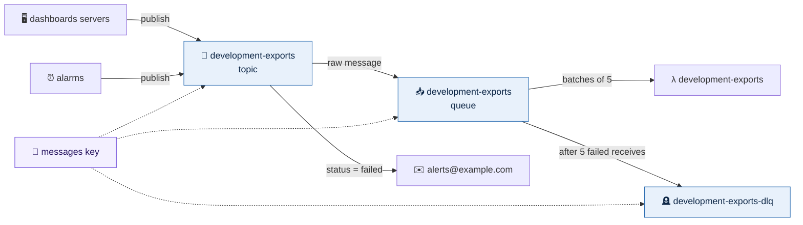

# Queues and topics

`live/<region>/<environment>/messaging` builds an environment's SQS queues and
SNS topics, one `.yml` file each, after `keys` and before anything that sends
or reads messages (`lambda`, `compute`). With no files, it builds nothing.



## A file

A file holds a `queue`, a `topic`, or both. Both are named
`<environment>-<file>`, so `exports.yml` in development builds the queue and the
topic `development-exports`.

```yaml
# live/us-east-2/production/messaging/exports.yml
queue:
  visibility_timeout_seconds: 360
  dead_letter:
    max_receive_count: 5
topic:
  subscriptions:
    - protocol: sqs
      endpoint: queue:exports
      raw_message_delivery: true
    - protocol: email
      endpoint: alerts@example.com
      filter_policy:
        status:
          - failed
  publishers:
    - cloudwatch
```

| `queue:` key | Meaning |
|---|---|
| `fifo_queue`, `content_based_deduplication` | A FIFO queue: exactly once, in order within each message group. Its name gets `.fifo` |
| `visibility_timeout_seconds` | How long a received message stays hidden (default 30). For a Lambda consumer, at least six times the function's timeout |
| `message_retention_seconds` | How long an unread message is kept (default four days, at most 14) |
| `delay_seconds`, `receive_wait_time_seconds` | A delay before new messages can be received (default 0); how long a receive waits for one (default 20, so empty receives are rare) |
| `dead_letter.max_receive_count` | Receives before a failing message moves to the dead-letter queue (default 5) |
| `senders`, `consumers` | Other environments by name, or account IDs, whose roles may send, or receive and delete |

| `topic:` key | Meaning |
|---|---|
| `fifo_topic`, `content_based_deduplication` | A FIFO topic, delivering in order to FIFO queues only |
| `subscriptions` | Where the topic delivers: `protocol` (`sqs`, `lambda`, `https`, `email`, `email-json`) and `endpoint`. `queue:<file>` is a queue in this stack and `lambda:<file>` a function in this environment's `lambda` stack; anything else is used as written. `raw_message_delivery` (`sqs` and `https`), `filter_policy` written as YAML, and `filter_policy_scope` are optional |
| `publishers` | Other environments by name, or account IDs, whose roles may publish; and `cloudwatch` (alarms), `events` (EventBridge) or `s3` (bucket events), publishing for this account |

## What every queue and topic gets

- **A dead-letter queue** for every queue, `<name>-dlq`, keeping failed messages
  the full 14 days. Only its own queue may use it, so you can redrive messages
  back from the console once the cause is fixed.
- **The environment's messages key** (`alias/<environment>-messages`, from
  `keys`), for the queue, its dead-letter queue and the topic. It is kept apart
  from the data key, because AWS services use it as themselves: SNS delivering
  into an encrypted queue, and alarms, EventBridge and S3 events publishing to
  an encrypted topic. Each does so only for this account.
- **A policy that refuses anything not over TLS.** Within the account, IAM
  alone decides who may send, publish and read. The policy only adds what IAM
  cannot grant: a topic delivering into a queue (only the topics in this stack
  that subscribe it), other accounts named in `senders`, `consumers` and
  `publishers`, and the services named in `publishers`.
- **No plain HTTP.** A subscription is `https`, never `http`.

The plan refuses a misspelt key, a `queue:` naming no queue in the stack, a
`queue:` subscribed as anything but `sqs` (or `lambda:` as anything but
`lambda`), a FIFO topic delivering to anything but a FIFO queue, a sender that
is neither an environment in `config/` nor an account ID, and a service named
as a queue's sender (it publishes to a topic instead).

## Sending and reading

**Servers** send and read with their role. Give the role a shared policy in
`global/shared/iam/policies/`, as `examples/global/shared/iam/policies/publish-exports.yml`
does: the action on the queue or topic, and the messages key through SQS or
SNS only (`kms:ViaService`). Add `sqs` and `sns` to the environment's
`endpoints.yml` so they are reached without the internet ([endpoints](endpoints.md)).

**A Lambda function** takes messages from a queue with `event_source_mapping`
in its file ([global](global.md#lambda-operations)):

```yaml
# live/us-east-2/production/lambda/exports.yml   (code in src/exports/)
runtime: python3.12
handler: app.handler
timeout: 60
event_source_mapping:
  event_source_arn: queue:exports      # a FIFO queue is queue:<file>.fifo
  batch_size: 5
```

The function may then receive and delete that queue's messages, and decrypt
them through SQS, nothing more. It reports failures message by message
(`batchItemFailures`), so one bad message does not send the whole batch back.
The queue's `visibility_timeout_seconds` should be at least six times the
function's `timeout`, or a slow batch reappears while it is still running.

A topic delivering straight to a function (`lambda:<file>`) needs the function
to exist first: apply `lambda` before `messaging` for that subscription. A topic
delivering to a queue that the function reads needs no such order, keeps
messages while the function is down, and is usually the better design.

## Another account

Name the environment in `senders`, `consumers` or `publishers`; its account
comes from `config/`. The messages key already lets every environment's account
use it through SQS and SNS, so the queue's or topic's policy is what decides.
The other account's roles still need IAM permission of their own, for the
queue or topic and for the key.
