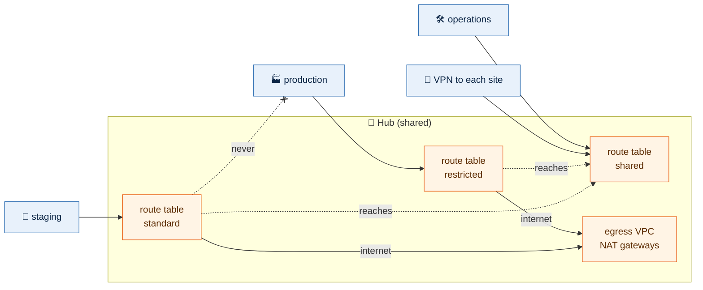

# Network

Hub and spoke, in Ohio (us-east-2) and Oregon (us-west-2). Each region has a
Transit Gateway hub with an egress VPC; every environment is a spoke VPC
attached to its region's hub; the two hubs are peered. Each site (an office,
a corporate VPN, another company's network) has its own VPN, terminating on
both hubs ([sites](#sites)).



## Modules

| Module | Builds |
|---|---|
| `ip-plan` | Every VPC's CIDR and its subnets per tier, in one place. No resources |
| `vpc` | A VPC: subnets per tier and availability zone, a route table per subnet, optional internet and NAT gateways, the Transit Gateway attachment with its association and propagations, flow logs |
| `transit-gateway` | A Transit Gateway with default association and propagation off, its route tables, and static routes |
| `transit-gateway-peering` | The peering between two hubs in different regions, its association on each side, and static routes across it |
| `vpn` | A customer gateway and a BGP VPN connection on a Transit Gateway, associated and propagated |

Each module has tests under `tests/` that run against a mocked AWS provider:
`make test` runs them all.

## Stacks from templates

A template is a module that composes the others into one kind of stack, and
every stack of that kind calls it:

```bash
make stack STACK=us-west-2/shared/hub           # calls templates/hub
make stack STACK=us-west-2/staging/network      # calls templates/network
```

A network stack is one module call, with its environment and region read from its
path (a hub stack passes only its region):

```hcl
module "network" {
  source = "../../../../templates/network"

  environment = local.environment
  region      = local.region
}
```

Everything that differs between environments comes from `modules/ip-plan`, and a
template refuses an environment and region that has no entry there. Adding an
environment is one entry in the IP plan and one `make stack`. A change to a
template reaches every stack that calls it on its next plan; there are no copies
to keep in step.

Each template has tests under `tests/` for its wiring (which route table a
network joins, which tiers it gets), run against a mocked AWS. A stack's own test
checks only what the stack adds: its identity from `stack.tf`.

| Template | Builds | Finds |
|---|---|---|
| `templates/hub` | Transit Gateway and its route tables, the egress VPC, a VPN for each enabled site whose `ip_address` is set | the primary hub finds the other regions' hubs, to peer with them |
| `templates/network` | The environment's VPC, attached to its segment's route table | the region's hub, by its `Component = hub` tag |

Build order: the other regions' hubs, then the primary hub (it requests the peering), then the global `dns`, then each
environment's network. `make order` works it out ([architecture](architecture.md#apply-order)).

## IP plan

The ranges in `config/` are examples: replace them with ranges that do not
overlap your offices, partners or any other network you will connect to. Changing a range is safe until a VPC is built from it; after
that it means rebuilding the VPC.

Each region's VPCs are in `config/<region>.yml`, beside its state bucket and the
environments' accounts ([configuration](configuration.md#config)): the hub
under `hub`, each environment's VPC under `vpcs`:

```yaml
# config/us-east-2.yml, the network part
hub:
  cidr: 10.40.0.0/20
  amazon_side_asn: 64512
  primary: true
vpcs:
  operations:
    cidr: 10.42.0.0/16
    segment: shared
    public: false
```

| Key | `vpcs.<environment>` | `hub` |
|---|---|---|
| `cidr` | a /16 | a /20, for the egress VPC |
| `segment` | `restricted`, `standard` or `shared`: the hub route table it joins, which decides what it can reach. Left out with `connectivity: peering` | always `shared`; not written |
| `connectivity` | `transit_gateway` (the default: on the region's hub) or `peering`: off the hub, with its own NAT and VPC peering ([below](#off-the-hub-connectivity-peering)) | not allowed |
| `public` | `true` for a public tier (internet-facing load balancers), else `false` | always has one; not written |
| `amazon_side_asn` | not allowed | the Transit Gateway's BGP ASN, 64512 to 65534, different for each hub |
| `primary` | not allowed | `true` on exactly one hub. The primary is built after the other hubs, requests the peering, is the sites' preferred VPN path, and is where `global` stacks run. Moving it is a one-line change |
| `security_group_referencing` | not allowed: every VPC follows its region's hub | `false` by default. `true` lets security groups in VPCs attached to this hub reference each other's groups (`group:<environment>/<group>`, [security groups](security-groups.md#groups-in-other-environments)). Same region only: never across the peering |
| `transit_gateway` | not allowed: every VPC attaches to its region's | `owner: self` by default: the hub builds its own. `owner: parent`, with the gateway's `id` and the parent's RAM `share_arn`, attaches the hub and every spoke in the region to another organization's gateway instead ([accounts](accounts.md#a-parent-organizations-network)) |
| `resolver` | not allowed: every VPC uses its region's hub | `inbound` and `outbound`, where this hub has [resolver endpoints](#dns-with-the-sites). By default only the primary hub has an inbound one, and every hub has an outbound one while a site forwards anything. Set `outbound: false` for a region whose servers never need a site's names |

Adding an environment is one entry under `vpcs` and one `make stack`. The
plan refuses, naming the entry and its file:

- a region file not named after an AWS region, or with keys other than `zones`,
  `hub` and `vpcs`
- `shared` under `vpcs`: it is the hub's environment
- an unknown or misspelt key (`segmnet` fails rather than being ignored)
- an environment whose `account_id` or `team` differs between region files
- a `cidr` that is not a network address, or not the size above
- a `segment` other than the three, or a `public` that is not `true` or `false`
- a hub ASN outside the private range, or used by both hubs
- anything but exactly one hub with `primary: true`
- a range outside `10.0.0.0/8`, which the hubs route between VPCs
- two ranges that overlap

`modules/ip-plan/tests/fixtures/` holds one broken folder per rule, and `make
test` proves each is refused. What every VPC shares (the subnet layout, the sites,
DNS forwarding, prefix lists) is in `config/global.yml`;
which segment may reach which is fixed in the IP plan. A site without an
`ip_address` has no VPN built.

| VPC | Ohio (us-east-2) | Oregon (us-west-2) |
|---|---|---|
| Egress (hub) | 10.40.0.0/20 | 10.60.0.0/20 |
| Production | 10.41.0.0/16 | 10.61.0.0/16 (DR) |
| Operations | 10.42.0.0/16 | |
| Staging | | 10.62.0.0/16 |

Every spoke (/16) is carved the same way, so a tier sits at the same addresses
in every environment and region. The layout is one file, `config/global.yml`:

```yaml
subnets:
  environment:
    private:
      size: 19
      start: 0
      route: hub
    data:
      size: 22
      start: 192
      route: internal
    public:
      size: 23
      start: 216
      route: internet
    ops:
      size: 23
      start: 228
      route: hub
    dmz:
      size: 24
      start: 240
      route: none
    transit:
      size: 28
      start: 252
      route: none
  hub:
    public:
      size: 24
      start: 0
    transit:
      size: 28
      start: 15
```

`size` is each subnet's prefix length. `start` is the third octet where the
tier's block begins, counted from the VPC's first address. Every tier reserves
room for six zones, and zone `azN` always takes the Nth block: `az1` the first,
`az3` the third, whichever zones a region lists and in whatever order. So a
region can grow from three zones to six by adding them to `zones`, and only new
subnets are planned. `route` is where a network tier's traffic goes:

| `route` | Default route | Other VPCs and the sites | Used by |
|---|---|---|---|
| `hub` | to the hub, and out through the egress VPC | through the hub | `private`, `ops` |
| `internal` | none: no internet, unless the environment adds a route ([below](#a-route-for-one-tier)) | through the hub (`10.0.0.0/8`) | `data`, so databases can answer operations' tooling and the sites but never reach the internet on their own |
| `internet` | an internet gateway; built only where the network has `public: true` | no | `public` |
| `none` | none | no: only its own VPC | `transit`, which holds only the hub attachment, and `dmz` until something is placed there |

`reserved: 26` on a tier keeps `.64` to `.127` of each of its subnets' first
/24 for addresses people choose: a subnet CIDR reservation AWS never hands out
from on its own ([compute](compute.md#addresses-aws-assigned-or-chosen-and-identical-everywhere)).

The hub's route tables still decide who may connect at all; a route only lets
replies find their way back. Adding a tier is one entry, with no template
change. The plan refuses, naming the tier: a size outside the VPC, a start that
is not on a boundary for its size (`start: 193` for a /22), tiers whose six
blocks overlap or run past the end of the VPC, a missing `transit` tier (or hub
`public`), a `transit` route other than `none`, and a zone numbered past `az6`.

Every subnet is tagged `Tier` (`data`) and `Subnet` (`data-az1`: the tier and
the zone ID's last part). `Subnet` names exactly one subnet in an environment's
VPC, the same way in every environment and account, so a stack places an
instance with `subnet_id: data-az1` and finds it by tag, never by a subnet ID.
`make output` on a network or hub shows the same names: `subnets` maps each
(`data-az1`) to its subnet ID, CIDR and zone ID.

Their `Name` tags are for the console and nothing looks them up: the
environment, the tier and the zone, as `Staging - Data Subnet AZ1` and
`Staging - Data Route Table AZ1` ([conventions](conventions.md#names)). A
network finds the hub's route tables by their `Segment` tag (`standard`), and
every other stack finds its environment's VPC by its `Environment` and
`Component` tags.

Today's layout, for Ohio production (`10.41.0.0/16`):

| Tier | Each zone | Reserved for six zones | az1, az2, az3 | Holds |
|---|---|---|---|---|
| `private` | /19 | 10.41.0.0 – 10.41.191.255 | .0.0, .32.0, .64.0 | workloads |
| `data` | /22 | 10.41.192.0 – 10.41.215.255 | .192.0, .196.0, .200.0 | databases and caches |
| `public` | /23 | 10.41.216.0 – 10.41.227.255 | .216.0, .218.0, .220.0 | internet-facing load balancers; only where `public: true` |
| `ops` | /23 | 10.41.228.0 – 10.41.239.255 | .228.0, .230.0, .232.0 | the tooling that serves this environment: jump hosts, monitoring proxies, runners that deploy into it |
| `dmz` | /24 | 10.41.240.0 – 10.41.245.255 | .240.0, .241.0, .242.0 | nothing yet: kept apart for partner-facing hosts such as SFTP. Its route is `none` until it has a use |
| `transit` | /28 | 10.41.252.0 – 10.41.252.95 | .252.0, .252.16, .252.32 | the Transit Gateway attachment only |

`10.x.246.0` – `10.x.251.255` is unallocated, room for one more /24 tier.

About half of each /16 is unallocated, so a tier can be added later without
renumbering. An
egress VPC (/20) has `public` (/24 ×3) and `transit` (/28 ×3).

## Who changes the hub

The hub and each spoke are separate stacks, applied separately, and neither
needs the other's state: a network finds its hub by tags, the hub never looks a
spoke up. Each change has one owner:

| Change | Owner | How |
|---|---|---|
| The Transit Gateway, its three route tables, its routes and blackholes | The hub stack (`live/<region>/shared/hub`) | `terraform-apply-shared-hub` |
| VPN to each site, and its propagation | The hub stack | The same |
| Peering between hubs, and the routes across it | The primary hub stack | The same |
| The resolver, its rules, and the zones every VPC attaches to | The hub and `global/shared/dns` | The same |
| Sharing the gateway, prefix lists and resolver rules with other accounts | The hub stack, through RAM | The same |
| A spoke's attachment, in its own account | The network stack | `terraform-apply-<environment>-network` |
| Accepting that attachment, associating it with its segment's table, announcing it to the tables that may reach it, authorizing its private zones | The network stack, in the hub's account | `terraform-network-<environment>`, which can do only that, for that environment's attachments and segments |
| The VPC's own routes toward the hub | The network stack | `terraform-apply-<environment>-network` |

No workload, service or IAM role can change any of it, and the network role
can change the hub's side only through its narrow role. Which table a spoke
joins is `segment` in `config/`, and the role is built from the same file, so a
spoke asking for another segment is refused by AWS, not just by review. With a
[parent's gateway](accounts.md#a-parent-organizations-network), every row above
the attachment is the parent's.

## Routing

Spokes have no internet or NAT gateway. Their `private` tier sends everything to
the hub, and so does `ops`; `data` sends only internal traffic to the hub and,
unless its environment adds a route ([below](#a-route-for-one-tier)), has no way
to the internet. Each egress VPC holds one NAT
gateway per availability zone and returns internal traffic (10.0.0.0/8) to the
hub.

The hub's route tables are the boundary between environments. An attachment is
associated with one table (which decides where it can send) and propagates its
CIDR into the tables that may reach it. Nothing joins a table by default.

| Route table | Associated | Reaches |
|---|---|---|
| `restricted` | production, production DR | itself, `shared`, the sites, the internet through egress |
| `standard` | staging | itself, `shared`, the sites, the internet through egress |
| `shared` | operations, the VPN, the egress VPC, the peering | everything |

Staging never reaches production, and production never reaches staging:
`restricted` and `standard` each hold a `10.0.0.0/8` blackhole. Without it,
traffic to another segment would follow `0.0.0.0/0` to the egress VPC and come
back through `shared`, which knows every range. The routes a table should have
(its own segment, `shared`, the sites, the peering) are more specific, so they still
win. A site's ranges outside `10.0.0.0/8` (an office on `192.168.0.0/16`) are routed
back from the `data` tier and the hub's DNS tier as well as `10.0.0.0/8`.

With a second region, the primary hub peers with every other hub: each table
gets static routes to the other region's ranges by the same rules (restricted
to restricted and shared, standard to standard and shared, shared to
everything). Apply the other regions' hubs before the primary hub, which
requests and accepts the peering.

Inspection (AWS Network Firewall) is not built; it would sit in the egress VPC.

### A route for one tier

An environment can give one tier a route its layout does not, with a route file
in its network stack. Staging's `data` tier sends its internet traffic to the
hub, which takes it out through its NAT, because SQL Server there needs Windows
Update and the Salesforce connectors (CData, DBAmp):

```yaml
# live/us-west-2/staging/network/config/route-table/data.yml
route:
  - destination_cidr_block: 0.0.0.0/0
    transit_gateway_id: hub
```

`hub` is this region's hub: the network finds its Transit Gateway by its tags, in
the stack's own region, since a route can only point at a Transit Gateway in its
own region (the other region is reached through the hubs' peering). Routing decides where traffic can go; the
security groups still decide which servers may send it, so only the groups
that allow 443 and 80 out (`sqlserver-cluster`, `sqlserver-quorum`) reach the
internet, and S3 still goes through its gateway endpoint, whose route is more
specific. The plan refuses a route the tier already has.

**Why `data` has no route out by default.** The data tier holds the data: RDS,
Aurora, EFS, SQL Server. Without a default route, nothing there can send
anything to the internet, even through a security group written too loosely or
a compromised server: the route table has no path out. That is a second line of
defense that does not depend on every group being right, and it costs managed
services nothing, since they patch themselves and need no internet.

A self-managed server in the tier changes that: SQL Server on EC2 needs Windows
Update and its connectors. Adding the route moves the guarantee for the whole
tier onto the security groups, so in that environment only groups written for
it (`sqlserver-cluster`, `sqlserver-quorum`) allow 443 and 80 out, and a managed
database's group never has egress. Keep the route per environment, never in
`config/global.yml`, so each one is a deliberate choice. If routing alone must
keep the managed stores off the internet (an auditor's requirement, say), give
self-managed servers a tier of their own, routed `hub`, and leave `data`
`internal`.

## Off the hub: `connectivity: peering`

A small or short-lived environment (an ad hoc one) can stand on its own instead
of joining the hub: its own internet and NAT gateways, VPC peering to the few
networks it needs, and every route written out. Nothing in it touches the hub,
so it needs no segment and the hub stack need not know it.

```yaml
# config/us-east-2.yml
vpcs:
  adhoc:
    cidr: 10.43.0.0/16
    connectivity: peering
    public: true
```

Its subnets are carved as every other VPC's, but its route tables carry only
the routes its network stack's files give, one file per tier in
`config/route-table/`, each route `aws_route`'s own arguments:

```yaml
# live/us-east-2/adhoc/network/config/route-table/private.yml
route:
  - destination_cidr_block: 0.0.0.0/0
    nat_gateway_id: own
  - destination_cidr_block: 10.42.0.0/16
    vpc_peering_connection_id: operations
```

```yaml
# live/us-east-2/adhoc/network/config/route-table/public.yml
route:
  - destination_cidr_block: 0.0.0.0/0
    gateway_id: own
```

```yaml
# live/us-east-2/adhoc/network/config/peering/operations.yml
peer_vpc_id: operations
```

| Route key | Meaning |
|---|---|
| `destination_cidr_block` | Required |
| `gateway_id` | `own`: this VPC's internet gateway, made when a route names it |
| `nat_gateway_id` | `own`: the NAT gateway in the subnet's own zone, one per zone in the public tier, made when a route names it. Needs `route-table/public.yml` to send `0.0.0.0/0` to `gateway_id: own`. Only off the hub: a VPC on the hub goes out through it |
| `vpc_peering_connection_id` | A peering by name: a file in this stack's `config/peering/`, or an environment that peered with this one; or a `pcx-` id |
| `transit_gateway_id` | Only on the hub: `hub` (this region's hub, found by its tags) or a Transit Gateway id (`tgw-` and 17 hex digits) |

A route has exactly one target. A tier with no file has only the VPC's local
route, so the `data` tier of an ad hoc environment reaches nothing until a file
says so.

A peering file is `aws_vpc_peering_connection`'s own arguments: `peer_vpc_id`
(an environment's name in `config/`, or a `vpc-` id), `peer_region` (left out
for the same region) and `tags`. Within a region it is accepted where it is
made; across regions an `aws_vpc_peering_connection_accepter` accepts it in the
peer's region. Across accounts it is refused: the peer's account must accept,
which is not built.

**Both sides route.** Peering is not transitive and carries nothing by itself:
the peer needs a route back, written in its own network stack as a route file
naming this environment. A VPC on the hub may have route files too, for routes
beyond the ones its tiers already have:

```yaml
# live/us-east-2/operations/network/config/route-table/private.yml
route:
  - destination_cidr_block: 10.43.0.0/16
    vpc_peering_connection_id: adhoc
```

Apply the new environment's network first (it makes the peering, and `make
order` puts it after the peer's), then plan the peer's network again for its
route back. The plan refuses a route to a destination its tier already has from
`config/global.yml`, the same destination twice, a target that is not one of
the four, a peering it cannot name, and a NAT route on a VPC on the hub.

What an environment off the hub does not have: the hub's VPN (peering does not
pass it on, so people reach its servers through Session Manager), the hub's DNS
forwarding to the sites, and security group references across the hub. Private hosted
zones are associated as for every VPC.

## Network ACLs

Every tier keeps the VPC's default network ACL, which allows everything:
security groups do the filtering. A tier that needs a coarse second line (an ad
hoc environment's `data` tier, say) gets one file in its network stack's
`config/network-acl/`, `aws_network_acl`'s own rules, and the ACL covers every
subnet of that tier:

```yaml
# live/us-east-2/adhoc/network/config/network-acl/data.yml
ingress:
  - rule_no: 100
    action: allow
    protocol: "-1"
    cidr_block: 10.0.0.0/8
egress:
  - rule_no: 100
    action: allow
    protocol: "-1"
    cidr_block: 10.0.0.0/8
```

Each rule takes `rule_no` (1 to 32766, once per direction), `action` (`allow`
or `deny`), `protocol` (`tcp`, `udp`, `icmp` or `"-1"`), `cidr_block`, and
`from_port` and `to_port` (or `icmp_type` and `icmp_code`). A network ACL is
stateless and ends in an implicit deny: whatever a rule lets in, another must
let its replies out, often on ephemeral ports 1024 to 65535. Leave a tier
without a file unless you need one.

## Defaults in every VPC

| What | Setting | Why |
|---|---|---|
| Flow logs | all traffic, accepted and rejected, to the CloudWatch log group `/vpc/flow-logs/<vpc id>`, kept 365 days (`flow_log_retention_days` in the `vpc` module) | incident response and audit need a record from the first day |
| Flow log role | `flow-logs-<vpc id>`, assumable only by VPC Flow Logs for this account, allowed to write only to its own log group | least privilege; no confused-deputy use from another account |
| Default security group | every rule removed, its `Name` tag `<Environment> - Default Security Group (unused)` | AWS will not delete it; with no rules it admits and sends nothing, so nothing can rely on it by accident |
| Default network ACL | left as AWS creates it (allow all), unless the tier has a file in `config/network-acl/` ([network ACLs](#network-acls)) | security groups do the filtering; custom ACLs are stateless and break return traffic in ways that are hard to see |

The log group's and role's names include the VPC ID because several
environments' VPCs may share one account.

## Adding and removing zones

A zone's subnets always sit in the blocks numbered after it, so adding a zone to
a region's `zones` plans only that zone's new subnets, NAT gateway and
attachment subnet; nothing existing moves, and the order of the list does not
matter. Removing a zone would delete its subnets: every VPC, every subnet and
each hub's Transit Gateway is protected with `prevent_destroy`, so that plan
fails at once, naming them, before anything changes. Removing a zone or a VPC
on purpose is a reviewed change that lifts the protection first.

## Sites

A site is a network outside AWS that reaches it over a VPN: a corporate VPN, an
office, another company's network during a move. Each is a named block under
`sites` in `config/global.yml`, and everything a site brings comes and goes
with its block:

```yaml
sites:
  corporate:
    ip_address: 203.0.113.10
    bgp_asn: 65010
    cidrs:
      - 172.16.0.0/16
    forward:
      aadds.example.com:
        - 172.16.10.4
        - 172.16.10.5
  legacy-office:
    enabled: false
    bgp_asn: 65020
    ip_address:
      - 198.51.100.20
      - 198.51.100.21
    cidrs:
      - 192.168.0.0/16
```

| Key | Meaning |
|---|---|
| `enabled` | `false` switches the site off everywhere, keeping its settings to turn it back on; leave it out for `true` |
| `ip_address`, `bgp_asn` | The site's VPN device, as `aws_customer_gateway` takes them: one address, or a list with one per internet link. Each hub builds a VPN to every address, named after the site and the address (`Shared - Corporate VPN 203.0.113.10`), and BGP moves traffic to the other link when one fails. Left empty, the site has no VPN yet |
| `cidrs` | The ranges behind it. None may overlap a hub or VPC; the plan refuses one that does, naming both. Ranges inside `10.0.0.0/8` already route through the hub; ones outside it are routed back from the tiers that reach the sites, and may ask the hub's inbound resolver |
| `forward` | Domains whose names the site's DNS servers answer, each with their addresses ([below](#dns-with-the-sites)) |

The VPN's routes are learned over BGP, so the Transit Gateway knows each site's
ranges without them being written down twice.

**Adding a site** is adding its block and applying each hub, then each
network (which attaches the site's forwarding rules). **Cutting one off** is
`enabled: false` (or deleting the block), applied the other way round: the
networks first, which detach its forwarding rules, then the hubs, which delete
the rules, the VPN and its customer gateway. Its routes leave the Transit
Gateway with the VPN.

## DNS with the sites

Servers in AWS may need names a site's DNS answers (the directory they join,
Entra Domain Services, among them), and people at a site need names in AWS.
Both are set by the network team in `config/global.yml`: a site's `forward`
for the first, `dns.inbound` for the second.

```yaml
dns:
  inbound: true
```

Each hub's `route53-resolver` builds them in the egress VPC's `dns` tier, each
endpoint with an address in two zones (a /28 per zone at `10.x.14.0`):

- an **outbound endpoint** and one **forwarding rule** per domain under an
  enabled site's `forward`, sending those questions to that site's DNS servers
  over its VPN. A domain is forwarded by one site only. Forwarding rules work
  only in their own region, so each region whose servers need a site's names
  (to join the domain) has its own: `hub.resolver.outbound` in
  `config/<region>.yml`, on by default;
- one **inbound endpoint**, in the primary region, whose addresses (the hub's
  `dns` output) each site's DNS servers forward AWS names to. One is enough:
  every private zone is attached to every hub, so it answers for every
  environment in every region. While that region is down, the sites cannot
  resolve names in AWS; servers in the other region still resolve their own.
  Move or add it with `hub.resolver.inbound`.

```yaml
hub:
  resolver:
    inbound: false
    outbound: true
```

Each environment's network finds its own region's rules by name and associates
them with its VPC, so every VPC resolves the sites' domains without endpoints of
its own, and the hub never reads an environment. With no site forwarding
anything and `dns.inbound` false, nothing is built and nothing is paid for. An
endpoint costs about $0.125 an hour per address, about $180 a month at two.
The environments in `dns.resolve_all_private` need both endpoints in their
region; the plan refuses otherwise.

Private hosted zones in the hub are the private domain (`dns.private_domain`)
and any listed under `dns.private_zones` (reverse zones, another internal
domain) in the same file. The global `dns` stack creates them, and
each network attaches its own VPC by name, as it does with the forwarding rules
([global](global.md#dns)).

## Directory: AWS Managed Microsoft AD

The domain lives outside AWS today, reached through a site. The scaffolding for
an AWS-hosted one is in place, switched off, so it can be turned on without new
code: a `directory` block in `config/global.yml`, which the primary hub builds
and nothing else ever does.

```yaml
directory:
  enabled: false
  name: ad.example.internal
  short_name: CORP
  edition: Standard
  description: AWS Managed Microsoft AD, in the primary hub
```

| Key | Meaning |
|---|---|
| `enabled` | `false` builds nothing and checks nothing, so the block can wait half filled; leave it out for `true` |
| `name`, `short_name`, `edition`, `description` | As `aws_directory_service_directory` takes them: the domain's DNS name (its own, never one of our hosted zones or a site's `forward`), its NetBIOS name, `Standard` or `Enterprise` |

Turned on, the primary hub builds:

- the directory (`MicrosoftAD`), its two domain controllers in the hub's `dns`
  tier, in two zones, reached from every VPC through the hub. It is protected
  with `prevent_destroy`, like the VPCs;
- its `Admin` password, generated once into the secret
  `directory/<name>/admin` and never written into a plan file in the clear;
- a forwarding rule for its domain, sent to the domain controllers by the
  primary region's outbound resolver, which every VPC in that region attaches.
  The hub's `directory` output holds its id (for RDS's `domain`), the domain
  controllers' addresses and the secret.

What it does not do yet, on purpose: reach another region (that takes the
`Enterprise` edition and `aws_directory_service_region`, so servers in the other
region have domain controllers of their own), share the directory with other
accounts, or trust another domain. AWS makes the domain controllers' security
group itself; review its inbound rules before servers join. A directory costs
about $290 a month (`Standard`) or about $880 (`Enterprise`).

## VPN

BGP, not static routes, so a failed tunnel, or a failed region, fails over on its
own. Both tunnels accept only IKEv2, AES-256 (CBC or GCM), SHA-2 (256,
384 or 512) and Diffie-Hellman groups 14, 19, 20 or 21, so neither can be
negotiated down to AES-128, SHA-1 or a weak group. Each site's router must offer at
least one of each. Both tunnels log to `/vpn/tunnel-logs/<transit gateway
id>/<site>/<address>`, kept 365 days. Its tunnel pre-shared keys are generated by AWS and held in Terraform state;
see SECURITY.md.
