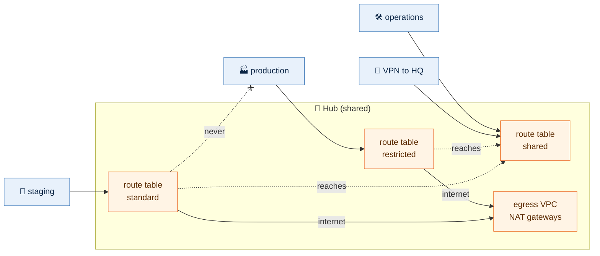

# Network

Hub and spoke, in Ohio (us-east-2) and Oregon (us-west-2). Each region has a
Transit Gateway hub with an egress VPC; every environment is a spoke VPC
attached to its region's hub; the two hubs are peered. The VPN to HQ
terminates on both hubs.



## Modules

| Module | Builds |
|---|---|
| `ip-plan` | Every VPC's CIDR and its subnets per tier, in one place. No resources |
| `vpc` | A VPC: subnets per tier and availability zone, a route table per subnet, optional internet and NAT gateways, the Transit Gateway attachment with its association and propagations, flow logs |
| `transit-gateway` | A Transit Gateway with default association and propagation off, its route tables, and static routes |
| `transit-gateway-peering` | The peering between two hubs in different regions, its association on each side, and static routes across it |
| `vpn` | A customer gateway and a BGP VPN connection on a Transit Gateway, associated and propagated |

Each module has tests under `tests/` that run against a mocked AWS provider:
`make test` runs them all.

## Stacks from templates

A template is a module that composes the others into one kind of stack, and
every stack of that kind calls it:

```bash
make stack STACK=us-west-2/shared/hub           # calls templates/hub
make stack STACK=us-west-2/staging/network      # calls templates/network
```

A network stack is one module call, with its environment and region read from its
path (a hub stack passes only its region):

```hcl
module "network" {
  source = "../../../../templates/network"

  environment = local.environment
  region      = local.region
}
```

Everything that differs between environments comes from `modules/ip-plan`, and a
template refuses an environment and region that has no entry there. Adding an
environment is one entry in the IP plan and one `make stack`. A change to a
template reaches every stack that calls it on its next plan; there are no copies
to keep in step.

Each template has tests under `tests/` for its wiring (which route table a
network joins, which tiers it gets), run against a mocked AWS. A stack's own test
checks only what the stack adds: its identity from its path.

| Template | Builds | Finds |
|---|---|---|
| `templates/hub` | Transit Gateway and its route tables, the egress VPC, the VPN once HQ's IP is set | nothing; it is built first |
| `templates/network` | The environment's VPC, attached to its segment's route table | the region's hub, by its `Component = hub` tag |

Build order: both hubs, then each environment's network.

## IP plan

The ranges in `config/` are examples: replace them with ranges that do not
overlap your offices, partners or any other network you will connect to. Changing a range is safe until a VPC is built from it; after
that it means rebuilding the VPC.

Each region's VPCs are in `config/<region>.yml`, beside its state bucket and the
environments' accounts ([configuration](configuration.md#config)): the hub
under `hub`, each environment's VPC under `vpcs`:

```yaml
# config/us-east-2.yml, the network part
hub:
  cidr: 10.40.0.0/20
  amazon_side_asn: 64512
  primary: true
vpcs:
  operations:
    cidr: 10.42.0.0/16
    segment: shared
    public: false
```

| Key | `vpcs.<environment>` | `hub` |
|---|---|---|
| `cidr` | a /16 | a /20, for the egress VPC |
| `segment` | `restricted`, `standard` or `shared`: the hub route table it joins, which decides what it can reach | always `shared`; not written |
| `public` | `true` for a public tier (internet-facing load balancers), else `false` | always has one; not written |
| `amazon_side_asn` | not allowed | the Transit Gateway's BGP ASN, 64512 to 65534, different for each hub |
| `primary` | not allowed | `true` on exactly one hub. The primary is built first, requests the peering, is HQ's preferred VPN path, and is where `global` stacks run. Moving it is a one-line change |
| `security_group_referencing` | not allowed: every VPC follows its region's hub | `false` by default. `true` lets security groups in VPCs attached to this hub reference each other's groups (`group:<environment>/<group>`, [security groups](security-groups.md#groups-in-other-environments)). Same region only: never across the peering |

Adding an environment is one entry under `vpcs` and one `make stack`. The
plan refuses, naming the entry and its file:

- a region file not named after an AWS region, or with keys other than `zones`,
  `hub` and `vpcs`
- `shared` under `vpcs`: it is the hub's environment
- an unknown or misspelt key (`segmnet` fails rather than being ignored)
- an environment whose `account_id` or `team` differs between region files
- a `cidr` that is not a network address, or not the size above
- a `segment` other than the three, or a `public` that is not `true` or `false`
- a hub ASN outside the private range, or used by both hubs
- anything but exactly one hub with `primary: true`
- a range outside `10.0.0.0/8`, which the hubs route between VPCs
- two ranges that overlap

`modules/ip-plan/tests/fixtures/` holds one broken folder per rule, and `make
test` proves each is refused. What every VPC shares (the subnet layout, HQ's
address and ranges, DNS forwarding, prefix lists) is in `config/global.yml`;
which segment may reach which is fixed in the IP plan. Without HQ's public IP,
no VPN is built.

| VPC | Ohio (us-east-2) | Oregon (us-west-2) |
|---|---|---|
| Egress (hub) | 10.40.0.0/20 | 10.60.0.0/20 |
| Production | 10.41.0.0/16 | 10.61.0.0/16 (DR) |
| Operations | 10.42.0.0/16 | |
| Staging | | 10.62.0.0/16 |

Every spoke (/16) is carved the same way, so a tier sits at the same addresses
in every environment and region. The layout is one file, `config/global.yml`:

```yaml
subnets:
  environment:
    private:
      size: 19
      start: 0
      route: hub
    data:
      size: 22
      start: 192
      route: internal
    public:
      size: 23
      start: 216
      route: internet
    ops:
      size: 23
      start: 228
      route: hub
    transit:
      size: 28
      start: 252
      route: none
  hub:
    public:
      size: 24
      start: 0
    transit:
      size: 28
      start: 15
```

`size` is each subnet's prefix length. `start` is the third octet where the
tier's block begins, counted from the VPC's first address. Every tier reserves
room for six zones, and zone `azN` always takes the Nth block: `az1` the first,
`az3` the third, whichever zones a region lists and in whatever order. So a
region can grow from three zones to six by adding them to `zones`, and only new
subnets are planned. `route` is where a network tier's traffic goes:

| `route` | Default route | Other VPCs and HQ | Used by |
|---|---|---|---|
| `hub` | to the hub, and out through the egress VPC | through the hub | `private`, `ops` |
| `internal` | none: no internet at all | through the hub (`10.0.0.0/8`) | `data`, so databases can answer operations' tooling and HQ but never reach the internet |
| `internet` | an internet gateway; built only where the network has `public: true` | no | `public` |
| `none` | none | no: only its own VPC | `transit`, which holds only the hub attachment |

`reserved: 26` on a tier keeps `.64` to `.127` of each of its subnets' first
/24 for addresses people choose: a subnet CIDR reservation AWS never hands out
from on its own ([compute](compute.md#addresses-aws-assigned-or-chosen-and-identical-everywhere)).

The hub's route tables still decide who may connect at all; a route only lets
replies find their way back. Adding a tier is one entry, with no template
change. The plan refuses, naming the tier: a size outside the VPC, a start that
is not on a boundary for its size (`start: 193` for a /22), tiers whose six
blocks overlap or run past the end of the VPC, a missing `transit` tier (or hub
`public`), a `transit` route other than `none`, and a zone numbered past `az6`.

Every subnet is tagged `Tier` (`data`) and `Subnet` (`data-az1`: the tier and
the zone ID's last part). `Subnet` names exactly one subnet in an environment's
VPC, the same way in every environment and account, so a stack places an
instance with `subnet: data-az1` and finds it by tag, never by a subnet ID.
`make output` on a network or hub shows the same names: `subnets` maps each
(`data-az1`) to its subnet ID, CIDR and zone ID.

Today's layout, for Ohio production (`10.41.0.0/16`):

| Tier | Each zone | Reserved for six zones | az1, az2, az3 | Holds |
|---|---|---|---|---|
| `private` | /19 | 10.41.0.0 – 10.41.191.255 | .0.0, .32.0, .64.0 | workloads |
| `data` | /22 | 10.41.192.0 – 10.41.215.255 | .192.0, .196.0, .200.0 | databases and caches |
| `public` | /23 | 10.41.216.0 – 10.41.227.255 | .216.0, .218.0, .220.0 | internet-facing load balancers; only where `public: true` |
| `ops` | /23 | 10.41.228.0 – 10.41.239.255 | .228.0, .230.0, .232.0 | the tooling that serves this environment: jump hosts, monitoring proxies, runners that deploy into it |
| `transit` | /28 | 10.41.252.0 – 10.41.252.95 | .252.0, .252.16, .252.32 | the Transit Gateway attachment only |

`10.x.240.0` – `10.x.251.255` is unallocated, for a new tier.

About half of each /16 is unallocated, so a tier can be added later without
renumbering. An
egress VPC (/20) has `public` (/24 ×3) and `transit` (/28 ×3).

## Routing

Spokes have no internet or NAT gateway. Their `private` tier sends everything to
the hub, and so does `ops`; `data` sends only internal traffic to the hub and has
no way to the internet. Each egress VPC holds one NAT
gateway per availability zone and returns internal traffic (10.0.0.0/8) to the
hub.

The hub's route tables are the boundary between environments. An attachment is
associated with one table (which decides where it can send) and propagates its
CIDR into the tables that may reach it. Nothing joins a table by default.

| Route table | Associated | Reaches |
|---|---|---|
| `restricted` | production, production DR | itself, `shared`, HQ, the internet through egress |
| `standard` | staging | itself, `shared`, HQ, the internet through egress |
| `shared` | operations, the VPN, the egress VPC, the peering | everything |

Staging never reaches production, and production never reaches staging:
`restricted` and `standard` each hold a `10.0.0.0/8` blackhole. Without it,
traffic to another segment would follow `0.0.0.0/0` to the egress VPC and come
back through `shared`, which knows every range. The routes a table should have
(its own segment, `shared`, HQ, the peering) are more specific, so they still
win. HQ's ranges outside `10.0.0.0/8` (an office on `192.168.0.0/16`) are routed
back from the `data` tier and the hub's DNS tier as well as `10.0.0.0/8`.

With a second region, the primary hub peers with every other hub: each table
gets static routes to the other region's ranges by the same rules (restricted
to restricted and shared, standard to standard and shared, shared to
everything). Apply the other regions' hubs before the primary hub, which
requests and accepts the peering.

Inspection (AWS Network Firewall) is not built; it would sit in the egress VPC.

## Defaults in every VPC

| What | Setting | Why |
|---|---|---|
| Flow logs | all traffic, accepted and rejected, to the CloudWatch log group `/vpc/flow-logs/<vpc id>`, kept 365 days (`flow_log_retention_days` in the `vpc` module) | incident response and audit need a record from the first day |
| Flow log role | `flow-logs-<vpc id>`, assumable only by VPC Flow Logs for this account, allowed to write only to its own log group | least privilege; no confused-deputy use from another account |
| Default security group | every rule removed, tagged `vpc-01-default-unused` | AWS will not delete it; with no rules it admits and sends nothing, so nothing can rely on it by accident |
| Default network ACL | left as AWS creates it (allow all) | security groups do the filtering; custom ACLs are stateless and break return traffic in ways that are hard to see |

Names include the VPC ID because every environment's VPC is `vpc-01`, and
several may share one account.

## Adding and removing zones

A zone's subnets always sit in the blocks numbered after it, so adding a zone to
a region's `zones` plans only that zone's new subnets, NAT gateway and
attachment subnet; nothing existing moves, and the order of the list does not
matter. Removing a zone would delete its subnets: every VPC, every subnet and
each hub's Transit Gateway is protected with `prevent_destroy`, so that plan
fails at once, naming them, before anything changes. Removing a zone or a VPC
on purpose is a reviewed change that lifts the protection first.

## DNS with HQ

AWS has to resolve HQ's names (Active Directory, for domain joins, the SQL Server
cluster and FSx), and HQ may need to resolve names in AWS. Both are set by the
network team in `config/global.yml`:

```yaml
dns:
  inbound: true
  forward:
    ad.example.com:
      - 10.10.128.6
      - 10.10.132.6
```

Each hub's `route53-resolver` builds them in the egress VPC's `dns` tier (a /28
per zone at `10.x.14.0`):

- an **outbound endpoint** and one **forwarding rule** per domain under
  `forward`, sending those questions to HQ's DNS servers over the VPN;
- an **inbound endpoint** when `inbound` is true, whose addresses (the hub's
  `dns` output) HQ's DNS servers forward AWS names to.

Each environment's network finds the hub's rules by name and associates them
with its own VPC, so every VPC resolves the AD domain without its own endpoints,
and the hub never reads an environment. With nothing under `forward` and
`inbound` false, nothing is built and nothing is paid for. A resolver endpoint
costs about $0.125 an hour per zone.

Private hosted zones (an internal domain, reverse zones) are listed under
`dns.private_zones` in the same file. The global `dns` stack creates them, and
each network attaches its own VPC by name, as it does with the forwarding rules
([global](global.md#dns)).

## VPN

BGP, not static routes, so a failed tunnel, or a failed region, fails over on its
own. Both tunnels accept only IKEv2, AES-256 (CBC or GCM), SHA-2 (256,
384 or 512) and Diffie-Hellman groups 14, 19, 20 or 21, so neither can be
negotiated down to AES-128, SHA-1 or a weak group. HQ's router must offer at
least one of each. Both tunnels log to `/vpn/tunnel-logs/<transit gateway
id>/vpn-01`, kept 365 days. Its tunnel pre-shared keys are generated by AWS and held in Terraform state;
see SECURITY.md.
