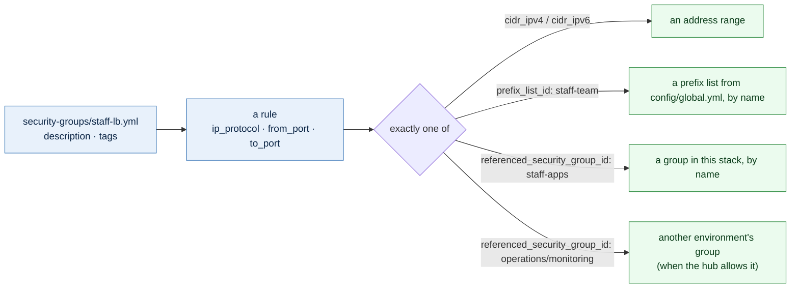

# Security groups

Each environment's security groups are a stack of their own, between its network
and anything that uses them: `live/<region>/<environment>/security-groups/`. A
rule change plans on its own, never touching routing or servers.

A group file is written the way Terraform writes the resources: the group's
arguments from `aws_security_group`, and each rule's arguments from
`aws_vpc_security_group_ingress_rule` or `aws_vpc_security_group_egress_rule`,
under the same names. Nothing is implied; what a file says is what is built.



## One file per group

The file name is the group's name, as everywhere else: `staff-lb.yml` is the
group `staff-lb`. Adding a group is adding a file. The files go in the stack's
`config/` folder, never beside its `.tf` files:

```text
live/us-west-2/staging/security-groups/
└── config/
    ├── public-lb.yml
    ├── staff-lb.yml
    ├── services-lb.yml
    ├── services-lb-clients.yml
    ├── frontends.yml
    ├── staff-apps.yml
    ├── backend-services.yml
    ├── sqlserver.yml
    ├── sqlserver-clients.yml
    ├── sqlserver-cluster.yml
    ├── sqlserver-quorum.yml
    ├── reports.yml
    ├── reports-clients.yml
    ├── workflows.yml
    ├── workflows-clients.yml
    ├── files.yml
    ├── files-clients.yml
    ├── monitoring.yml
    ├── monitoring-agent.yml
    └── endpoints.yml
```

```yaml
# live/us-east-2/production/security-groups/config/staff-lb.yml
description: The staff load balancer, in front of the staff apps
tags:
  Kind: load-balancer
ingress:
  - description: HTTPS from the staff team
    ip_protocol: tcp
    from_port: 443
    to_port: 443
    prefix_list_id: staff-team
  - description: HTTPS from the operations VPC, through the hub
    ip_protocol: tcp
    from_port: 443
    to_port: 443
    cidr_ipv4: 10.42.0.0/16
egress:
  - description: HTTPS to the staff apps
    ip_protocol: tcp
    from_port: 443
    to_port: 443
    referenced_security_group_id: staff-apps
```

| Key | Terraform argument |
|---|---|
| `description` | `aws_security_group.description`. Required |
| `tags` | `aws_security_group.tags`. `Kind` is required: `load-balancer`, `server`, `database`, `client` or `endpoint` ([below](#kinds)). `Name` and `Key` are the stack's own and refused: `Key` is the group's name, which other stacks find it by, and `Name` is the environment and the group's name for the console (`Staging - services-lb`) |
| `ingress` | one `aws_vpc_security_group_ingress_rule` per entry |
| `egress` | one `aws_vpc_security_group_egress_rule` per entry. Leave it out and the group sends nothing: Terraform removes the allow-all rule AWS adds to a new group |

Every rule takes the resource's own arguments:

| Rule key | Meaning |
|---|---|
| `description` | Required |
| `ip_protocol` | `tcp`, `udp`, `icmp`, `icmpv6`, or `"-1"` for every protocol. Required |
| `from_port`, `to_port` | Both, for one port (`443` and `443`) or a range; none when `ip_protocol` is `"-1"`. For `icmp` and `icmpv6` they are the type and the code (`8` and `0` for ping), `-1` and `-1` for all |
| `cidr_ipv4`, `cidr_ipv6` | An address range |
| `prefix_list_id` | A managed prefix list: its name from `prefix_lists` in `config/global.yml` ([below](#prefix-lists)), or a `pl-` id |
| `referenced_security_group_id` | A group: its name in this stack (its own name for traffic between its members), `<environment>/<group>` for another environment's ([below](#groups-in-other-environments)), or an `sg-` id |

A rule names exactly one of `cidr_ipv4`, `cidr_ipv6`, `prefix_list_id` and
`referenced_security_group_id`, as the provider requires. Where the provider
wants an id, the file gives the name of something in this repository and the
template finds its id, so a file carries no account-specific ids.

### Kinds

Every group's file says what kind of thing the group guards, in its `Kind`
tag, so the console and a cost report can sort groups without reading their
names:

| `Kind` | For | Examples |
|---|---|---|
| `load-balancer` | a load balancer | `public-lb`, `services-lb` |
| `server` | servers or tasks in one role, or a capability many servers share | `frontends`, `staff-apps`, `monitoring-agent`, `ecs-services` |
| `database` | a database or another data store | `sqlserver`, `billing-database`, `files` |
| `client` | an empty group callers wear ([client groups](#designing-groups)) | `sqlserver-clients`, `services-lb-clients`, `operators` |
| `endpoint` | interface endpoints and other AWS service endpoints in the VPC | `endpoints`, `kubernetes-api` |

A file without one, or with another value, is refused, and the refusal names
the five.

## Designing groups

**One group per role, for "who may reach me".** `frontends`, `database`,
`runner`: each names the groups allowed to connect
(`referenced_security_group_id: public-lb`), not servers. A role group is also
an identity: `database` allows `frontends`, and only front end servers are in
`frontends`.

**Client groups: an empty group as an identity.** When many kinds of server
call one thing (every app calls the services load balancer and SQL Server),
the thing admits a group that has no rules of its own, and every caller wears
it:

```yaml
# live/us-west-2/staging/security-groups/config/sqlserver-clients.yml
description: Callers of SQL Server; no rules, attached to every server or task that connects to it, and admitted by sqlserver
tags:
  Kind: client
```

```yaml
# live/us-west-2/staging/security-groups/config/sqlserver.yml
description: The SQL Servers
tags:
  Kind: database
ingress:
  - description: SQL Server from its clients
    ip_protocol: tcp
    from_port: 1433
    to_port: 1433
    referenced_security_group_id: sqlserver-clients
```

The blueprints attach the client groups to every app, so a new app can call
SQL Server without a rule changing, and a server that must not cannot: it is
admitted by what it wears, never by the subnet it happens to sit in. This
replaces admitting whole tiers by address, which lets in everything else in
them too. Name the empty group after what it reaches: `<thing>-clients`.

**A few shared capability groups**, each answering one question for many
servers: `monitoring-agent` (the collectors may reach the agent port),
`domain-member` (what a server joined to the domain needs from its domain
controllers, written out port by port in the examples). Never a group named after a kind of server ("standalone",
"services") or one load balancer group that unrelated servers all join: a rule
added for one of them reaches every one, and nobody can tell who needs what.
Three to five groups per server is typical; AWS allows five per network
interface by default.

**No server needs a group for Session Manager.** The agent connects out to the
endpoints on 443, and the `endpoints` group (made by the endpoints stack)
accepts 443 from the VPC. Nothing connects in.

**Egress per group, written out.** Rules from every group on a server add up,
so one permissive group shared by everything cancels any tighter egress a role
group sets. A server usually needs internal traffic (`10.0.0.0/8`, `"-1"`) and
HTTPS and HTTP out (`0.0.0.0/0`, for package mirrors and Windows Update); a
load balancer needs only its targets; a database needs nothing out, so it has
no `egress`. Routing does the heavier lifting: a group says which addresses
may be reached, and the route tables say how. The `data` tier has no route to
the internet unless its environment adds one; staging does, through the hub's
NAT, so SQL Server reaches Windows Update and the Salesforce connectors (CData,
DBAmp), and its groups allow 443 and 80 out ([network](network.md#a-route-for-one-tier)).

**Name where traffic comes from, not this VPC's own subnets.** Inside the VPC,
servers and load balancers reach each other by group. Everything else arrives
through the hub, so a rule names what is behind it: another environment's VPC
(`cidr_ipv4: 10.42.0.0/16`, operations), or the people on the VPN and in the
office (`prefix_list_id: staff-team`). A rule for this VPC's own subnets is
almost always a group rule written the long way.

**The internet reaches load balancers only, on 443 and 80.** Inbound from
`0.0.0.0/0` or `::/0` is refused on any other port or range; 80 is for the
redirect to HTTPS.

## Groups in other environments

A rule reaches another environment by its addresses (`cidr_ipv4`) or a prefix
list by default. Naming its group instead, so only the collectors themselves
are allowed, needs the Transit Gateway to carry security group references,
which is off unless the network team turns it on for the region:

```yaml
# config/us-east-2.yml
hub:
  security_group_referencing: true
```

The hub and every VPC attached to it in that region then allow it, and a group
file can say:

```yaml
# live/us-east-2/production/security-groups/config/monitoring-agent.yml
description: The monitoring agent, reached by the operations collectors
tags:
  Kind: server
ingress:
  - description: Agent port from the collectors in operations
    ip_protocol: tcp
    from_port: 10050
    to_port: 10050
    referenced_security_group_id: operations/monitoring
```

The group is found by its `Environment` and `Key` tags with this stack's
credentials, so it must be visible to them: true when both environments share
an account (`account_id` in `config/global.yml`). It works within one region,
never across the peering. The plan refuses `<environment>/<group>` while the
region has it off, for an environment with no VPC in the region, and for the
stack's own environment (name its groups plainly).

## What the plan refuses

A key that is not one of the resource's arguments, a group or rule without a
description, a description with a character AWS refuses (only letters, digits,
spaces and `._-:/()#,@[]+=&;{}!$*`, so no apostrophes: "the hub egress", not
"the hub's egress"), a rule without `ip_protocol`, without both `from_port` and
`to_port` (unless `ip_protocol` is `"-1"`), or with ports outside 0 to 65535 or
reversed, a rule naming none or more than one of `cidr_ipv4`, `cidr_ipv6`,
`prefix_list_id` and `referenced_security_group_id`, a group that is not in the
stack, a prefix list `config/global.yml` does not define, the same file name in
two folders, a file without a `Kind` from the five, a file that sets `Name` or
`Key`, and the internet on anything but TCP 443 or 80.

## How it is built

The `security-group` module creates every group and one resource per rule
(`aws_vpc_security_group_ingress_rule`, `aws_vpc_security_group_egress_rule`),
passing each rule's arguments through. Each rule is keyed by what it allows, so
reordering a file changes nothing. The `security-groups` template reads the
files, finds the ids behind the names, and finds the VPC by its tags. Each
group is tagged `Key` (its file's name, which the other stacks look it up by)
and `Name` (`Staging - services-lb`, for the console).

## Prefix lists

Groups of addresses that are about people or hosts rather than a VPC (the
sites' networks, the managed domain's controllers) are named once, by the network
team, in `config/global.yml`, each entry as `aws_ec2_managed_prefix_list`'s
`entry` takes it:

```yaml
prefix_lists:
  staff-team:
    - cidr: 10.92.1.0/24
      description: VPNC
```

Each region's hub builds them as AWS managed prefix lists (the `prefix-list`
module), with room for five more entries each. A rule uses one as
`prefix_list_id: staff-team`; changing a list's entries changes every rule that
uses it, with no edit to any group file. Each list's maximum size counts
against the rule limit of every security group that uses it.
