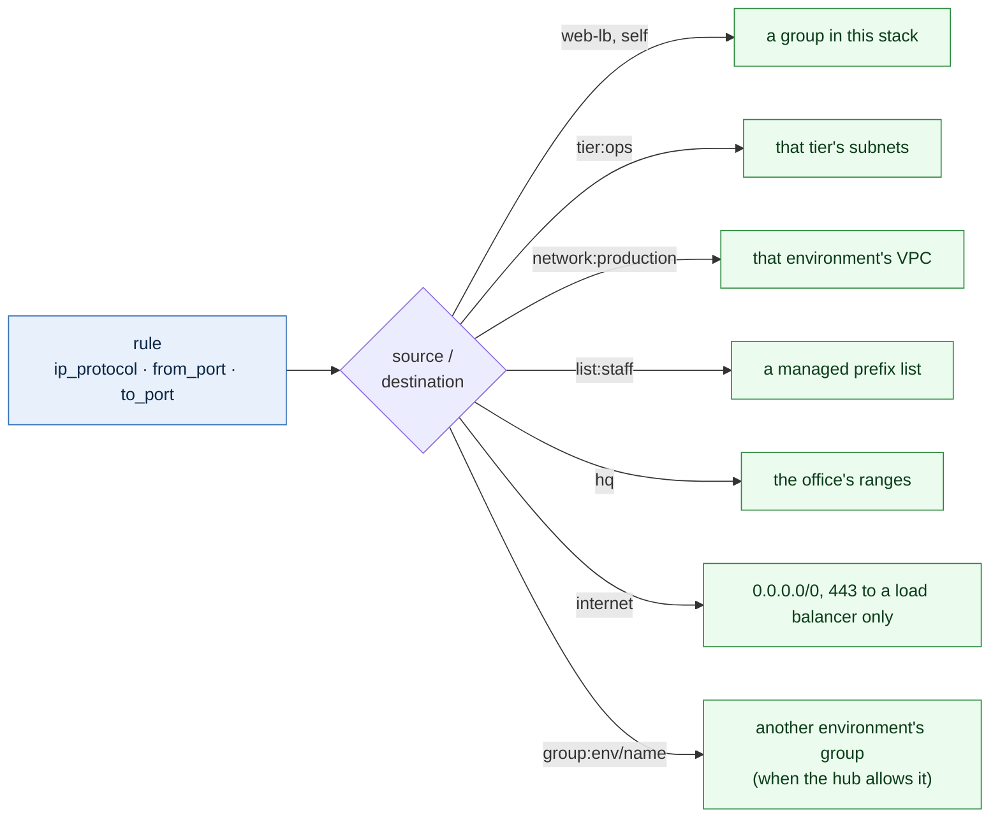

# Security groups

Each environment's security groups are a stack of their own, between its network
and anything that uses them: `live/<region>/<environment>/security-groups/`. A
rule change plans on its own, never touching routing or servers.



## One file per group

The file name is the group's name. Adding a group is adding a file.

```yaml
# live/us-east-2/operations/security-groups/grafana.yml
description: Grafana servers
ingress:
  - description: HTTPS from the Grafana load balancer
    from_port: 443
    to_port: 443
    source:
      - grafana-lb
  - description: Metrics between Grafana servers
    from_port: 9090
    to_port: 9090
    source:
      - self
  - description: Metrics between Grafana servers
    from_port: 9100
    to_port: 9110
    source:
      - self
  - description: SSH from the ops tier
    from_port: 22
    to_port: 22
    source:
      - tier:ops
```

| Key | Meaning |
|---|---|
| `description` | What the group is for. Required |
| `load_balancer` | `true` for a public load balancer's group: the only kind that may accept `internet` |
| `ingress` | Rules for traffic in, written as `aws_vpc_security_group_ingress_rule` writes them: `description`, `ip_protocol` (default `tcp`), `from_port`, `to_port`, and `source` |
| `egress` | Rules for traffic out, with `destination` instead of `source`. Leave it out for the default: internal traffic (`10.0.0.0/8`), HTTPS and HTTP out |

One rule is one port range, as in the provider: `from_port: 443` and
`to_port: 443` for one port, `from_port: 9100` and `to_port: 9110` for a range.
`ip_protocol` is `tcp` (the default), `udp`, `icmp` (the ports are then the ICMP
type and code) or `-1` for every protocol, which takes no ports. `source` and
`destination` take one name or a list.

## Sources, never raw addresses

`source` and `destination` name what may connect, so a file copies between environments
and regions unchanged:

| Source | Stands for |
|---|---|
| a group's name | that security group in the same stack |
| `self` | this group's own members |
| `tier:<name>` | that tier's subnets in this environment's VPC, from `config/` |
| `network:<environment>` | that environment's whole VPC in this region |
| `list:<name>` | a managed prefix list from `prefix_lists` in `config/global.yml`, built in the region's hub: named groups of people or hosts, such as `list:staff-team` |
| `hq` | HQ's ranges, `hq.cidrs` in `config/global.yml` |
| `internet` | `0.0.0.0/0`; only on TCP 443, and only to a `load_balancer` group |
| `group:<environment>/<group>` | that environment's security group, when its region's hub has `security_group_referencing: true` ([below](#groups-in-other-environments)) |

## Designing groups

**One group per role, for "who may reach me".** `web`, `database`, `runner`:
each names the groups allowed to connect (`source: web-lb`, `source: web`), never
servers or addresses. A role group is also an identity: `database` allows
`source: web`, and only web servers are in `web`.

**A few shared capability groups**, each answering one question for many
servers: `monitoring-agent` (the collectors may reach the agent port),
`domain-member` (what a domain-joined server needs from the domain
controllers). Never a group named after a kind of server ("standalone",
"services") or one load balancer group that unrelated servers all join: a rule
added for one of them reaches every one, and nobody can tell who needs what.
Three to five groups per server is typical; AWS allows five per network
interface by default.

**No server needs a group for Session Manager.** The agent connects out to the
endpoints on 443, which the default egress allows, and the `endpoints` group
(made by the endpoints stack) accepts 443 from the VPC. Nothing connects in.

**Egress per group, never one shared egress group.** Rules from every group on
a server add up, so one permissive group shared by everything cancels any
tighter egress a role group sets. Leave `egress` out for the default (internal
traffic, HTTPS and HTTP out, which package mirrors and Windows Update need) and tighten it where it matters: a database needs
nothing out. Routing does the heavier lifting: the `data` tier has no route to
the internet at all.

## Groups in other environments

A rule names another environment's VPC by range (`network:operations`,
`tier:ops`, `list:monitoring-collectors`) by default. Naming its group
instead, so only the collectors themselves are allowed, needs the Transit
Gateway to carry security group references, which is off unless the network
team turns it on for the region:

```yaml
# config/us-east-2.yml
hub:
  security_group_referencing: true
```

The hub and every VPC attached to it in that region then allow it, and a group
file can say:

```yaml
# live/us-east-2/production/security-groups/monitoring-agent.yml
description: The monitoring agent, reached by the operations collectors
ingress:
  - description: Agent port from the collectors in operations
    from_port: 10050
    to_port: 10050
    source:
      - group:operations/monitoring
```

The group is found by its `Environment` and `Name` tags with this stack's
credentials, so it must be visible to them: true when both environments share
an account (`account_id` in `config/global.yml`). It works within one region,
never across the peering. The plan refuses `group:` while the region has it off,
for an environment with no VPC in the region, and for the stack's own
environment (name its groups plainly).

## What the plan refuses

A rule without a description, an unknown key, ports outside 0 to 65535 or
reversed, a rule without both `from_port` and `to_port` (unless `ip_protocol` is `-1`), a group name
that is not in the stack, a tier the VPC does not have, an environment with no
VPC in the region, a `list:` that `config/global.yml` does not define, `hq`
while `hq.cidrs` is empty, and `internet` on anything
but TCP 443 to a load balancer group.

## How it is built

The `security-group` module creates every group and one resource per rule
(`aws_vpc_security_group_ingress_rule`, `aws_vpc_security_group_egress_rule`).
Each rule is keyed by what it allows, so reordering a file changes nothing. The
`security-groups` template reads the files, turns sources into addresses from
`config/`, and finds the VPC by its tags.

## Prefix lists

Groups of addresses that are about people or hosts rather than a tier or a VPC
(the office and VPN networks, the domain controllers) are named once, by
the network team, in `config/global.yml`:

```yaml
prefix_lists:
  staff-team:
    - cidr: 10.10.70.0/24
      description: Corporate wired
    - cidr: 10.10.80.0/24
      description: Corporate wireless
```

Each region's hub builds them as AWS managed prefix lists (the `prefix-list`
module), with room for five more entries each. A rule uses one as
`list:staff-team`; changing a list's entries changes every rule that uses it,
with no edit to any group file. Each list's maximum size counts against the
rule limit of every security group that uses it.
