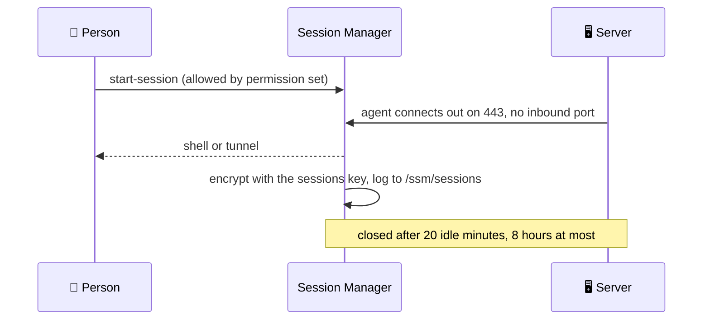

# Systems Manager

Session Manager, SSM documents and patching, in four stacks: two shared by the
region, two per environment.

| Stack | Holds |
|---|---|
| `live/<region>/shared/session-manager` | the region's Session Manager preferences |
| `live/<region>/shared/documents` | Command and Automation documents every environment uses |
| `live/<region>/<environment>/access` | tunnels to fixed hosts in that environment |
| `live/<region>/<environment>/patching` | that environment's patch baselines and maintenance window |



## `session-manager`

Two files in `config/`: the preferences document AWS reads, and the log group
every session streams to.

```text
live/us-east-2/shared/session-manager/
└── config/
    ├── document/
    │   └── SSM-SessionManagerRunShell.yml
    └── log-group/
        └── sessions.yml
```

```yaml
# live/us-east-2/shared/session-manager/config/document/SSM-SessionManagerRunShell.yml
content:
  inputs:
    idleSessionTimeout: "20"
    maxSessionDuration: "480"
```

```yaml
# live/us-east-2/shared/session-manager/config/log-group/sessions.yml
retention_in_days: 365
```

The document is the `aws_ssm_document` `SSM-SessionManagerRunShell`, the one
name AWS reads its preferences from. Its file takes the two inputs of the
document's `content` that are choices, `idleSessionTimeout` (1 to 60 minutes)
and `maxSessionDuration` (up to 1440), as AWS writes them, and `tags`. The rest
of the content is fixed: every session is encrypted with a key of its own
(`alias/shared-sessions`, or `alias/<environment>-sessions` in an environment's
own account, usable only by Session Manager) and streamed to the log group
`/ssm/sessions`; no S3 copy, no run-as.

The log group file is `/ssm/sessions`'s `aws_cloudwatch_log_group` arguments,
`retention_in_days` and `tags`; it is the only log group here, so its file is
`sessions.yml`. The plan refuses the document without it, any other document or
log group, and any other input. Without either file the region runs on AWS's
own preferences: sessions neither encrypted with our key nor logged.

The stack also turns on **Default Host Management** in its region: every
instance can use Session Manager and Patch Manager whatever its own instance
profile holds, so a server is never unreachable because its role forgot
`AmazonSSMManagedInstanceCore`. It uses one account-wide role,
`service-role/AWSSystemsManagerDefaultEC2InstanceManagementRole`, which only the
primary region's stack creates; every region's setting points at it.

The server's agent encrypts each session with the sessions key and streams it to
`/ssm/sessions` with the server's own credentials, so every server's role lists
the `session-manager` policy from the iam stack in its `managed_policy_arns`, and the Default Host
Management role the same permissions ([global](global.md#iam)).

AWS reads these preferences from one document with a fixed name,
`SSM-SessionManagerRunShell`, which this stack creates. Leave the Session
Manager preferences page in the console alone: opening it creates the same
document by hand.

## `documents`

One file per Command or Automation document, in `config/`: the procedures every environment
runs (join a domain, install an agent, build a cluster). The file holds the
document's type and its content, written as YAML.

```yaml
# live/us-east-2/shared/documents/config/install-cloudwatch-agent.yml
document_type: Command
content:
  schemaVersion: "2.2"
  description: Install the CloudWatch agent
  mainSteps:
    - action: aws:runDocument
      name: install
      inputs:
        documentType: SSMDocument
        documentPath: AWS-ConfigureAWSPackage
        documentParameters:
          action: Install
          name: AmazonCloudWatchAgent
```

`document_type` and `content` are `aws_ssm_document`'s arguments, and both
are needed; the plan refuses any other key, and two files with one name. Names may not start with `AWS` (reserved). Prefer AWS's own documents
(`AWS-RunPatchBaseline`, `AWS-ConfigureAWSPackage`) where they do the job.

## `access`

One file per tunnel in `config/`, to one fixed host and port: a database or
cache that people reach from their own machine. A tunnel is a Session
document, written out in full like any other document.

```yaml
# live/us-west-2/staging/access/config/redis.yml
document_type: Session
content:
  schemaVersion: "1.0"
  description: Port forwarding to the staging Redis database
  sessionType: Port
  parameters:
    localPortNumber:
      type: String
      description: Port on your workstation
      allowedPattern: ^[0-9]{1,5}$
      default: "10701"
  properties:
    type: LocalPortForwarding
    host: redis.staging.example.com
    portNumber: "10701"
    localPortNumber: "{{ localPortNumber }}"
```

The document is named `<environment>-<file>` (`staging-redis`). Fixing the
host in the document, rather than using AWS's generic remote-host document, is
what lets access be granted to this tunnel and nothing wider: whoever may use it
gets `ssm:StartSession` on its ARN (the stack's output) in their Identity
Center permission set. The plan refuses a key other than `document_type` and
`content`, and any `document_type` but `Session`: other documents belong in
`documents`.

## `domain-join`

Windows servers join the domain by themselves, through Systems Manager. One
file per association in `config/`, in `aws_ssm_association`'s own arguments:
which servers (by tag), which domain, which OU.

```yaml
# live/us-west-2/staging/domain-join/config/windows.yml
targets:
  - key: tag:Domain
    values:
      - aadds.example.com
parameters:
  DomainName: aadds.example.com
  OrganizationalUnit: OU=Staging,OU=AADDC Computers,DC=aadds,DC=example,DC=com
schedule_expression: rate(1 day)
```

A server joins when it carries the tag (`Domain: aadds.example.com`), within
minutes of starting and again on the schedule, which does nothing on a member.
The stack builds, with its first file:

- the document `<environment>-DomainJoin`, our own PowerShell
  (`modules/domain-join/domain-join.ps1`): it skips a member, names the
  computer after its `Server` tag (as Ubuntu's boot script does), joins it into
  the OU, and asks Systems Manager to restart it;
- the secret `domain-join/<environment>`, which a person fills with the join
  account as JSON (`username`, `password`). That account may only create
  computers in the environment's OU: never an administrator, never shared
  between environments. The document always reads this secret; a file cannot
  name another.

The joining servers' role needs the shared `domain-join` policy (read the join
secrets) beside Session Manager's, and their security groups need the domain
controllers' ports, as `domain-member` in the examples writes them. The
domain's names resolve through the hub ([network](network.md#dns-with-the-sites)),
whichever directory it is: Entra Domain Services through a site, or the
primary hub's AWS Managed Microsoft AD. With no file, the stack builds nothing.

## `patching`

Two kinds of file in `config/`: patch baselines, and the maintenance window that
applies them.

```text
live/us-east-2/operations/patching/
└── config/
    ├── patch-baseline/
    │   ├── windows.yml
    │   ├── amazon-linux-2023.yml
    │   └── ubuntu.yml
    └── maintenance-window/
        └── patching.yml
```

```yaml
# live/us-east-2/operations/patching/config/patch-baseline/windows.yml
description: Windows security and critical updates, approved after 7 days
operating_system: WINDOWS
approval_rule:
  - approve_after_days: 7
    patch_filter:
      - key: CLASSIFICATION
        values:
          - SecurityUpdates
          - CriticalUpdates
      - key: MSRC_SEVERITY
        values:
          - Critical
          - Important
```

A baseline is an `aws_ssm_patch_baseline` named `<environment>-<file>`, taking
`description`, `operating_system`, `approved_patches`, `rejected_patches`,
`approval_rule` (`approve_after_days`, `compliance_level`,
`enable_non_security`, `patch_filter` of `key` and `values`) and `tags`. Each is
registered for the environment's patch group, which takes one baseline per
operating system, so the plan refuses two for the same one. Waiting
`approve_after_days` lets a bad patch be caught before it is installed.

```yaml
# live/us-east-2/operations/patching/config/maintenance-window/patching.yml
description: Weekly patching, Sunday 07:00 UTC
schedule: cron(0 7 ? * SUN *)
duration: 3
cutoff: 1
```

A window is an `aws_ssm_maintenance_window` named `<environment>-<file>`,
taking `description`, `schedule`, `schedule_timezone`, `duration`, `cutoff`,
`enabled` and `tags`; `schedule`, `duration` and `cutoff` are required. Fixed,
for every window: it never runs on unregistered targets, its one target is every
instance tagged `PatchGroup = <environment>`, and its one task runs
`AWS-RunPatchBaseline` to install, a quarter of the instances at a time,
stopping if more than one in ten fail, rebooting only when a patch needs it,
with output in `/ssm/patching/<environment>` (kept 365 days). Compute tags its
instances. `PatchGroup` has no space, unlike AWS's older `Patch Group`: servers
expose their tags through instance metadata, which refuses a launch with a
space in a tag key.

Give production a later window and a longer wait than staging, so staging takes
each patch first.
