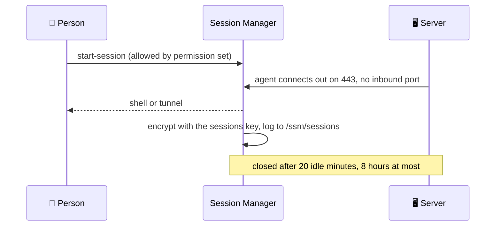

# Systems Manager

Session Manager, SSM documents and patching, in four stacks: two shared by the
region, two per environment.

| Stack | Holds |
|---|---|
| `live/<region>/shared/session-manager` | the region's Session Manager preferences |
| `live/<region>/shared/documents` | Command and Automation documents every environment uses |
| `live/<region>/<environment>/access` | tunnels to fixed hosts in that environment |
| `live/<region>/<environment>/patching` | that environment's patch baselines and maintenance window |



## `session-manager`

Every session in the region is encrypted with a key of its own (`alias/shared-sessions`,
or `alias/<environment>-sessions` in an environment's own account, usable only by
Session Manager), streamed to the CloudWatch log group
`/ssm/sessions` (kept 365 days), closed after 20 idle minutes, and never longer
than 8 hours. Optional overrides in `session-manager.yml`:

```yaml
idle_timeout_minutes: 20
max_session_minutes: 480
retention_in_days: 365
```

The stack also turns on **Default Host Management** in its region: every
instance can use Session Manager and Patch Manager whatever its own instance
profile holds, so a server is never unreachable because its role forgot
`AmazonSSMManagedInstanceCore`. It uses one account-wide role,
`service-role/AWSSystemsManagerDefaultEC2InstanceManagementRole`, which only the
primary region's stack creates; every region's setting points at it.

The server's agent encrypts each session with the sessions key and streams it to
`/ssm/sessions` with the server's own credentials, so every role EC2 assumes gets
the built-in `session-manager` policy from the iam stack, and the Default Host
Management role the same permissions ([global](global.md#iam)).

AWS reads these preferences from one document with a fixed name,
`SSM-SessionManagerRunShell`, which this stack creates. Leave the Session
Manager preferences page in the console alone: opening it creates the same
document by hand.

## `documents`

One file per Command or Automation document: the procedures every environment
runs (join a domain, install an agent, build a cluster). The file holds the
document's type and its content, written as YAML.

```yaml
# live/us-east-2/shared/documents/install-cloudwatch-agent.yml
document_type: Command
content:
  schemaVersion: "2.2"
  description: Install the CloudWatch agent
  mainSteps:
    - action: aws:runDocument
      name: install
      inputs:
        documentType: SSMDocument
        documentPath: AWS-ConfigureAWSPackage
        documentParameters:
          action: Install
          name: AmazonCloudWatchAgent
```

Names may not start with `AWS` (reserved). Prefer AWS's own documents
(`AWS-RunPatchBaseline`, `AWS-ConfigureAWSPackage`) where they do the job.

## `access`

One file per tunnel, to one fixed host and port: a database or cache that
people reach from their own machine.

```yaml
# live/us-west-2/staging/access/redis.yml
description: Port forwarding to the staging Redis database
host: redis.staging.example.com
port: 10701
local_port: 10701
```

The template writes the Session document (`staging-redis`). Fixing the host in
the document, rather than using AWS's generic remote-host document, is what lets
access be granted to this tunnel and nothing wider: whoever may use it gets
`ssm:StartSession` on its ARN (the stack's output) in their Identity Center
permission set. The plan refuses a file without `host` and `port`.

## `patching`

```yaml
# live/us-east-2/operations/patching/patching.yml
schedule: cron(0 7 ? * SUN *)
duration: 3
approve_after_days: 7
```

A patch baseline per operating system (Windows, Amazon Linux 2023, Ubuntu)
approving security and critical patches once they are `approve_after_days` old,
so a bad patch can be caught first; the environment as the patch group; and a
maintenance window that runs `AWS-RunPatchBaseline` on every instance tagged
`PatchGroup = <environment>`, a quarter at a time, stopping if more than one in
ten fail, rebooting only when a patch needs it, with output in
`/ssm/patching/<environment>` (kept 365 days). Compute tags its instances.
`PatchGroup` has no space, unlike AWS's older `Patch Group`: servers expose their
tags through instance metadata, which refuses a launch with a space in a tag key.

Give production a later window and a longer wait than staging, so staging takes
each patch first.
